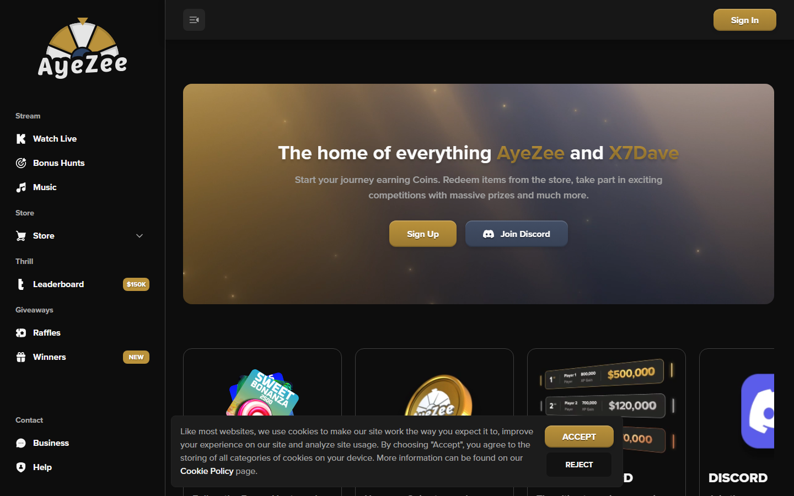
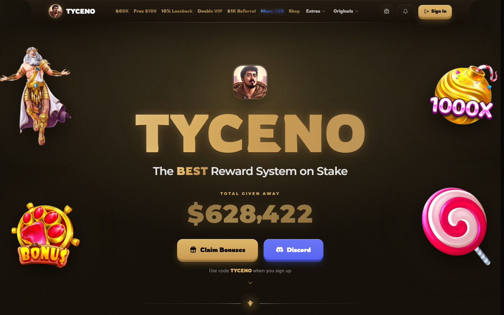
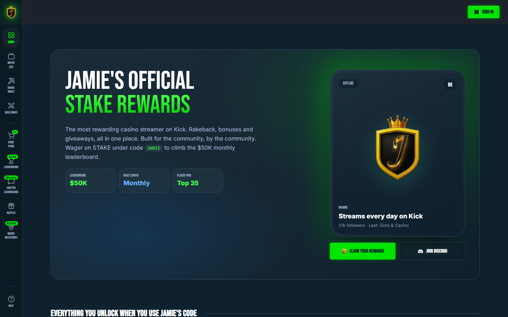
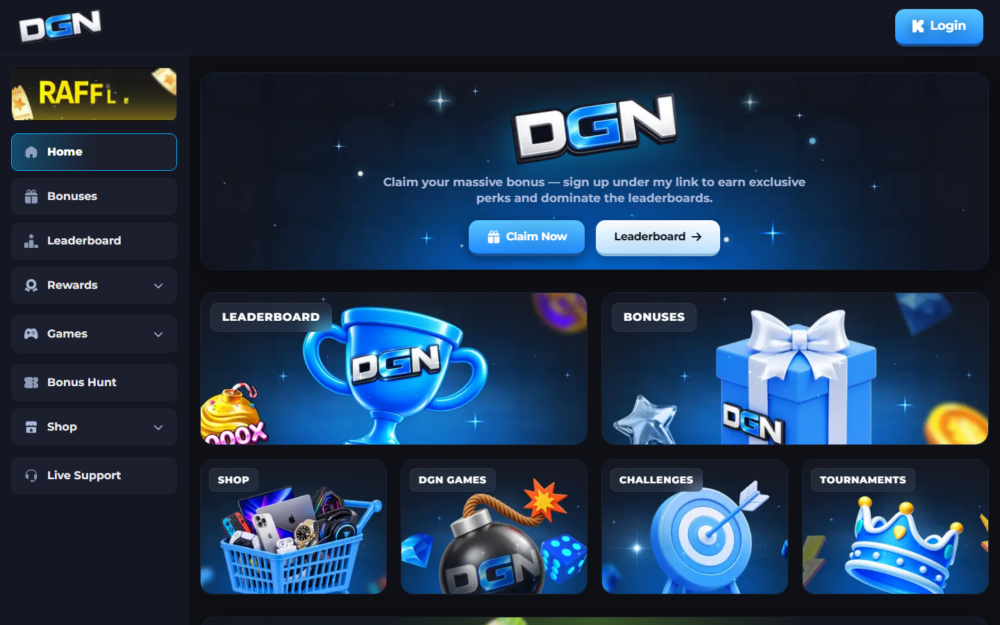
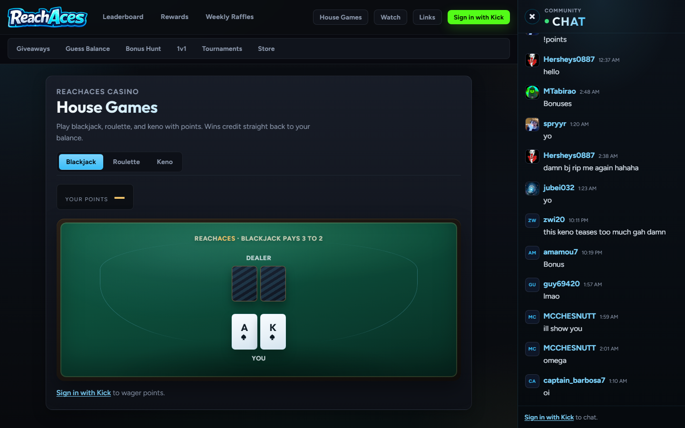
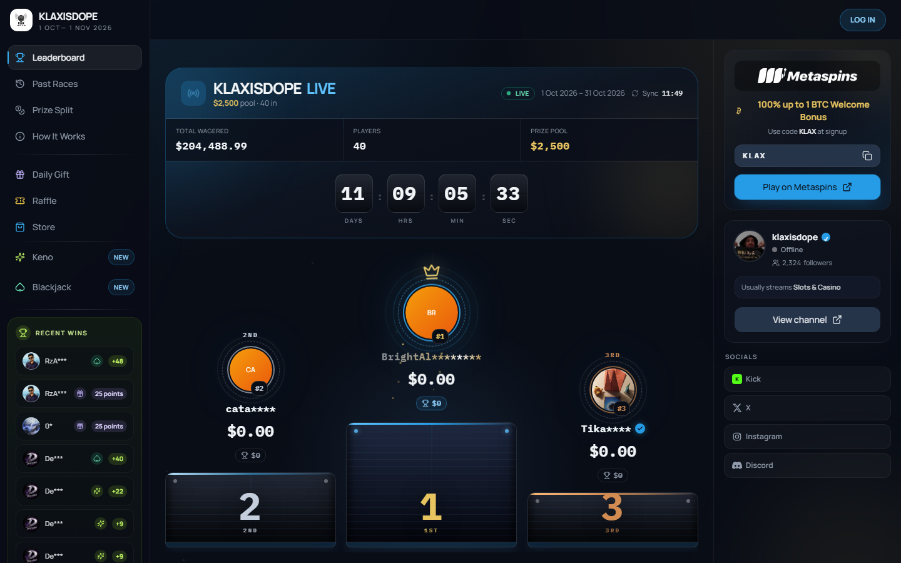
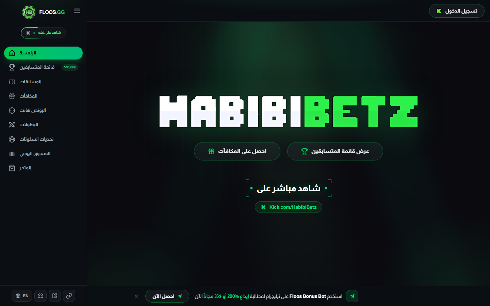
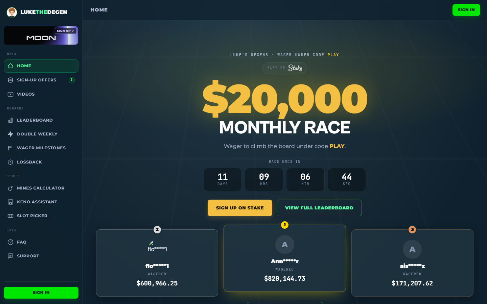
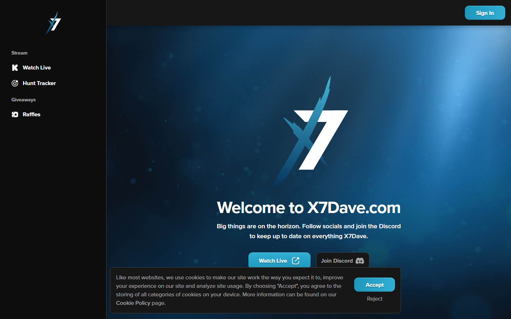
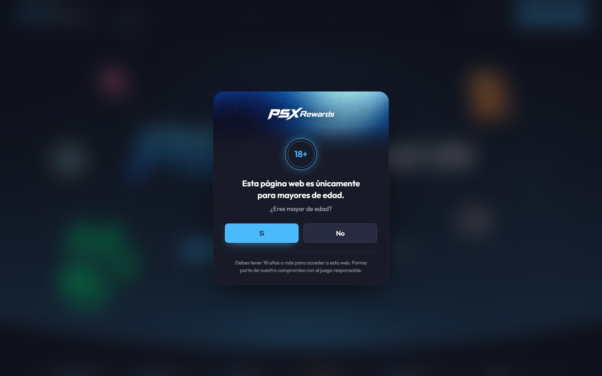

# Catálogo de sitios oficiales de streamers de casino en Kick — por TIERS

> **Fecha de relevamiento:** 2026-10-20 · **Alcance:** 63 canales de Kick evaluados (57 con sitio propio), de ~800 canales escaneados (búsqueda pública de Kick + links de bio).
> **Dataset para tu catálogo visual:** [kick_casino_sites_catalog.csv](kick_casino_sites_catalog_2026-10-20.csv) (tier, seguidores, URL, features, stack, paleta, partner, evidencia).
> **Capturas de pantalla:** carpeta [screenshots](screenshots) (1440x900, 20 sitios).

## 0. Cómo leer este reporte

| Etiqueta | Significado |
|---|---|
| `[VERIFICADO: Kick API, 2026-10-20]` | Seguidores y links de bio leídos de los endpoints públicos `kick.com/api/v2/channels/<slug>` y `/links`. |
| `[VERIFICADO: HTML, 2026-10-20]` | Homepage descargada: menú, rutas, stack, fuentes y colores leídos del código. |
| `[VERIFICADO: captura]` | Visto en screenshot headless (Edge). |
| `[ASUNCIÓN]` | Dato no confirmado (sitio caído, bloqueado, o inferido por similitud). |

**Profundidad del sitio (★):**
- ★★★ Plataforma de comunidad completa: login con Kick/cuenta + economía de puntos + store + raffles + juegos/hunt tracker/challenges.
- ★★ Leaderboard + raffles/store/milestones.
- ★ Solo leaderboard de wager (o landing mínima).
- 0 = sitio de afiliados/reviews sin programa de lealtad.

**Criterio de TIER** (audiencia Kick + sitio propio):

| Tier | Seguidores en Kick | Criterio |
|---|---|---|
| **S** | ≥ 150.000 | con portal propio |
| **A** | 35.000 – 150.000 | con portal propio |
| **B** | 10.000 – 35.000 | con portal propio |
| **C** | 2.000 – 10.000 | con portal propio |
| **D** | < 2.000 | micro-canales / sin programa |
| **Gigantes sin portal** | ≥ 100.000 | sin sitio de comunidad verificable |

> [!WARNING]
> Un sub-agente de navegador que lancé al principio **no pudo abrir el browser** (falló la instalación de Playwright) y devolvió fichas inventadas de Roshtein/ClassyBeef/AndyPSX/Xposed. **Las descarté por completo.** Todo lo de abajo viene de fuentes que pude verificar. De hecho, su descripción de ClassyBeef (rojo/naranja) era falsa: el sitio real es amarillo `#ffd737` sobre negro.

---

## 1. TIER S — Gigantes con portal propio (≥150k)

| # | Streamer | Kick | Sitio | ★ | Qué ofrece | Stack / estética | Partner |
|---|---|---|---|---|---|---|---|
| 1 | **Roshtein** | 420.356 ✔ | [roshtein.com](https://roshtein.com) | ★★★ | Store, **Exchange** (puntos de Kick → Rosh Coins), RoshPlay (casino social propio), events, Roshback, slot verifier, raffles, bonus hunts | Next.js. Cloudflare con desafío anti-bot | Stake + RoshPlay |
| 2 | **ClassyBeef** | 238.073 ✔ | [classybeef.com](https://classybeef.com) | ★★★ | `/store`, `/raffles`, `/leaderboards`, `/giveaways`, `/race`, `/redeem`, contador de giveaways, equipo de 4 streamers | Next.js + API propia (`api.classybeef.com`). **Amarillo #ffd737 sobre negro** | Stake (.com/.us/.eu) |
| 3 | **Cheesur** | 209.425 ✔ | [cheesur.vip](https://cheesur.vip) | ★ | Leaderboard Thrill $25K mensual | Next.js, landing mínima | Thrill |
| 4 | **AyeZee** | 182.404 ✔ | [ayezee.tv](https://ayezee.tv) | ★★★ | Coins, **Store**, bonus hunts + hunt tracker, leaderboard Thrill **$150K**, raffles, winners, music | Next.js + Typekit + Vercel. **Negro #0d0d0d + dorado #a17f33/#ba923b**, hero con partículas `[VERIFICADO: captura]` | Thrill |
| 5 | **N3on** | 938.183 ✔ | [n3on.jackstreams.com](https://n3on.jackstreams.com) | ★ | Leaderboard $25K alojado en vendor (Jack Streams) | `[ASUNCIÓN]` no descargado | Jack.social |

### Gigantes sin portal verificable
`[VERIFICADO: Kick API]` — Útiles para tu catálogo como "referencia sin sitio".

| Streamer | Kick | Qué tiene en bio |
|---|---|---|
| Adin Ross | 2.640.825 | Solo merch (BrandRisk) |
| Trainwreckstv | 666.415 | Nada de lealtad |
| Ac7ionman | 238.385 | Tips (powerchat) + Stake.us |
| Xposed | 186.934 | Código Roobet + consolekings.com. **`xposed.ca` está estacionado** (redirige a `/lander`), no es oficial |
| Sam | 118.116 | Códigos Stake (identidad no confirmada) |

---

## 2. TIER A — 35k a 150k

| Streamer | Kick | Sitio | ★ | Qué ofrece | Stack / estética | Partner |
|---|---|---|---|---|---|---|
| Schneckyirl | 59.793 | schneckyirl.com | ? | **Caído (HTTP 522)** al momento del test | `[ASUNCIÓN]` | Stake |
| Keithlocks | 57.527 | [keithlocks.com](https://keithlocks.com) | ★★ | Leaderboards Stake + Stake Exclusives ($70K) | Vite SPA + Inter, violeta #7c3aed / rosa | Stake |
| **Tyceno** | 54.531 | [tyceno.gg](https://tyceno.gg) | ★★★ | Shop, raffles, challenges, **daily wheel, vault, blackjack, keno, originals (chicken/wheel/dice)**, "Total given away $628,422" `[captura]` | Next.js + Vercel. **Dorado #c79a55 + verde Kick #53fc18**, fuente BBH Bartle | Stake |
| BlondeRabbit | 46.032 | [blonderabbit.com](https://blonderabbit.com) | ★★ | Leaderboards Stake API ($59K), raffles | Vite SPA, Oswald + Inter, violeta #8b5cf6 sobre #0a0a0f | Stake |
| X7Dave | 42.057 | [x7dave.com](https://x7dave.com) | ★★ | Hunt tracker, raffles (gemelo de AyeZee) | Next.js + Typekit, azul marino + celeste #1e96bc `[captura]` | red AyeZee |
| **AndyPSX** (PSXRewards) | 38.396 | [andypsx.com](https://andypsx.com) | ★★★ | **UI en español**: leaderboard, **juegos de slots dentro del sitio** (por proveedor), bonus, shop, bonus hunt, daily reward, `live.andypsx.com`. Gate +18 `[captura]` | Next.js + GA. Navy oscuro + celeste #4db8ff / naranja #f97316 | Gamdom |
| SweetFlips | 37.020 | [sweetflips.gg](https://sweetflips.gg) | ★ | Leaderboard Crypto Vega $100K | Next.js, amarillo #f7c44a + azul #1bb2ff | CryptoVega, Luxdrop |

---

## 3. TIER B — 10k a 35k

| Streamer | Kick | Sitio | ★ | Qué ofrece | Notas técnicas | Partner |
|---|---|---|---|---|---|---|
| VikingSlots | 24.890 | vikingrewards.gg | ? | timeout | `[ASUNCIÓN]` | Thrill |
| CasinoDaddy | 24.601 | [aboutslots.com](https://www.aboutslots.com) | 0 | Portal de reviews/bonos + foro (sin lealtad) | Next.js, dorado #ffcf5c | afiliados |
| **HighStakesHugs** | 22.834 | [getdgn.com](https://getdgn.com) | ★★★ | Botón **Login con logo de Kick** `[captura]`, store, shop, bonus hunt, challenges, tournaments, **juegos propios (dice/mines/keno/crash)**, raffles | Next.js + GA, navy #1c1f2e/#abbadb, sidebar + bento de ilustraciones 3D azules | GETDGN |
| TheGambler1999 | 22.753 | [thegambler.pro](https://thegambler.pro) | ★★ | `/login`, shop, giveaways, leaderboard, videos | Nuxt, Rajdhani, dorado #f5c044 + verde #3be07e | Gamdom |
| Auslots | 21.831 | zesty.bet | ? | falla TLS | `[ASUNCIÓN]` | Zesty |
| Bombet | 21.566 | [bombet.tv](https://bombet.tv) | ★ | Landing SPA mínima | Vite + Poppins | Roobet |
| Aitchislots | 21.373 | [aitchrewards.com](https://aitchrewards.com) | ★ | Rewards Degen.com | Vite SPA, negro + verde #00ff6a | Degen.com |
| **Jamie** | 21.312 | [jamierewards.gg](https://jamierewards.gg) | ★★★ | **Sign In con ícono Kick**, Point Store (13 items), leaderboard $50K Top 35, **Chatter Leaderboard semanal**, raffles, challenges, hunt tracker, **Wager Milestones $260K** `[captura]` | Next.js + Cloudflare. Verde neón sobre petróleo, sidebar de íconos | Stake |
| WRewards | 20.619 | [wrewards.com](https://wrewards.com) | ★ | raffles/leaderboards (shell, login) | Next.js | Gamdom |
| LadyLuckSlots | 19.976 | ladyluckslotsrewards.com | 0 | Página placeholder | Vite SPA | Stake |
| Bennyslots | 16.538 | benny.gg | ? | 522 | `[ASUNCIÓN]` | Stake |
| SpinLife | 15.442 | [spinlife.tv](https://spinlife.tv) | ★★ | Store, raffles, leaderboard, guess the balance, puntos, login | **WordPress**, Kanit, naranja #ec6608 | jack.social |
| GazzGambles | 13.648 | [gazz.gg](https://gazz.gg) | ★ | Leaderboards + giveaways | Next.js, verde oscuro + #53fc18 | Shuffle |
| CheekyGamblers | 12.333 | cheekygamblers.com | ? | 522 | `[ASUNCIÓN]` | — |
| DeltaGambles | 11.957 | [deltagambles.com](https://deltagambles.com) | ★ | Leaderboard Stake $50K | Vite SPA + Onest, lima #a3e635 | Stake |
| BigJuanWins | 11.343 | [bigjuan.org](https://bigjuan.org) | ★ | Leaderboard "King of Stake" | Oswald + DM Sans, dorado #d4a843 sobre verde oscuro | Stake |
| GWA Slots | 10.008 | [gwaslots.com](https://gwaslots.com) | ★ | Giveaways/store (shell) | Vite + Tailwind, rosa/amarillo neón | — |
| RiskyDegens | 10.004 | [riskydegens.com](https://riskydegens.com) | ★ | Roobet weekly leaderboard | Next.js, violeta | Roobet |

---

## 4. TIER C — 2k a 10k

| Streamer | Kick | Sitio | ★ | Features clave | Stack | Partner |
|---|---|---|---|---|---|---|
| DEVL | 9.885 | devlrewards.com | ★ | Hub (shell SPA) | Vite, Inter + Orbitron | Thrill |
| **HabibiBetz** | 9.397 | [floos.gg](https://floos.gg) | ★★★ | **UI árabe/RTL**, login con ícono Kick, leaderboard $10K, hunt tracker, torneos, **daily chest**, store, slot challenges `[captura]` | Next.js + GA, negro + verde #22c55e | — |
| CamNeverWins | 9.044 | camneverwins.com | ★ | Leaderboard Rainbet (1 página) | Vercel estático | Rainbet |
| JoshyGambles | 8.421 | joshy.gg | ★★ | Rewards, leaderboard, challenges, how-to-sign-up (auth Discord) | **SvelteKit**, violeta + dorado | Roobet |
| DailyGambling | 8.404 | slotessentials.com / BotRix | ★ | Roobet/Packdraw $50K | WordPress | Roobet |
| KayzGamble | 8.001 | kayz.gg | ★ | Leaderboard + rewards | Next.js, **cian #00f0ff** sobre #040e26 | Roobet |
| Toaster | 7.338 | toaster.gg | ★★ | Leaderboards, raffles, coins | Next.js + Outfit | Stake |
| LameGambles | 6.820 | lame.gg | ★★ | Leaderboard, raffles, milestones, shop | Next.js + Satoshi, cian #04d9fe | Stake |
| **ReachAces** | 6.577 | [reachaces.com](https://reachaces.com) | ★★★ | **"Sign in with Kick"** (`/api/auth/login`), **chat de Kick embebido**, giveaways, guess the balance, bonus hunt, 1v1, slot tournaments, store, **House Games con puntos (blackjack/roulette/keno)** `[captura]` | HTML estático + Outfit/Figtree, dark glow | Stake |
| RoroGambles / XtraGambles | 6.354 / 6.230 | rorogambles.com / xtragambles.com | ? | página mínima / 429 | `[ASUNCIÓN]` | — |
| TroyStake | 5.387 | troyrewards.com | 0 | Shell SPA | Vite + Inter | Stake |
| RoosterCatt | 5.288 | roostercat.gg | ★★ | Giveaways, raffles, slot challenges | Vite SPA, verde #2ea043 | Stake + Bandit |
| CousinGambler | 5.200 | cousingambler.com | ★ | Leaderboard Castle | Playfair + Bungee, dorado + verde Kick | Castle |
| JackedGambles | 5.132 | jackedgambles.com | ★ | Leaderboard, **bounties**, creator | Next.js, rojo #fd1b53 | — |
| LukeTheDegen | 4.941 | [lukerewards.vip](https://lukerewards.vip) | ★★ | `/login`, leaderboard $20K, double weekly, milestones, lossback, **calculadoras (mines/keno/slot picker)** `[captura]` | Nuxt + Cabinet Grotesk/Satoshi, menta #5bffa8 | Stake + Moon |
| MrTreeGambling | 4.827 | mrtreerewards.com | ★ | Leaderboard, jackpot, rakeback, VIP | Next.js, dorado sobre #09090b | rain.gg etc. |
| Blakjac21 | 4.788 | blakjac21.com | ★★★ | **Gemelo exacto de ReachAces** (Sign in with Kick, `/commands`, `/accounts`) | HTML + Inter/Teko | Stake |
| TokyoGambling | 4.751 | tokyorewards.com | ★ | Raffles, leaderboard, cliprally, auth Discord | Inter, burdeos/beige | Stake |
| FruitySlots | 3.707 | fruityslots.com | 0 | Reviews + demos | WordPress + Outfit | afiliados UK |
| ZenGambling | 3.413 | zengambling.com | ★★ | Leaderboard, raffles, wager milestones, rank rewards, lossback, calculadora | Next.js, PP Neue Corp Wide, violeta #a855f7 | Stake |
| Fortunate | 3.277 | fortunesrewards.com | ★★ | Store, raffles, puntos | Next.js, violeta + ámbar | — |
| MimeGamba | 2.589 | mimegamba.com | ★ | Leaderboards | Next.js, celeste + rosa | — |
| WagerClub | 2.483 | wagerclub.gg | ★ | Leaderboard, giveaways | Archivo, verde Kick | BetPanda |
| **KlaxisDope** | 2.324 | [klaxis.live](https://klaxis.live) | ★★ | Leaderboard live con **podio y countdown**, past races, prize split, **daily gift, raffle, store, keno, blackjack**, widget con tu canal de Kick `[captura]` | Next.js + IBM Plex Mono/Manrope, **verde Kick #53fc18** | Metaspins |

## 5. TIER D — micro (<2k)
LetsGiveItASpin (637, perfil en CasinoGrounds), SlotSpinner (631, solo Discord), HideousSlots (173, reviews WordPress).

---

## 6. Hallazgos para tu catálogo

### 6.1 Familias de plantillas (mismo código = mismo "ADN" visual)
`[ASUNCIÓN]` sobre vendor común, pero con rutas idénticas verificadas en HTML:

| Familia | Sitios | Rutas / señales |
|---|---|---|
| **Red AyeZee** | ayezee.tv, x7dave.com, jamierewards.gg | `/hunt-tracker`, `/store`, `/leaderboards`, `/raffles`, `/gambling-help`, banners de cookies idénticos |
| **Hunt + Daily** | getdgn.com, floos.gg | `/bonus-hunt`/`/hunt-tracker`, `/tournaments`, `/daily-chest`, `/store`, `/challenges` |
| **Template ReachAces** | reachaces.com, blakjac21.com | `/commands`, `/accounts`, `/api/auth/login`, house games con puntos |
| **Wager leaderboards (Vite SPA)** | keithlocks.com, blonderabbit.com, deltagambles.com, aitchrewards.com, devlrewards.com | Un solo hero con leaderboard "Stake API" + Discord |
| **Paleta Kick-green #53fc18** | klaxis.live, gazz.gg, wagerclub.gg, cousingambler.com, tyceno.gg | Acento verde de marca Kick |

### 6.2 Patrones estéticos dominantes
- **Dark mode casi universal** (`#0a0a0f`–`#181a27`) con **un solo acento saturado**: dorado (AyeZee, Tyceno, BigJuan), verde Kick, cian, violeta.
- Layout **sidebar fija izquierda con íconos + contenido tipo bento** (Jamie, GETDGN, Klaxis, AyeZee, LukeTheDegen, Floos).
- Hero con **número gigante** (prize pool: "$20,000", "$628,422 given away") + **countdown** + **top 3 con podio**.
- Stack: **Next.js es el más frecuente**, seguido de Vite SPA; también Nuxt, SvelteKit y WordPress (este último solo en los sitios de reviews).
- Login casi siempre con **ícono de Kick** (Jamie, GETDGN, Floos, ReachAces).

### 6.3 Popularidad (señales disponibles)
- Seguidores de Kick: los Tier S concentran >1,8M entre los 5 (N3on 938k).
- "Total given away": Tyceno $628.422; AyeZee anuncia $8M entregados (bio de Kick); Klaxis muestra **$204.488 wagered** del mes; Wager Milestones de Jamie hasta $260K.
- Asimetría clave: **Roshtein, AyeZee y ClassyBeef** tienen economías propias (puntos/coins + store) y no dependen de un wager obligatorio; el **resto de la cola larga es un leaderboard de wager atado a un código de afiliado**.

### 6.4 Alerta de compliance para DiggityBets
Según [AGENTS.md §2.2](file:///c:/Users/tomas/Desktop/streamerbot/AGENTS.md), tu suite **no puede** exigir afiliación para participar. Mirando el mercado:
- **Referentes válidos para imitar:** Roshtein (Exchange de puntos de Kick → moneda interna → store), AyeZee (Coins + Store, "sin wager ni cuenta de casino" según su bio), ReachAces/Klaxis (house games y raffles con puntos gratuitos).
- **Lo que NO conviene copiar:** leaderboards de wager atados a código de afiliado (Keithlocks, DeltaGambles, ZenGambling, etc.).

---

## 7. Capturas (1440×900)

````carousel

<!-- slide -->

<!-- slide -->

<!-- slide -->

<!-- slide -->

<!-- slide -->

<!-- slide -->

<!-- slide -->

<!-- slide -->

<!-- slide -->

````

## 8. Límites de este relevamiento

- **Roshtein y ClassyBeef bloquean navegadores automatizados** (desafío Cloudflare / WAF). No los esquivé (iría contra sus términos). Los datos salen del HTML/rutas visibles vía descarga pública y un lector de contenido; **no tengo captura de ninguno**. Sacalas vos con tu navegador normal.
- No inicié sesión en ningún sitio ni creé cuentas: el "login con Kick" está confirmado **visualmente** solo en Jamie, GETDGN, Floos y ReachAces/Blakjac21; en el resto es `[ASUNCIÓN]` por rutas y textos.
- Sitios caídos o con timeout durante el test: schneckyirl.com, benny.gg, cheekygamblers.com, vikingrewards.gg, zesty.bet, xtragambles.com (429).
- El descubrimiento se basó en la búsqueda pública de Kick por nombre y en links de bio: **puede faltar gente cuyo canal no tenga "slots/casino/gamba" en el nombre**. El directorio en vivo de Kick no permitió filtrar por categoría.
- Los seguidores cambian cada hora; son foto del 2026-10-20.

## 9. Próximos pasos posibles
1. Exportar el CSV a una **página-galería** dentro del repo (grilla de tarjetas por tier con captura, paleta y features).
2. Profundizar en los 10 sitios ★★★: flujo de login con Kick (OAuth), modelo de puntos y catálogo de la store.
3. Segunda pasada de descubrimiento (canales LATAM/ES y DE/TR/RU) para ampliar la lista.


