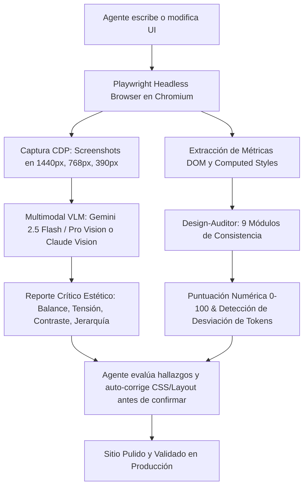

# AGENT CREATIVE & VISUAL AWARENESS 2026: SOTA Design Intelligence, Creative Technologies & Multimodal Visual Feedback

> **Alcance:** Manual canónico de arquitectura para dotar al equipo de agentes de HuntHub / DiggityBets (`site/`, `overlay-*`, `tools/`) de máxima creatividad compositiva, eliminación del "AI-Slop", y conciencia visual multimodal automatizada.  
> **Protocolo LEC-015:** Documento de Referencia Técnica y Explicación Canónica.  
> **Presupuesto:** 100% Free Tier ($0 USD / $0 ARS), Sin dependencias pesadas en el notebook host, cumplimiento de rendimiento OBS (≤5% CPU).

---

## 1. El Problema del "AI-Slop" y las Leyes de Creatividad Visual para Agentes

### 1.1 ¿Por qué los LLMs generan interfaces genéricas por defecto?
Los modelos de lenguaje sin restricciones visuales convergen hacia el promedio de sus datos de entrenamiento:
1. **Boxed-in-Boxes (Cajas dentro de cajas):** Tarjetas dentro de tarjetas, bordes redondeados excesivos (`rounded-2xl` o `border: 1px solid rgba(255,255,255,0.1)` en cada elemento), generando ruido visual y claustrofobia.
2. **Gradientes genéricos púrpuras/azules:** El estereotipo de "IA / Web3" carente de identidad de marca o tensión compositiva.
3. **Pobre jerarquía de luminancia y espaciado:** Dependencia de márgenes aleatorios en vez de una cuadrícula armónica o separación por espacio negativo.
4. **Carencia de retroalimentación óptica:** El agente "cree" que el código CSS funciona porque no tiene errores de sintaxis, pero desconoce si un elemento colisiona, se deforma en 390px o tiene bajo contraste.

### 1.2 Leyes Canónicas de Composición Anti-Slop (2026)
* **Ley 1: De-Boxing y Separación por Superficie:** Nunca uses un borde o caja a menos que sea estructuralmente indispensable. Agrupa elementos mediante espaciado negativo, sutiles deltas de luminancia (`background: hsl(0 0% 8%)` vs `hsl(0 0% 5%)`) y alineación axial estricta.
* **Ley 2: Presupuesto Cromático 90/8/2:**
  - **90% Fondo Oscuro de Alta Luminancia de Absorción:** Tonos profundos de grafito o vacío espacial (`#07090e`, `#0a0d14`).
  - **8% Superficies Estructurales y Vidrio Ahumado:** Superficies translúcidas con `backdrop-filter: blur(16px)` y sutil borde perimetral (`rgba(255,255,255,0.06)`).
  - **2% Acento Cinético de Alto Voltaje:** Verde neón Kick (`#53FC18`), oro resplandeciente (`#ffd700`) o cian láser (`#00f0ff`), reservado *únicamente* para puntos de conversión, victorias o elementos activos.
* **Ley 3: Escalado Fluido Matemático (Utopia):** Prohibido usar tamaños estáticos fijos en px para tipografía o espaciado de secciones. Se utiliza `clamp()` para una transición 100% fluida entre móviles (390px) y ultra-wide (1440px+).

---

## 2. Tecnologías Clave para la Creatividad de los Agentes

Para que el equipo de agentes componga interfaces deslumbrantes y originales, se articulan 4 motores tecnológicos de código abierto:

### 2.1 Shaders Procedurales y Canvas 2D/WebGL Ultraligeros
* **GLSL Fragment Shaders sin Three.js:** Con `references/design-mastery/glsl-canvas/` o Canvas 2D directo, los agentes pueden generar texturas vivas: humo perlin volumétrico en vaults, destellos holográficos en cartas de slots y gradientes líquidos dinámicos con menos de 15 KB de huella y aceleración GPU directa.
* **Proton Engine & Dinámicas Vectoriales:** En `references/design-mastery/proton-particles/`, generación de partículas con campos de atracción magnética física hacia el saldo `$DIG` de la barra superior.
* **Vanta.js:** En `references/sota-expansion/motion-ui/vanta/`, fondos 3D reactivos al cursor que elevan una landing page de plana a cinematográfica.

### 2.2 Dinámica Física y Micro-Interacciones Táctiles
* **Dynamics.js:** En `references/sota-expansion/motion-ui/dynamics.js`, física real con resortes (`spring`), masa, fricción y rebote para modales, ruletas y aperturas de cofres, reemplazando las transiciones mecánicas lineales (`ease-in-out`).
* **Flubber:** En `references/sota-expansion/motion-ui/flubber/`, metamorfosis suave entre formas vectoriales SVG (p. ej. transición entre ícono de espada de batalla y trofeo de torneo).
* **Lax.js:** En `references/sota-expansion/motion-ui/lax.js`, animaciones de scroll e inercia livianas (<4 KB) con cero impacto en el hilo principal.

### 2.3 Catálogos de Componentes SOTA 2026: KokonutUI
Ubicado en `references/sota-expansion/design-intelligence/kokonutui/`, incluye más de 40 componentes vanguardistas listos para ser adaptados a Vanilla JS/CSS:
* **Bento Grid Adaptativo:** Grillas asimétricas con tarjetas de proporciones 2x1 y 1x1, bordes con degradados perimetrales y reflejos angulares.
* **Action Search Bar:** Barras de búsqueda interactivas con chips dinámicos, comandos con atajos de teclado y modales flotantes con desenfoque Gaussiano.
* **Detent Dial & Currency Transfer:** Controles de precisión para apuestas, sliders hápticos simulados y transferencias con animaciones de conteo a 60 FPS.
* **Dynamic Text & Cradle Text:** Efectos tipográficos cinéticos para anunciar multiplicadores (1000x) y jackpots con ritmo visual.

---

## 3. Arquitectura de Conciencia Visual para Agentes (Visual Awareness)

Para que los agentes no programen "a ciegas", se implementa un **Bucle Cerrado de Retroalimentación Visual Multimodal**:



### 3.1 Integración de Herramientas y Servidores MCP

#### A) `design-critique-mcp` (Servidor MCP para Crítica Visual)
* **Ruta:** `references/sota-expansion/design-intelligence/design-critique-mcp/`
* **Tecnología:** Servidor Model Context Protocol con backend en `@google/generative-ai` (Gemini API), `@modelcontextprotocol/sdk`, `chroma-js`, `sharp` y `node-vibrant`.
* **Herramientas Disponibles:**
  1. `critique_design`: Crítica exhaustiva recibiendo `image_data` (Base64) con desglose en composición, balance, jerarquía tipográfica y accesibilidad.
  2. `analyze_color_scheme`: Extracción algorítmica de paleta dominante, relaciones cromáticas y validación de armonía.
  3. `analyze_layout`: Evaluación de cuadrícula, alineación y distribución del espacio en blanco.
  4. `analyze_accessibility`: Auditoría WCAG 2.1, cálculo de ratios de contraste y simulación de daltonismo.

#### B) `design-auditor` (Lighthouse de Consistencia de Diseño)
* **Ruta:** `references/sota-expansion/design-intelligence/design-auditor/`
* **Comando CLI:**
  ```bash
  npx design-auditor http://localhost:8080 --local --save-report
  ```
* **Módulos de Auditoría:**
  1. **Tipografía (Peso 15%):** Conteo de familias tipográficas (≤3), verificación de escala modular y ritmo de interlineado.
  2. **Colores (Peso 20%):** Conteo total de tonos, agrupamiento por similitud (fórmulas delta-E), detección de colores no tokenizados y contraste WCAG AA.
  3. **Ritmo Vertical y Espaciado (Peso 15%):** Consistencia de márgenes y paddings basados en múltiplos del token base (4px / 8px).
  4. **Componentes y Botones (Peso 15%):** Consistencia de radios de curvatura, alturas interactivas y estados de foco.
  5. **Ancho de Lectura (Peso 10%):** Límite óptimo de 45 a 75 caracteres por línea en textos largos.
  6. **Imágenes y Enlaces (Peso 15%):** Ratios de aspecto fijos sin distorsión y estados hover evidentes.
  7. **Breakpoints (Peso 5%):** Coherencia fluida entre resoluciones sin desbordamiento horizontal.

#### C) `ui-skills` (Playbook de Reglas para Agentes)
* **Ruta:** `references/sota-expansion/design-intelligence/ui-skills/`
* Contiene protocolos estructurados:
  - `skills/fixing-motion-performance/`: Asegurar que toda animación use propiedades compuestas (`transform`, `opacity`) sin forzar re-flows ni layouts.
  - `skills/fixing-accessibility/`: Comprobación de árboles de accesibilidad ARIA, etiquetas semánticas y navegación por teclado.
  - `skills/create-design-md/`: Generación de tokens estructurados para evitar la proliferación de valores ad-hoc.

---

## 4. Recetas de Implementación Operativa

### 4.1 Script del Bucle de Autocorrección Visual (`tools/audit/visual_critique_loop.mjs`)
Los agentes pueden invocar un script en Node.js que captura la pantalla con Playwright y la envía directamente a la API de Vertex AI / Gemini Vision para recibir una auditoría estética en JSON:

```javascript
import { chromium } from 'playwright';
import fs from 'fs';
import { GoogleGenAI } from '@google/genai';

async function auditVisualQuality(url) {
  const browser = await chromium.launch({ headless: true });
  const page = await browser.newPage({ viewport: { width: 1440, height: 900 } });
  await page.goto(url, { waitUntil: 'networkidle' });

  // Captura de pantalla en buffer
  const screenshotBuffer = await page.screenshot({ fullPage: false });
  await browser.close();

  const base64Image = screenshotBuffer.toString('base64');

  // Consulta a Gemini Flash Vision (Rápido y de costo ultra bajo / créditos gratuitos GCP)
  const ai = new GoogleGenAI({ apiKey: process.env.GEMINI_API_KEY });
  const response = await ai.models.generateContent({
    model: 'gemini-2.5-flash',
    contents: [
      {
        role: 'user',
        parts: [
          { inlineData: { mimeType: 'image/png', data: base64Image } },
          {
            text: `Actúa como Director de Arte Senior y Diseñador UI/UX especializado en interfaces oscuras premium y casinos modernos.
            Evalúa la imagen adjunta bajo 5 criterios (puntuación de 0 a 100):
            1. Jerarquía y De-boxing (ausencia de cajas innecesarias, aireación correcta).
            2. Armonía cromática 90/8/2 (fondo oscuro de absorción, acentos neón controlados).
            3. Legibilidad y tipografía (escala modular, contraste WCAG AA).
            4. Tensión compositiva y elegancia minimalista (evitar clichés genéricos de IA).
            5. Errores visuales visibles (desalineaciones, texto cortado, desbordes).
            Devuelve un JSON estructurado con: { overallScore, scores: {}, criticalFindings: [], suggestions: [] }.`
          }
        ]
      }
    ]
  });

  return JSON.parse(response.text);
}
```

### 4.2 Regla de Oro para Adaptación de Componentes a Vanilla JS
Cuando un agente se inspire en un componente de `kokonutui` o `magicui` (originalmente en React/Tailwind):
1. **Extraer la estructura semántica:** Convertir los elementos JSX anidados a HTML5 limpio (`<section>`, `<article>`, `<button>`).
2. **Convertir utilidades a tokens CSS:** Mapear clases de Tailwind a las variables nativas de `site/css/design-tokens.css` (`var(--bg-void)`, `var(--brand-primary)`, `var(--surface-glass)`).
3. **Mapear la animación a Web Animations API (WAAPI) o CSS Variables:** Si el componente usa Framer Motion, reemplazarlo por `element.animate()` o transiciones CSS con curvas cúbicas predefinidas (`cubic-bezier(0.16, 1, 0.3, 1)`).

---

## 5. Índice de Repositorios Clave de Referencia

| Repositorio | Ubicación Local | Enfoque Principal |
| :--- | :--- | :--- |
| **kokonutui** | `references/sota-expansion/design-intelligence/kokonutui` | 40+ componentes UI modernos e interactivos (bento, cards, search). |
| **design-auditor** | `references/sota-expansion/design-intelligence/design-auditor` | Linter automatizado de consistencia visual (9 módulos, score 0-100). |
| **ui-skills** | `references/sota-expansion/design-intelligence/ui-skills` | Reglas operativas para agentes en accesibilidad, rendimiento y motion. |
| **design-critique-mcp** | `references/sota-expansion/design-intelligence/design-critique-mcp` | Servidor MCP para análisis visual multimodal vía Gemini Vision. |
| **dynamics.js** | `references/sota-expansion/motion-ui/dynamics.js` | Animaciones basadas en física de resortes y rebote orgánico. |
| **nue** | `references/sota-expansion/web-performance/nue` | Arquitectura web ligera, basada en estándares y máximo rendimiento. |
| **vanta** | `references/sota-expansion/motion-ui/vanta` | Fondos WebGL 3D animados interactivos en JavaScript puro. |
| **flubber** | `references/sota-expansion/motion-ui/flubber` | Interpolación fluida de rutas vectoriales SVG (shape morphing). |
| **lax.js** | `references/sota-expansion/motion-ui/lax.js` | Animaciones fluidas al hacer scroll basadas en el hardware. |
| **tabler-icons** | `references/sota-expansion/design-assets/tabler-icons` | Catálogo de 5.200+ íconos vectoriales SVG limpios. |
