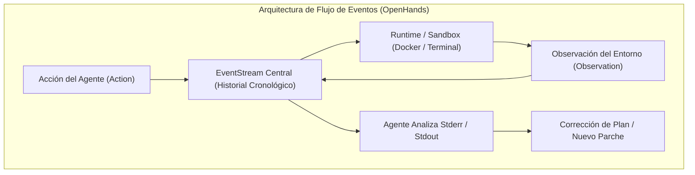

> **Alcance:** Literatura canónica de arquitectura de software, código limpio, TypeScript, validación en el Edge, sistemas distribuidos, videocursos técnicos e ingeniería de agentes IA para la Software Factory Web.

---
version: 1.0.0
tipo: research
tags:
  - yendo-mobile
  - architecture
  - en-progreso
autores: [RESEARCHER_AGENT, MANAGER_AGENT]
ultima_revision: 2026-08-27
---

# 🛠️ Canon de Ingeniería Agéntica 03: Arquitecturas Open Source y Tooling de Producción

> **Ubicación Canónica:** `.knowledge/canon_estudio/CANON_AGENTIC_03_SOTA_OPEN_SOURCE_AND_TOOLING.md`  
> **Área:** Implementaciones de Código Abierto y Herramientas de Ejecución Agéntica.  
> **Proyectos Analizados:** All-Hands-AI/OpenHands, princeton-nlp/SWE-agent, microsoft/autogen, E2B, Playwright.

---

## 1. OpenHands (OpenDevin): Arquitectura de Flujo de Eventos (EventStream)

OpenHands es uno de los proyectos de código abierto más avanzados en ingeniería de software autónoma. Su arquitectura se sustenta en el patrón **EventStream**.

### 1.1 El Ciclo de Recuperación de Errores de Terminal
Cuando una herramienta de terminal falla en OpenHands:
1. El error no tumba el proceso del agente; se emite un evento `CmdOutputObservation` con el código de retorno y el `stderr`.
2. El agente cuenta con un prompt especializado de **Terminal Error Recovery** que analiza la causa raíz (ej. falta de dependencias, error de sintaxis, ruta incorrecta).
3. Aplica una acción correctiva inmediata (ej. instala la biblioteca o corrige la línea) y vuelve a intentar el comando.

---

## 2. Microsoft AutoGen: Conversación Multi-Agente y GroupChatManager

AutoGen modela la colaboración agéntica como una conversación estructurada entre agentes especializados.

### 2.1 El Patrón GroupChatManager:
- **GroupChat:** Contenedor de la conversación donde se registran los mensajes.
- **GroupChatManager:** Un agente coordinador que en cada turno evalúa qué agente del equipo debe hablar a continuación:
  - Si el `CODER` acaba de escribir una función, el manager selecciona automáticamente al `TESTER` para que corra los tests.
  - Si el `TESTER` reporta un fallo, el manager devuelve el turno al `CODER` con el reporte de error.
  - Cuando los tests pasan y se alcanza la condición de parada, el manager termina la conversación y entrega el resultado al usuario humano.

---

## 3. Sandboxing Seguro con E2B (Cloud Sandboxes)

En entornos de producción, permitir que agentes de IA ejecuten código arbitrario o scripts de bash directamente en la máquina del usuario o en el servidor principal es un vector de riesgo inaceptable (**OWASP LLM03: Excessive Agency**).

### 3.1 Cómo opera E2B (`e2b.dev`):
1. **Micro-VMs Efímeras:** E2B provisiona entornos Linux aislados en menos de 150 milisegundos mediante Firecracker microVMs.
2. **Aislamiento Total de Red y Disco:** El agente puede clonar repositorios, compilar TypeScript, instalar paquetes de npm y ejecutar tests sin tocar el sistema anfitrión ni acceder a credenciales maestras.
3. **Persistencia por Snapshots:** Se pueden tomar capturas del estado de la máquina virtual para reanudar el trabajo o descartar cambios defectuosos.

---

## 4. Automatización de Navegadores con Playwright y Browser-Use

Para que los agentes puedan interactuar con interfaces web, auditar el renderizado visual y validar accesibilidad (a11y), requieren capacidades de navegación multimodal.

### 4.1 Playwright & Browser-Use:
- **Árbol de Accesibilidad (Accessibility Tree):** En lugar de intentar comprender capturas de pantalla gigantes píxel a píxel con modelos de visión pesados, Browser-Use y Playwright extraen el árbol semántico del DOM con identificadores numéricos simples (`[12] Botón Login`, `[15] Input Email`).
- **Navegación Robusta:** Permite que el agente haga clics, rellene formularios y tome capturas de pantalla de estados específicos para su posterior análisis con modelos de visión (VLM).

---

## 5. Los Compiladores y Linters como "Sensores de Realidad"

Uno de los mayores descubrimientos de la ingeniería agéntica es que **el agente nunca debe confiar en su propia autoevaluación subjetiva para código**:
- `npx tsc --noEmit` actúa como un sensor matemático determinista de verdad: o compila (código 0) o no compila.
- `expo-doctor` actúa como sensor de integridad del stack móvil.
- `node tools/scripts/scan_secrets.js` actúa como sensor de seguridad estática.

El agente utiliza estos comandos como retroalimentación objetiva del mundo real, eliminando el sesgo de confirmación.

---

## Relaciones de Contexto
- [[AGENTIC_WORKFLOW_MASTER_PROTOCOL]]
- [[CANON_AGENTIC_01_FOUNDATIONAL_PAPERS]]
- [[CANON_AGENTIC_02_FRAMEWORKS_ORCHESTRATION]]
- [[CANON_AGENTIC_04_DESCUBRIMIENTOS_Y_EVOLUCION_YENDO]]
- [[Masterclass_Septiembre_2026_Sintesis_Maestra]]
- [[YENDO_DNA]]
- [[YENDO_LIBRARY]]
