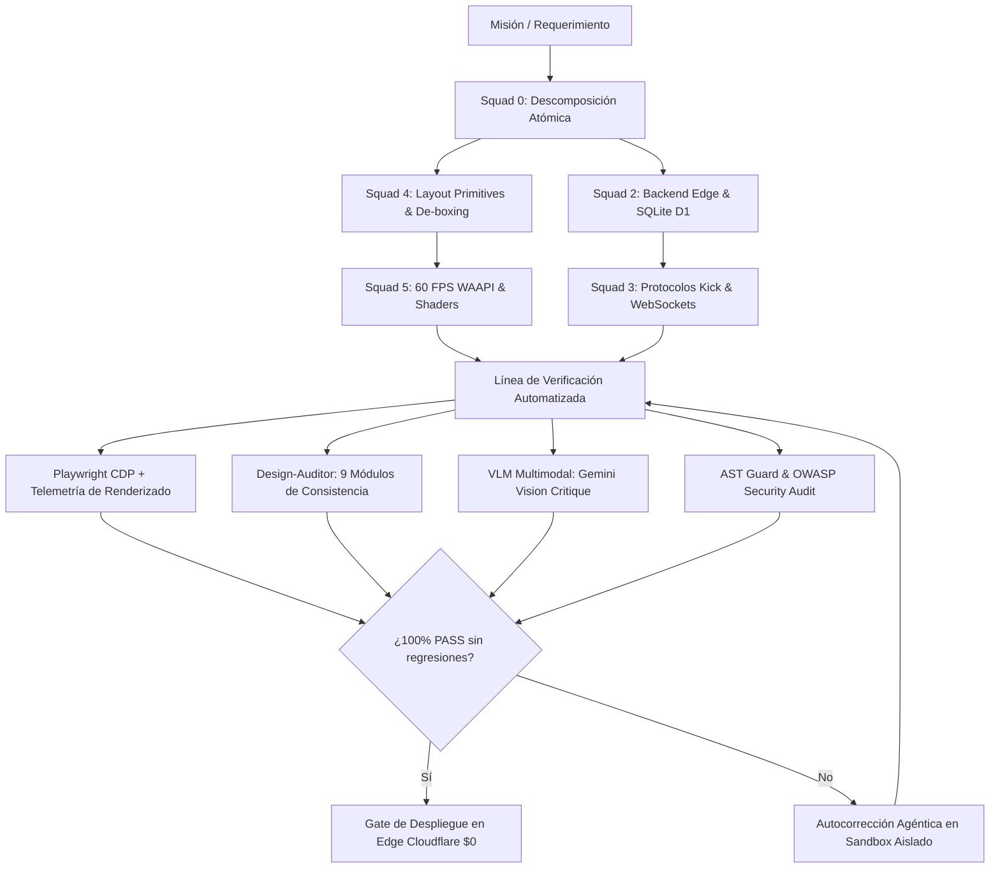

# CANON AGENTIC SOFTWARE FACTORY & WEB CRAFT 2026: Metodología, Arquitectura y Manufactura de Software de Élite Mediante IA Agéntica

> **Alcance:** Tratado canónico para la orquestación y operación de la Software Factory de HuntHub / DiggityBets (`Squad 0` a `Squad 7`), definiendo la metodología de producción de sitios web modernos, elegantes, minimalistas, fluidos, hiper-eficientes y blindados contra vulnerabilidades mediante agentes autónomos coordinados.  
> **Protocolo LEC-015:** Documento de Explicación Canónica y Referencia Metodológica.  
> **Restricciones Duras:** Presupuesto $0 permanente, ejecución liviana en host notebook (HP 250 G8), OBS Browser Sources ≤ 5% CPU, cero fugas de secretos y cero licencias comerciales restrictivas.

---

## 1. El Paradigma de la Software Factory Agéntica

### 1.1 De la Fábrica de Software Tradicional a la Fábrica Agéntica
La fábrica de software tradicional del siglo XX y principios del XXI (CMMI, Scrum tradicional, fábricas con decenas de desarrolladores humanos en silos) sufría de **tres fricciones estructurales irreversibles**:
1. **Pérdida de Contexto y Desalineación**: Especificaciones redactadas por analistas que se deformaban al pasar por el líder técnico, los desarrolladores y el equipo de QA.
2. **Latencia de Ciclo Lenta**: Días o semanas para validar una hipótesis de interfaz o corregir un error de regresión.
3. **Inconsistencia de Estilo y Deuda Técnica**: Múltiples humanos introduciendo criterios arbitrarios de CSS, librerías redundantes y parches rápidos que acumulaban "slop" y bloatware.

La **AI Agentic Software Factory (2026)** redefine este modelo:
* **El Humano como Diseñador de Intención y Guardián de Puertas (Gatekeeper):** El operador o fundador define los objetivos de producto y aprueba las decisiones arquitectónicas en las puertas de control (Gates).
* **Los Agentes como Fuerza de Manufactura Especializada:** Múltiples agentes organizados en *squads* funcionales (Arquitectura, Frontend, Movimiento, QA, Seguridad, DevOps) ejecutan tareas atómicas con herramientas programáticas directas.
* **La Paradoja de Productividad de la IA y el Cuello de Botella de Verificación:** La IA puede generar miles de líneas de código en segundos; el verdadero cuello de botella ya no es escribir código, sino **verificar objetivamente que el código sea correcto, visualmente impecable, accesible y seguro**. Una factoría agéntica madura invierte el 70% de su energía en **arneses de prueba, linters de diseño y bucles de verificación automatizados**.

---

## 2. Los 6 Invariantes del Web Crafting Agéntico de Élite

Toda interfaz producida por la Software Factory debe satisfacer seis invariantes no negociables:

### Invariante 1: Estética Superior y Erradicación del "AI-Slop"
* **Ley de De-boxing:** Cero cajas dentro de cajas innecesarias. La agrupación visual se realiza por **espacio negativo armónico** y sutiles deltas de luminancia en vez de bordes gruesos o tarjetas repetitivas.
* **Presupuesto Cromático 90/8/2:** 90% fondo oscuro de absorción profunda (`#06080d`), 8% superficies de vidrio ahumado translúcido con desenfoque (`rgba(17, 22, 36, 0.76)` con `backdrop-filter: blur(16px)`), y 2% acento cinético de alto voltaje (`#53fc18`, `#ffd700`) reservado exclusivamente para eventos clave.
* **Espacio de Color OKLCH:** Uso de coordenadas cromáticas perceptualmente uniformes para evitar aberraciones y bandas de color en pantallas OLED móviles.

### Invariante 2: Ergonomía Fluida Matemática (Utopia)
* Prohibido el uso de valores estáticos en píxeles para tipografía y márgenes estructurales. Se aplican fórmulas matemáticas fluidas con `clamp(min, preferred, max)` calculadas según el ancho del viewport (390px a 1440px+), asegurando un escalado 100% orgánico sin saltos abruptos.

### Invariante 3: Rendimiento de Renderizado a 60 FPS y Presupuesto de Fotograma
* **Compositor GPU Directo:** Todas las animaciones e interacciones deben operar exclusivamente sobre propiedades compuestas: `transform` (utilizando `translate3d` o matrices) y `opacity`. Queda estrictamente prohibido animar `width`, `height`, `top`, `left`, `margin` o `padding`.
* **Aislamiento de Renderizado:** Inyección de `contain: layout style paint` y `content-visibility: auto` en vistas complejas para evitar la propagación de recalculaciones de estilo a través del árbol DOM.
* **Presupuesto de CPU en OBS:** Los overlays deben mantenerse en `<= 5% de uso de CPU` en OBS Studio para garantizar estabilidad en transmisiones en vivo.

### Invariante 4: Micro-Interacciones Táctiles y Física de Resortes
* Reemplazo de transiciones lineales mecánicas por **física de resortes orgánica** (`spring(stiffness, damping, mass)` vía `dynamics.js`), retroalimentación háptica visual inmediata al presionar (`pointerdown` scale(0.965)), y síntesis de audio procedural en el cliente con Web Audio API (foley de fichas de cerámica y campanas de cristal sintetizadas sin archivos pesados).

### Invariante 5: Arquitectura Edge Ultraligera ($0 Permanente)
* Servidores sin estado basados en Cloudflare Workers, activos estáticos servidos directamente en el Edge con Cloudflare Workers Static Assets, y persistencia relacional con Cloudflare D1 (Serverless SQLite). Consultas atómicas por lotes (`db.batch`) y preparado estricto de sentencias SQL.

### Invariante 6: DevSecOps Zero-Trust y Ciberseguridad Agéntica
* **Sanitización Extrema:** Ninguna cadena proveniente de usuarios o chat de Kick se inserta mediante `innerHTML` sin pasar por `window.escapeHTML` y `DOMPurify`.
* **Content Security Policy (CSP) Hermética:** Restricción estricta de fuentes de scripts, estilos, conexiones y frames.
* **Criptografía Verificable:** Sorteos y juegos de azar con equidad demostrable (*Provably Fair*) mediante esquemas Commit-Reveal con `HMAC-SHA256` y semillas revelables.
* **Cero Secretos en Git:** Tokens y credenciales viven exclusivamente en `.dev.vars` o variables de entorno en Cloudflare.

---

## 3. Conciencia Visual y el Bucle de Verificación Agéntica

El mayor salto metodológico de 2026 es la **conciencia visual del agente**. Un agente que solo lee texto no puede discernir si una tipografía se solapa o si un botón pierde legibilidad en un teléfono móvil.

### Componentes del Bucle de Conciencia Visual
1. **Ejecutor Headless Playwright:** Abre la URL local o remota en un Chromium real bajo 3 resoluciones estándar: Desktop (1440px), Tablet (768px) y Mobile (390px).
2. **Telemetría CDP (Chrome DevTools Protocol):** Monitorea métricas en tiempo real:
   - `layoutCount`: Cantidad de veces que el navegador recalculó el diseño.
   - `recalcStyleCount`: Cantidad de recalculaciones de CSS.
   - `jsHeapUsedMB`: Consumo de memoria RAM de JavaScript.
   - Detección de solicitudes de red fallidas (404) y excepciones en consola.
3. **Linter de Consistencia Visual (`design-auditor`):** Evalúa 9 dimensiones objetivas de diseño del DOM computado: escalas modulares de tipografía, agrupamiento de color por delta-E, ritmo vertical de espaciado y contraste WCAG AA.
4. **Crítica Visual Multimodal (VLM):** La captura de pantalla en Base64 se transmite a modelos de visión (Gemini 2.5 Flash Vision o Claude 3.7 Sonnet Vision) junto con la rúbrica de diseño premium para obtener un reporte estructurado de fallas ópticas y sugerencias de pulido antes de confirmar el commit.

---

## 4. Catálogo de Repositorios Clave para la Metodología

Los siguientes repositorios de código abierto constituyen el ecosistema de referencia de la factoría agéntica:

### 4.1 Orquestación y Agencias Virtuales
* **`MetaGPT` (`FoundationAgents/MetaGPT`)**: Framework que modela una compañía de software completa (Product Manager, Architect, Engineer, QA) con procedimientos operativos estándar (SOP) formalizados.
* **`Paperclip` (`paperclip-ai/paperclip`)**: Orquestador de "empresa como código" que estructura tareas, dependencias entre agentes, dueños funcionales y ejecución jerárquica.
* **`Composio` (`ComposioHQ/composio`)**: Plataforma estandarizada de herramientas y conectores MCP para que los agentes ejecuten acciones de desarrollo, autenticación y despliegue.
* **`ruflo` (`ruvnet/ruflo`)**: Arnés de super-agentes con memoria vectorial RAG, swarms multi-agente y ejecución de herramientas nativas.

### 4.2 Rigor de Ingeniería, Aislamiento y Disciplina
* **`pstack` (`backnotprop/pstack` - Lauren Tan)**: Guía metodológica para desarrollo guiado por pruebas (TDD) en agentes de IA, cálculo del radio de impacto de cambios y erradicación del código innecesario.
* **`sandcastle` (`ai-hero/sandcastle`)**: Protocolo de sandboxes efímeros basados en Git Worktrees, permitiendo que los agentes ejecuten pruebas y refactorizaciones en ramas aisladas sin alterar el espacio de trabajo principal.

### 4.3 Inteligencia de Diseño, Componentes y Conciencia Visual
* **`kokonutui` (`kokonut-labs/kokonutui`)**: 40+ componentes interactivos vanguardistas de 2026 (bento grids, barras de búsqueda, diales hápticos).
* **`design-auditor` (`PashaSchool/design-auditor`)**: "Lighthouse de la consistencia visual", evalúa el sistema de diseño en 9 módulos calculando un puntaje de 0 a 100.
* **`ui-skills` (`ibelick/ui-skills`)**: Playbook de habilidades para agentes en optimización de rendimiento de animaciones, accesibilidad y tokens.
* **`design-critique-mcp` (`haasonsaas/design-critique-mcp`)**: Servidor MCP que implementa herramientas de análisis visual de imágenes mediante modelos de lenguaje con visión.

### 4.4 Motores de Movimiento y Rendimiento Web
* **`dynamics.js` (`michaelvillar/dynamics.js`)**: Animaciones basadas en física real con resortes, rebote elástico y masa.
* **`nue` (`nuejs/nue`)**: Arquitectura web ultraligera basada en estándares web puros, separando estructura, estilo y lógica sin capas intermedias infladas.
* **`flubber` (`veltman/flubber`)**: Interpolación y metamorfosis fluida de rutas vectoriales SVG (shape morphing).
* **`vanta` (`tengbao/vanta`)**: Fondos tridimensionales animados e interactivos en JavaScript sin Three.js pesado.
* **`lax.js` (`alexfoxy/lax.js`)**: Animaciones de scroll ultrasuaves de menos de 4 KB ejecutadas en el hilo del compositor GPU.

---

## 5. Manejo Ético y Técnico de Libros Privados y Comerciales

### 5.1 Política Ética de Propiedad Intelectual (`AGENTS.md §2.4`)
La Software Factory opera bajo una regla de **cumplimiento estricto de licencias**:
* Los libros comerciales protegidos por derechos de autor (*copyright*) no pueden ser volcados en texto completo dentro del repositorio ni en bases de datos públicas.
* En su lugar, la factoría destila sus **principios arquitectónicos, heurísticas y reglas operativas** en forma de guías canónicas y habilidades (*skills*), permitiendo que los agentes apliquen su conocimiento sin cometer infracciones de propiedad intelectual.

### 5.2 Catálogo Curado de Libros Comerciales Clave y su Síntesis Operativa

| Libro | Autor(es) | Editorial / Año | Síntesis Operativa para la Factoría |
| :--- | :--- | :--- | :--- |
| **Refactoring UI** | Adam Wathan & Steve Schoger | Independiente, 2018 | Empezar por el contenido antes del diseño, jerarquía mediante tamaño y peso tipográfico en vez de color, uso de sombras multicapa sutiles en lugar de bordes marcados. |
| **Designing Interfaces (3rd Ed.)** | Jenifer Tidwell, Charles Brewer, Aynne Valencia | O'Reilly, 2020 | Patrones canónicos de UI: vistas maestras, paneles laterales colapsables, revelación progresiva y formularios de entrada adaptativa. |
| **Every Layout: Relearn CSS Layout** | Heydon Pickering & Andy Bell | Independiente, 2020 | Algoritmos de diseño CSS compositivos (`Stack`, `Cluster`, `Sidebar`, `Switcher`, `Grid`) sin depender de frameworks externos ni media queries rígidas. |
| **Building Applications with AI Agents** | Michael Albrow | O'Reilly, 2025/2026 | Arquitectura de sistemas multi-agente, diseño de herramientas y esquemas JSON para Function Calling, memoria conversacional episódica y guardarraíles. |
| **AI Engineering: Building Applications with Foundation Models** | Chip Huyen | O'Reilly, 2025 | Evaluación rigurosa de modelos, técnicas de RAG híbrido (léxico + semántico), mitigación de alucinaciones y optimización de latencia y costo de contexto. |
| **System Design Interview Vol. 2** | Alex Xu & Sahn Lam | ByteByteGo, 2022 | Arquitectura de sistemas de alto tráfico: limitadores de tasa por ventana deslizante, colas de mensajería, replicación distribuida y balanceadores Edge. |
| **Database Internals** | Alex Petrov | O'Reilly, 2019 | Motores de almacenamiento B-Tree vs LSM-Tree, diarios de transacciones (WAL), niveles de aislamiento ACID y optimización de páginas en SQLite. |
| **Game Feel: A Game Designer's Guide to Virtual Sensation** | Steve Swink | CRC Press, 2008 | Física de la interacción, micro-retroalimentación auditiva y visual inmediata (<100ms) para dar sensación táctil y orgánica al software. |
| **The Design of Everyday Things** | Don Norman | Basic Books, 2013 | Visibilidad de funciones, correspondencia natural entre controles y acciones, retroalimentación constante y diseño a prueba de errores. |
| **Clean Architecture** | Robert C. Martin | Prentice Hall, 2017 | Regla de dependencias: la lógica de negocio central nunca depende de la base de datos ni de la interfaz de usuario; desacoplamiento estricto por interfaces. |

---

## 6. Inventario de Videocursos Gratuitos y Documentación Oficial Primaria

### 6.1 Videocursos y Masterclasses Gratuitas de Alta Fidelidad
1. **Apple WWDC**:
   - *Designing Fluid Interfaces (WWDC18)*: Principios de interfaces reactivas, física de resortes y cancelación de gestos sin bloqueos.
   - *Animate with Springs (WWDC23)*: Formulación matemática de resortes elásticos para transiciones naturales en UI.
2. **Nielsen Norman Group (NN/g)**:
   - *Aesthetic and Minimalist Design (Heuristic #8)*: Eliminación de ruido visual para elevar la velocidad de procesamiento cognitivo del usuario.
   - *Fitts's Law in Graphical User Interfaces*: Dimensionamiento y posicionamiento óptimo de botones y áreas de toque (mínimo 44×44px en móviles).
3. **Google Chrome Developers / web.dev**:
   - *Next-Gen CSS con Una Kravets*: APIs CSS modernas (`@property`, `@starting-style`, `content-visibility`, subgrid).
   - *Optimizing Core Web Vitals (INP, LCP, CLS)*: Métricas oficiales de rendimiento web y diagnóstico de atascos en el hilo principal.
4. **Andrej Karpathy & freeCodeCamp**:
   - *Intro to Large Language Models*: Fundamentos de tokenización, pre-entrenamiento, ajuste fino y limitaciones de los modelos de lenguaje.
   - *LangGraph & Agentic Workflows*: Orquestación de grafos cíclicos con estado y división de trabajo entre agentes especializados.
5. **Hussein Nasser**:
   - *WebSockets & Real-Time Architecture Masterclass*: Conexiones dúplex persistentes, multiplexación y manejo de reconexiones en streaming.

### 6.2 Documentación Oficial Primaria (Fuentes de Verdad Absoluta)
* **W3C & WHATWG**: Especificaciones oficiales de CSS3 (Transforms, Grid, Flexbox, Transitions, Animations) y HTML5 Semántico.
* **MDN Web Docs (Mozilla Developer Network)**: Referencia técnica de Web APIs, Web Audio API, Canvas 2D y Web Animations API (WAAPI).
* **Cloudflare Developer Platform Docs**: Arquitectura de Cloudflare Workers, Cloudflare D1 (SQLite en Edge) y Workers Static Assets.
* **Kick.com Official Developer Docs (KickEngineering/KickDevDocs)**: Contratos de API v1, flujo OAuth 2.1 PKCE y especificación de eventos Pusher y Webhooks.
* **OWASP Foundation**: Application Security Verification Standard (ASVS v4.0), Cross-Site Scripting (XSS) Prevention Cheat Sheet y Content Security Policy Guidelines.
