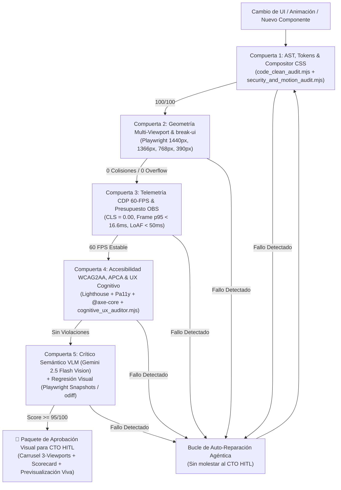

# Tratado Canónico: Auditoría Visual Automatizada, Crítico Multimodal VLM y Compuerta CTO HITL (SOTA 2026)

**Alcance:** Este documento define la arquitectura de **Evaluación, Testing y Auditoría Automatizada de Interfaces Web en 5 Compuertas** previa a la aprobación final del **CTO Human-In-The-Loop (HITL)**, integrando **Playwright Multi-Viewport Geometry**, **`break-ui` Adversarial Stress Testing**, **Telemetría CDP 60-FPS (`LoAF`, `CLS`, `INP`)**, **Accesibilidad `@axe-core/playwright` + `Pa11y` + `APCA`**, **Visual Regression (`odiff` / Snapshots)** y **Crítica Semántica con Modelos de Visión (`VLM UI Critic` — paradigma *Design2Code* / *UI2Code-N*)**. NO es fuente de contratos de OAuth o criptografía de sorteos.

---

## 1. Filosofía Operativa: El Rol del CTO HITL (*Human-In-The-Loop*)

`[VERIFICADO: Design2Code Stanford/ACL, UI2Code-N 2025, Playwright Visual Comparisons, Google Lighthouse CI]`

En una **Web Software Factory** donde el fundador actúa como **CTO HITL (Director de Arte e Ingeniería de Última Instancia)**:
- **Regla de Oro**: Ningún agente puede solicitar el "visto bueno visual" del CTO HITL si la página aún presenta desbordamientos horizontales, textos truncados, colisiones de cajas, bajo contraste, caídas de fotogramas o errores de consola.
- **Filtro Pre-HITL del 99%**: Las máquinas auditan determinísticamente la **geometría, fluidez, accesibilidad, seguridad y coherencia semántica** en un bucle cerrado de auto-reparación. El CTO HITL solo interviene al final para evaluar el **gusto estético superior, la dirección de marca y el impacto emocional**, recibiendo un **Paquete de Aprobación Visual (*HITL Sign-Off Packet*)** listo para decidir en menos de 30 segundos.

---

## 2. Arquitectura de las 5 Compuertas Automatizadas Pre-HITL

### Compuerta 1 — Auditoría Estática de AST, Tokens y Disciplina de Animación (`code_clean_audit.mjs`)
- Verifica el 100% de los archivos `.js`, `.mjs` y `.css` en menos de `500ms`:
  - **Cero errores de sintaxis** o métodos huérfanos.
  - **Disciplina del Hilo Compositor**: Prohibición de animar propiedades de layout (`top`, `left`, `width`, `height`, `margin`) en `@keyframes`; exigencia de `transform` y `opacity`.
  - **Higiene de Tokens**: Verificación de variables semánticas, ausencia de deformaciones `matrix3d` no deseadas en tarjetas informativas y sanitización `escapeHTML` / `textContent`.

### Compuerta 2 — Geometría DOM Multi-Viewport y Prueba de Estrés `break-ui` (`visual_audit.mjs`)
- Levanta un navegador Chromium headless real mediante `playwright-core` y barre las **10 vistas del sitio** en resoluciones críticas (**Desktop `1440x900`**, **Laptop HP `1366x768`**, **Tablet `768x1024`** y **Mobile `390x844`**):
  1. **Cero Scroll Horizontal Accidental**: `document.documentElement.scrollWidth <= clientWidth + 1`.
  2. **Cero Texto Truncado Involuntario**: Detecta cualquier nodo con `scrollWidth > clientWidth + 2`.
  3. **Matriz de Colisión entre Hermanos (*Sibling Bounding-Box Collision*)**: Compara `getBoundingClientRect()` de todos los elementos adyacentes para garantizar superposición `0px`.
  4. **Simetría Axial Óptica**: Verifica matemáticamente que los puntos focales centrados (como el logo superior) estén a `<= 4px` del eje central del viewport (`vw / 2`).
  5. **Ratio de Espacio Limpio (*Clean Space Ratio*)**: Exige al menos un **35% de aire visual** libre de cajas anidadas.
  6. **Inyección Adversaria `break-ui` (*Worst-Case Data Stress*)**: Inyecta nombres de usuario extremos (`32` caracteres sin espacios), cifras millonarias (`$99,999,999.99`), listas vacías (`0 items`) y caracteres especiales/emojis para comprobar que ninguna tarjeta explota ni rompe la fila.

### Compuerta 3 — Telemetría CDP a 60 FPS, `LoAF` y Presupuesto de CPU (`<= 5% OBS`)
- Mediante una sesión directa al **Chrome DevTools Protocol (`page.context().newCDPSession(page)`)**:
  - Extrae `Performance.getMetrics` (`LayoutCount`, `RecalcStyleCount`, `JSHeapUsedSize`, `Nodes`).
  - Audita `document.getAnimations()` para confirmar que las animaciones activas corren sin disparar reflujos continuos.
  - Verifica **Cumulative Layout Shift (`CLS === 0.00`)** y ausencia de **Long Animation Frames (`LoAF > 50ms`)**.

### Compuerta 4 — Accesibilidad Perceptual (`@axe-core` + `Pa11y` + `APCA`) y UX Cognitivo (`UXBench` / `UIGuard`)
- Combina tres motores complementarios:
  1. **`lighthouse_pa11y_audit.mjs`**: Ejecuta Google Lighthouse (`Performance`, `Accessibility`, `Best Practices`, `SEO`) y `Pa11y` bajo el estándar `WCAG2AA`.
  2. **Contraste Perceptual y Áreas Táctiles**: Valida ratios de contraste y tamaños mínimos de botones táctiles (`>= 32x32px` en móvil).
  3. **`cognitive_ux_auditor.mjs` (*UXBench* & *UIGuard*)**: Audita que todo modal posea botón de cierre explícito (`PopupNoClose = 0`), ausencia total de *dark patterns* (`Confirm-Shaming = 0`) y presencia de avisos legales `+18` y participación `100% gratuita`.

### Compuerta 5 — Crítico Semántico Multimodal (`VLM UI Critic`) y Diferenciación Visual (`odiff` / Snapshots)
- Inspirado en los papers **Design2Code** y **UI2Code-N (Test-Time Scaling for Frontend Polish)**:
  - Los tests geométricos ven coordenadas, pero un **Modelo de Visión-Lenguaje (`Gemini 2.5 Flash Vision` en Vertex AI)** evalúa la captura PNG renderizada igual que un diseñador senior humano.
  - El **VLM Critic** califica cada vista de `0 a 100` sobre una rúbrica estricta de 6 ejes:
    1. **Jerarquía Focal** (¿Se entiende en 1 segundo cuál es la acción principal?)
    2. **Ritmo y Alineación** (¿Los márgenes y grillas respiran con armonía?)
    3. **Pureza del Modo Oscuro** (¿Las superficies tienen profundidad sin verse sucias o saturadas?)
    4. **Legibilidad Tipográfica** (¿Los números y etiquetas se leen sin esfuerzo?)
    5. **Coherencia de Componentes** (¿Los botones, insignias y tarjetas comparten el mismo lenguaje?)
    6. **Ausencia de Artefactos Visuales** (¿Hay imágenes rotas, íconos desalineados o bordes cortados?)

---

## 3. Protocolo de Entrega al CTO HITL (*Visual Sign-Off Packet*)

Cuando y solo cuando las **5 Compuertas Automatizadas** están en verde (`B:0 M:0 m:0` y `Score >= 95/100`), el agente consolida un **Reporte Visual Ejecutivo para el CTO HITL** que incluye:
1. **Carrusel Comparativo Multi-Viewport**: Capturas reales en `1440px` (Desktop), `768px` (Tablet) y `390px` (Mobile) incrustadas directamente en el artefacto de revisión.
2. **Certificado de Telemetría y Auditoría**: Tabla compacta con los resultados reales de `visual_audit.mjs`, `code_clean_audit.mjs`, `cognitive_ux_auditor.mjs` y `lighthouse_pa11y_audit.mjs`.
3. **Puntos de Decisión Estética**: Máximo 2 o 3 preguntas concretas de dirección de arte para que el CTO HITL apruebe o pida ajustes finos con un solo mensaje.

---
**Conexiones del Grafo (Obsidian):** [[INDEX]] · [[CANON_SOTA_RAG_ARCHITECTURES_AND_TOOLS_2026]] · [[CURATED_MASTER_BOOKS_AND_COURSES_2026]] · [[CANON_SOFTWARE_ENGINEERING_AT_GOOGLE]] · [[CANON_HARNESS_ENGINEERING_INTEGRAL_2026]] · #architecture_and_books
