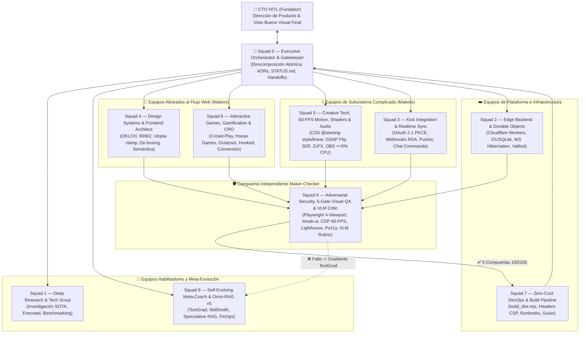

# Tratado Canónico: Topología de Equipos Multi-Agente de Élite y Matriz de 76 Skills para nuestra Web Software Factory (SOTA 2026)

**Alcance:** Este documento define la estructura organizacional definitiva de **10 Escuadrones Especializados (`Squad 0` a `Squad 9`)** y la asignación de las **76 Habilidades (`SKILL.md`)** de nuestra **Self-Evolving Web Software Factory**, fundamentada en **Team Topologies (*Matthew Skelton & Manuel Pais*)**, **Building Effective Agents (*Anthropic*)**, **Procedimientos Operativos Estándar (*MetaGPT SOPs*)** y **Disciplina de Ingeniería Agéntica (*Addy Osmani Agent-Skills*)**. NO es fuente de contratos específicos de Kick API ni de fórmulas matemáticas de probabilidades de slots.

---

## 1. Fundamentos Científicos de Organización Multi-Agente (2025–2026)

`[VERIFICADO: Matthew Skelton & Manuel Pais "Team Topologies", Anthropic "Building Effective Agents" 2025, Addy Osmani "AI Software Factory & Agent-Skills" 2025–2026, MetaGPT SOPs]`

### 1.1 Ley de Carga Cognitiva de *Team Topologies* Aplicada a Agentes de IA
En *Team Topologies*, Skelton y Pais demuestran que cuando un equipo humano abarca demasiados dominios dispares, su **carga cognitiva intrínseca y ajena** colapsa la velocidad y la calidad del flujo (*Fast Flow*). En los modelos de lenguaje (LLMs), este fenómeno es aún más severo y se manifiesta como **dilución de atención en la ventana de contexto (*Context Pollution*)**:
- Si un mismo agente recibe simultáneamente instrucciones de esquemas SQLite, leyes tipográficas, psicología de conversión y auditoría criptográfica, su precisión cae drásticamente.
- **Solución Estructural**: Dividir la Software Factory en los **4 Tipos de Equipos de *Team Topologies*** con contextos aislados y contratos de entrega (*Handoff Artifacts*) estrictos:
  1. **Equipos Alineados al Flujo (*Stream-Aligned Squads*)**: Entgan valor directo al usuario final en la web (`Squad 4: Design Systems & Frontend`, `Squad 8: Interactive Crowd-Play Games, Gamification & CRO`).
  2. **Equipos de Subsistema Complicado (*Complicated-Subsystem Squads*)**: Dominan matemática pesada, protocolos en tiempo real, shaders GPU y síntesis de audio (`Squad 3: Kick & Realtime Protocols`, `Squad 5: 60-FPS Motion, Shaders, WebAudio & OBS Overlays`).
  3. **Equipos de Plataforma (*Platform Squads*)**: Proveen infraestructura serverless de costo cero, bases de datos en el Edge, pipelines de compilación y el cerebro RAG (`Squad 2: Edge Backend & Durable Objects`, `Squad 7: Zero-Cost DevOps & Build Pipeline`).
  4. **Equipos Habilitadores y Gobernadores (*Enabling & Gatekeeper Squads*)**: Investigan tecnología de frontera, auditan seguridad/calidad visual en bucle *Maker-Checker* y evolucionan las habilidades de toda la fábrica (`Squad 1: Deep Research & Tech Scout`, `Squad 6: Adversarial Security & 5-Gate Visual QA`, `Squad 9: Self-Evolving Meta-Coach, Omni-RAG v5 & FinOps`).

### 1.2 Los 5 Patrones Canónicos de Anthropic (*Building Effective Agents*)
Nuestra fábrica combina los cinco patrones de diseño de Anthropic en un flujo determinista gobernado:
1. **Routing (`squad_semantic_router.mjs`)**: Clasifica en `<1ms` cada requerimiento y despierta únicamente a los escuadrones y documentos canónicos pertinentes.
2. **Orchestrator-Workers (`Squad 0 -> Squads 1..9`)**: El Manager (`Squad 0`) descompone misiones complejas en tareas ortogonales que los escuadrones ejecutan sin pisarse los archivos (*Set A / Set B* o *Sandcastle Git Worktrees*).
3. **Prompt Chaining & SOPs (*MetaGPT*)**: Ningún escuadrón escribe código de producción sin consultar primero el RAG (`kb-retrieval`) y verificar las restricciones (`CONSTRAINTS.md`).
4. **Parallelization**: Investigación y auditorías estáticas/visuales corren en paralelo para reducir la latencia total a la mitad.
5. **Evaluator-Optimizer (*Maker-Checker Loop*)**: Ningún agente constructor (*Maker*) puede aprobar su propio trabajo. Todo cambio pasa por el verificador independiente (`Squad 6`) y las **5 Compuertas Automatizadas Pre-HITL** antes de llegar al **CTO HITL**.

---

## 2. Matriz Organizacional de los 10 Escuadrones de la Web Software Factory

---

## 3. Catálogo Completo: Asignación de las 76 Skills por Escuadrón

| Escuadrón | Rol en la Fábrica (*Team Topologies*) | Skills Asignadas en `.agents/skills/` (76 Total) |
| :--- | :--- | :--- |
| **`Squad 0` — Executive Orchestrator & CTO Liaison** | *Orchestrator Hub* | `paperclip-converting-plans-to-tasks`, `subagent-driven-development`, `handoff`, `delivery-gate`, `constraint-driven-development`, `verify-before-claim`, `verification-before-completion`, `anti-shortcut-discipline`, `ponytail`, `caveman`, `claude-council`, `arena`, `grill-me`, `code-tour`, `codebase-onboarding`. |
| **`Squad 1` — Deep Research & Tech Scout** | *Enabling Team* | `research-mode`, `firecrawl`, `extract-design`, `agent-reach`, `find-skills`. |
| **`Squad 2` — Edge Architecture & Realtime Backend** | *Platform Team* | `cloudflare-durable-objects`, `durable-objects`, `workers-best-practices`, `modularity`, `code-structure`, `error-handling`, `provider-fallback`, `number-parsing`. |
| **`Squad 3` — Kick Integration & Stream Protocols** | *Complicated-Subsystem* | `kick-api`, `kick-api-contracts`, `channel-points-bridge`, `moderation-guard`. |
| **`Squad 4` — Design Systems, Tokens & Frontend Engineering** | *Stream-Aligned A* | `design-system-architect`, `design-system`, `taste-skill`, `hallmark`, `emil-design-eng`, `21st-ui`, `layout-primitives-architect`, `minimal-surface-hierarchy`, `optical-symmetry-and-focus`, `utopia-fluid-ergonomics`, `frontend-design`, `theme-factory`, `wireframe`, `web-artifacts-builder`, `stop-slop`. |
| **`Squad 5` — Creative Tech, 60-FPS Motion, Shaders & Audio** | *Complicated-Subsystem* | `animate`, `animation-performance`, `motion-engineer`, `vanilla-motion-choreography`, `obs-overlays`, `brag`. |
| **`Squad 6` — Adversarial Security, 5-Gate Visual QA & VLM Critic** | *Evaluator-Optimizer Gatekeeper* | `cto-hitl-visual-gate`, `visual-auditor`, `break-ui`, `design-critique`, `web-design-guidelines`, `web-perf`, `web-quality-skills`, `playwright-best-practices`, `security-audit`, `security-and-hardening`, `security-checklist`, `anti-fraud-fingerprinting`, `agent-security-hardening`, `adverse-review`, `code-reviewer`, `silent-failure-hunter`, `systematic-debugging`, `test-driven-development`, `evidence-driven-testing`. |
| **`Squad 7` — Zero-Cost DevOps & Workspace Isolation** | *Platform Team* | `agent-worktree`, `sandboxed-experiments`. |
| **`Squad 8` — Interactive Crowd-Play Games, Gamification & CRO** | *Stream-Aligned B* | `interactive-crowd-games`, `provably-fair-games`, `fair-draws`, `bracket-8`, `cro`, `marketing-psychology`, `marketing-loops`, `copywriting`, `pricing`, `prediction-market-risk-review`. |
| **`Squad 9` — Self-Evolving Meta-Coach, Omni-RAG v5 & FinOps** | *Enabling / Meta-Platform* | `self-evolving-factory`, `kb-retrieval`, `kb-writing`, `continuous-learning-instincts`, `continuous-learning-v2`, `eval-harness`, `agent-house-profiler`, `agent-self-evaluation`, `finops-context-budget`, `strategic-compact`. |

---

## 4. Protocolo de Trabajo Entre Escuadrones (*Standard Operating Procedure — SOP*)

1. **Fase de Intención y Enrutamiento (`Squad 0 + Squad 9`)**:
   - Ante cualquier pedido del CTO HITL, `squad_semantic_router.mjs` identifica los escuadrones responsables y recupera en `<50ms` los fragmentos canónicos del **Supercharged Omni-RAG v5**.
2. **Fase de Diseño y Especificación (`Squad 1 + Squad 4 / Squad 8`)**:
   - Si es una interfaz o juego nuevo, se extraen tokens de referencia (`extract-design` / `21st-ui`), se define la jerarquía de luminancia `OKLCH` (`90/8/2`) y el gancho psicológico (`Octalysis` / `Fogg B=MAP`).
3. **Fase de Construcción Paralela Aislada (`Squads 2, 3, 4, 5, 8`)**:
   - Los escuadrones constructores implementan el código respetando la frontera de archivos asignada (`<= 300` líneas por paso atómico).
4. **Fase de Verificación Independiente Maker-Checker (`Squad 6`)**:
   - `Squad 6` ejecuta las **5 Compuertas Automatizadas Pre-HITL** (`cto-hitl-visual-gate`). Si encuentra cualquier defecto geométrico, de contraste, de seguridad o de FPS, devuelve el **Gradiente Textual** a los constructores sin interrumpir al CTO HITL.
5. **Fase de Entrega Ejecutiva al CTO HITL (`Squad 0`)**:
   - Con las 5 compuertas en `100/100`, `Squad 0` presenta el **Paquete de Aprobación Visual (*CTO Sign-Off Packet*)** al fundador y `Squad 9` consolida los aprendizajes en `.agents/memory/temporal_ledger.json`.

---
**Conexiones del Grafo (Obsidian):** [[INDEX]] · [[CANON_SOTA_RAG_ARCHITECTURES_AND_TOOLS_2026]] · [[CURATED_MASTER_BOOKS_AND_COURSES_2026]] · [[CANON_SOFTWARE_ENGINEERING_AT_GOOGLE]] · [[CANON_HARNESS_ENGINEERING_INTEGRAL_2026]] · #architecture_and_books
