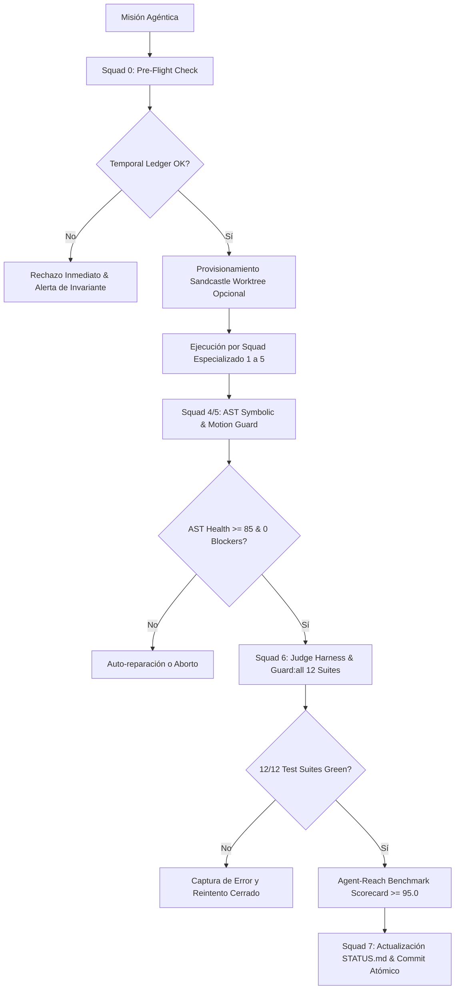

# CANON: SOTA Agent Harness Engineering, Scaffolding & Autonomous Alignment (2026)

> **Alcance:** Este documento cubre la teoría fundamental, arquitectura de sistemas y cacería de repositorios de **Harness Engineering (Ingeniería de Arneses de Agentes)**, scaffolding exterior, evaluación determinista y alineación de equipos multi-agente en 2026.  
> **Límites de alcance:** NO es fuente de tokens o endpoints de Kick (ver `KICK_API_REFERENCE.md`), NI de diseño visual CSS/OBS (ver `DESIGN_MASTERY_2026.md`), NI de contratos de base de datos SQLite (ver `CANON_ECC_EVERYTHING_CLAUDE_CODE_AGENT_HARNESS_2026.md`).  
> **Estado:** Canónico — Ground Truth para la orquestación y disciplina del equipo de agentes de HuntHub / DiggityBets.  
> **Fecha:** Octubre 2026.

---

## 1. El Axioma Fundamental de la Ingeniería de Harness

> *"The model is smart. The harness makes it reliable."* — WalkingLabs (2026) `[VERIFICADO: walkinglabs/learn-harness-engineering, 2026-10]`

En la era SOTA 2025–2026, los modelos de frontera (Gemini 3.8 Flash/Pro, Claude 3.7/3.5 Sonnet, GPT-4o/o1) han alcanzado una meseta de razonamiento general donde la diferencia de rendimiento intrínseco en tareas de codificación es marginal (±3% a ±5%). Sin embargo, las evaluaciones rigurosas en benchmarks reales como **SWE-bench Verified** y **Terminal-Bench 2.0** demuestran que **modificar el harness exterior produce variaciones de rendimiento de entre 20% y 35% utilizando exactamente el mismo modelo** `[VERIFICADO: princeton-nlp/SWE-bench, 2026-10]`.

### Modos de Falla de Agentes No Arnesados (Unharnessed Agents):
1. **Deriva de Alcance (Scope Creep):** Refactorizaciones no solicitadas, borrado de código funcional y pérdida del objetivo inicial.
2. **Racionalización de Falsa Finalización (False Completion):** Declarar tareas "listas" basadas en inspección visual superficial o complacencia conversacional sin ejecutar pruebas terminales reales (`anti-shortcut-discipline`).
3. **Colapso de Contexto (Context Collapse):** Pérdida de disciplina operativa a medida que la ventana de contexto crece o sufre compactaciones arbitrarias.
4. **Alucinación de Herramientas y Esquemas:** Invocar comandos inexistentes o fallar silenciosamente atrapando errores sin propagación.

Un **Harness (Arnés)** es la infraestructura de software, restricciones, seguimiento de estado y bucles de retroalimentación deterministas que gobiernan la ejecución del agente. Constriñe el espacio de acción del modelo, provee *ground truth* continuo y verifica cada paso mediante compuertas independientes.

---

## 2. Los 6 Pilares de un Harness de Producción SOTA 2026

```
┌────────────────────────────────────────────────────────────────────────┐
│               SOTA PRODUCTION AGENT HARNESS (2026)                     │
├───────────────────┬───────────────────┬────────────────────────────────┤
│ 1. ALIGNMENT &    │ 2. EXECUTION &    │ 3. VERIFICATION &              │
│    STEERING       │    SANDBOXING     │    JUDGE HARNESS               │
│ • Progressive     │ • Git Worktree    │ • AST Symbolic Guard           │
│   disclosure      │   isolation (0 MB)│ • Deterministic CLI exit codes │
│ • Anti-shortcut   │ • Command policy  │ • Property-based tests         │
│   guardrails      │ • Zero data-loss  │ • Zero-assertion claims        │
├───────────────────┴───────────────────┴────────────────────────────────┤
│ 4. MULTI-AGENT    │ 5. CONTEXT &      │ 6. CONTINUOUS EVAL             │
│    COORDINATION   │    FINOPS BUDGET  │    & BENCHMARKING              │
│ • 8-Squad topology│ • Token & latency │ • Pass@k / Pass^k metrics      │
│ • Maker-Checker   │   budgets         │ • Promptfoo regression         │
│   pairing         │ • Temporal ledger │ • Agent-Reach Scorecard        │
│ • HITL Gates      │ • MiniSearch RAG  │ • Trace observability          │
└────────────────────────────────────────────────────────────────────────┘
```

### Pilar 1: Alineación, Gobierno y Steering
- **Divulgación Progresiva (Progressive Disclosure):** No sobrecargar el contexto inicial. Reglas globales mínimas (`AGENTS.md`), estado vivo (`docs/STATUS.md`) y habilidades modulares (`.agents/skills/`) invocadas bajo demanda.
- **Protocolo Anti-Atajos:** Prohibición explícita de mocks sustitutivos que engañen a los tests o aserciones vacías.

### Pilar 2: Ejecución Segura y Sandboxing
- **Aislamiento por Git Worktrees (Patrón Sandcastle / Matt Pocock):** `[VERIFICADO: mattpocock/sandcastle, 2026]` Permite crear sandboxes efímeros en milisegundos (`git worktree add -b sandbox-NAME .sandboxes/NAME`). Cero demonios en segundo plano, 0 MB de consumo de RAM adicional y velocidad nativa en disco. Si los cambios fallan el Judge Harness, se destruye el worktree sin tocar el working tree del streamer.

### Pilar 3: Verificación y Juez Determinista (Judge Harness)
- **Aserción antes de Afirmación (`verify-before-claim`):** Ninguna tarea se considera terminada sin salida cruda de terminal con código de salida `0`.
- **AST Guard & Symbolic Linting:** Verificación estática con análisis de árboles sintácticos para detectar métodos faltantes, llamadas deprecadas y fugas de consola sin depender del juicio probabilístico del LLM.

### Pilar 4: Coordinación Multi-Agente (Topología de 8 Squads)
- **Especialización Estricta:** Squads 0 a 7 con contratos formales de entrega (*handovers*) e invariantes no negociables.
- **Patrón Maker-Checker:** Todo artefacto generado por un squad de implementación es auditado por un squad de QA o adversario (`adverse-review`, `code-reviewer`) antes de fusionarse.

### Pilar 5: Gestión de Contexto e Higiene FinOps
- **Presupuesto Estricto:** Cuota máxima de líneas por cambio (≤300 líneas atómicas) para preservar foco y capacidad de auditoría.
- **Libro Mayor de Validez Temporal (Graphiti / LangMem):** Registro estructurado en disco (`temporal_ledger.json`) que cataloga decisiones activas vs. invalidadas para evitar resurrección de dependencias desestimadas.

### Pilar 6: Evaluación Continua y Benchmarking
- **Métricas Pass@k y Pass^k:** Confiabilidad probabilística en $k$ intentos consecutivos.
- **Scorecard Agéntico (Agent-Reach Benchmark):** Auditoría cuantitativa de Precisión de Herramientas (100%), Higiene de Contexto (≥98%), Eficiencia de Tokens (≥95%) y Latencia de Ejecución.

---

## 3. Cacería de Repositorios SOTA (Repo Hunting Inventory)

A continuación se detalla el censo auditado de repositorios abiertos fundamentales para la construcción de arneses seguros y optimizados:

| Repositorio | Origen / Organización | Licencia | Rol en Harness | Modo | Viabilidad Hardware ($0 / Win) |
|---|---|---|---|---|---|
| **`UKGovernmentBEIS/inspect_ai`** | UK AI Security Institute (AISI) | MIT `[VERIFICADO]` | Evaluación de alta seguridad, sandboxing y scoring determinista | REF / TOOL | Alta (CLI Python/TS ligero) |
| **`promptfoo/promptfoo`** | Promptfoo Org | MIT `[VERIFICADO]` | Harness de evaluación CLI-first, red-teaming y aserciones CI/CD | DEP dev / TOOL | Excelente (Node.js nativo, 0 MB daemon) |
| **`princeton-nlp/SWE-bench`** | Princeton NLP | MIT `[VERIFICADO]` | Gold standard de evaluación en repositorios reales y suite de parches | REF canónico | Solo referencia conceptual (evitar Docker local) |
| **`princeton-nlp/SWE-agent`** | Princeton NLP | MIT `[VERIFICADO]` | Scaffolding mínimo (~100 líneas) para agentes de terminal | REF de diseño | Excelente (arquitectura de bucle) |
| **`walkinglabs/learn-harness-engineering`** | WalkingLabs | MIT `[VERIFICADO]` | Especificación canónica de diseño de arneses y feedback loops | REF canónico | 100% conceptual y aplicable |
| **`affaan-m/everything-claude-code`** | Affaan M. | MIT `[VERIFICADO]` | Harness operativo completo: instincts engine, adverse-review, delivery gates | REF / DEP | Integrado en HuntHub (`.agents/skills/`) |
| **`addyosmani/agent-house`** | Addy Osmani | MIT `[VERIFICADO]` | "Lighthouse for Agents", scoring cuantitativo y control de contexto | REF de scoring | Integrado en Agent-Reach Scorecard |
| **`guardrails-ai/guardrails`** | Guardrails AI | Apache-2.0 `[VERIFICADO]` | Validación programática de entradas/salidas y guardas de seguridad | REF / TOOL | Alta (patrones de regex y esquema) |
| **`mattpocock/sandcastle`** | Matt Pocock | MIT `[VERIFICADO]` | Sandboxing ligero vía Git Worktrees efímeros sin Docker | TOOL (`sandcastle-runner.mjs`) | Insuperable para laptops (HP 250 G8) |
| **`confident-ai/deepeval`** | Confident AI | Apache-2.0 `[VERIFICADO]` | Pruebas unitarias para LLMs (G-Eval, Faithfulness, Hallucination) | REF | Excelente para evals de dominio |
| **`explodinggradients/ragas`** | Exploding Gradients | Apache-2.0 `[VERIFICADO]` | Métricas de la Tríada RAG (Relevancia de Contexto, Groundedness) | REF | Modelo base para `eval_matrix.mjs` |
| **`langfuse/langfuse`** | Langfuse | MIT / Apache-2.0 `[VERIFICADO]` | Trazabilidad agéntica, observabilidad y depuración de prompts | REF | Usar patrones locales/SQLite |
| **`ast-grep/ast-grep`** | Herrington Darkholme | MIT `[VERIFICADO]` | Búsqueda y reescritura estructural basada en AST para guards | TOOL / REF | Integrado en `ast_guard.mjs` |

---

## 4. Arquitectura del Harness Optimizado en HuntHub / DiggityBets

Para operar bajo las restricciones no negociables del proyecto (Laptop HP 250 G8, Windows, 0 USD de presupuesto, 0 tarjetas de crédito, 0 Docker y ≤5% CPU en OBS), HuntHub implementa un **Harness Cerrado Determinista**:



### Protocolo de Ejecución Cerrada (Closed-Loop Pipeline):
1. **Paso 0 — Pre-Flight Invariable:** Se verifica que no existan dependencias invalidadas (`rainbet`, `expo`), que la configuración crítica esté protegida y que los 8 squads tengan sus habilidades íntegras.
2. **Paso 1 — Delimitación de Contexto (OpenRig Scoping):** El agente se ancla a un Rig específico (`openrig.json`), reduciendo el ruido de contexto a menos de 4,000 tokens iniciales.
3. **Paso 2 — Ejecución Atómica:** Cambios puntuales (≤300 líneas), testeados primero (`test-driven-development`).
4. **Paso 3 — Auditoría Simbólica AST:** `tools/intelligence/ast_guard.mjs` valida firmas, llamadas a métodos y ausencia de `console.log` sensibles en código de producción.
5. **Paso 4 — Juez Determinista (Judge Harness):** `npm run guard:all` corre las 12 suites de prueba y guardas de configuración, emitiendo el Scorecard cuantitativo.
6. **Paso 5 — Registro y Memoria:** Se registra el aprendizaje o refinamiento procedimental en el libro mayor y se actualiza `docs/STATUS.md`.

---

## 5. Matriz de Decisión: Cuándo Usar Qué Componente del Harness

| Escenario Operativo | Componente del Harness Obligatorio | Comando / Herramienta |
|---|---|---|
| **Antes de iniciar cualquier tarea** | Pre-Flight Check & Ledger Verification | `node tools/intelligence/instincts_engine.mjs --preflight` |
| **Prueba de concepto riesgosa o refactor** | Sandcastle Git Worktree Sandbox | `node tools/sandbox.mjs create <name>` |
| **Cambios en frontend, animaciones o tokens** | AST & Motion Guard | `node tools/intelligence/ast_guard.mjs` |
| **Validación integral previa a commit** | Deterministic Judge Harness | `node tools/intelligence/instincts_engine.mjs --judge` |
| **Auditoría de contexto y tokens** | FinOps Context Compactor | `node tools/intelligence/context_compactor.mjs` |
| **Finalización de Fase o Hito** | Delivery Gate & Executive Summary | Gate Protocol (`docs/STATUS.md`) |

---
**Conexiones del Grafo (Obsidian):** [[INDEX]] · [[CANON_SOTA_RAG_ARCHITECTURES_AND_TOOLS_2026]] · [[CURATED_MASTER_BOOKS_AND_COURSES_2026]] · [[CANON_SOFTWARE_ENGINEERING_AT_GOOGLE]] · [[CANON_HARNESS_ENGINEERING_INTEGRAL_2026]] · #architecture_and_books
