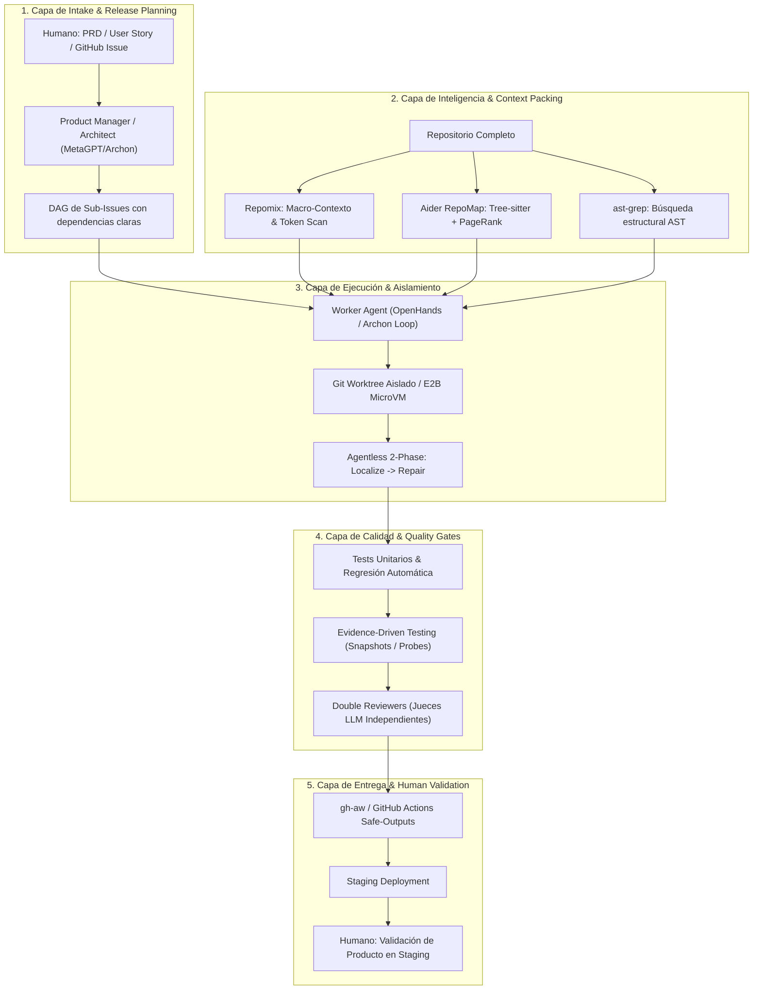

# CANON: Repositorios Clave, Herramientas e Integraciones para la Software Factory Autónoma (SOTA 2026)

> **Documento Canónico de Conocimiento de Arquitectura y Herramientas**  
> **Área:** Autonomous Software Engineering, Multi-Agent Orchestration & SDLC Automation  
> **Estado:** Clonado en Local, Verificado e Ingestado en RAG

---

## 1. El Arsenal de Repositorios Clonados en Local (`references/software-factory/`)

Hemos integrado y analizado 12 repositorios seminales de código abierto que cubren la totalidad del ciclo de vida de una Fábrica de Software de IA:

| Repositorio | Organización / Creador | Estrellas / Sello | Componente en Nuestra Fábrica |
| :--- | :--- | :--- | :--- |
| **`geekan/MetaGPT`** | DeepWisdom | ~55,000 ⭐ | SOPs formales (Standard Operating Procedures), roles estructurados (Product Manager, Architect, Project Manager, Engineer, QA). |
| **`All-Hands-AI/OpenHands`** | Graham Neubig et al. | ~45,000 ⭐ | Entorno de desarrollo agéntico completo: shell, editor, navegador y docker sandboxing. |
| **`SWE-agent/SWE-agent`** | Princeton NLP | ~16,000 ⭐ | ACI (Agent-Computer Interface) optimizada para navegación de código, ventanas de archivo y visualización de errores. |
| **`paul-gauthier/aider`** | Paul Gauthier | ~32,000 ⭐ | **RepoMap** con Tree-sitter + PageRank sobre grafos de dependencias para compactar repositorios enteros. |
| **`OpenAutoCoder/Agentless`** | UIUC | ~3,500 ⭐ | Metodología minimalista de 2 fases: **Localización jerárquica** (archivos $\to$ funciones $\to$ líneas) y **Reparación con re-ranking** de parches. |
| **`github/gh-aw`** | GitHub Next / Microsoft | Tech Preview | Workflows agénticos en Markdown con YAML compilados a GitHub Actions con seguridad sandboxed y `safe-outputs`. |
| **`e2b-dev/E2B`** | E2B Team | ~7,000 ⭐ | MicroVMs Firecracker efímeras (<200ms) para ejecución y testeo seguro de código en la nube. |
| **`michaelshimeles/skills`** | Michael Shimeles / Vercel Labs / Greptile | ~3,000 ⭐ | Arnés de skills de ingeniería: aislamiento en Git Worktrees, arquitectura de dos capas (Actions/Services), testing por evidencia y eliminación de vicios de IA (`unslop`). |
| **`coleam00/Archon`** | Cole Murray | ~4,000 ⭐ | Motor de workflows para agentes con DAGs en YAML, ejecución aislada por worktrees y compatibilidad multi-modelo. |
| **`coleam00/ai-software-factory`** | Cole Murray | ~2,500 ⭐ | Blueprint de Software Factory: pipeline **Issue-to-PR**, con PRDs de alto nivel, validación en staging y gates de doble revisión. |
| **`yamadashy/repomix`** | Kazuki Yamada | ~15,000 ⭐ | Empaquetador de contexto de repositorios líder (XML/Markdown), cálculo exacto de tokens, escaneo de credenciales Secretlint y servidor MCP. |
| **`ast-grep/ast-grep`** | Herrington Darkholme | ~11,000 ⭐ | Búsqueda, linting y refactorización estructural mediante Árboles de Sintaxis Abstracta (AST) políglota. |

---

## 2. Radiografía Profunda: `michaelshimeles/skills`

El repositorio `michaelshimeles/skills` condensa las mejores prácticas operacionales adoptadas por desarrolladores de alto rendimiento con Claude Code, Cursor, Codex y Gemini Antigravity.

### 2.1 El Protocolo de Cuatro Fases (`AGENTS.md`)
1. **Isolate (`/new-feature`):**
   - Prohibido codificar directamente en `main`.
   - Cada tarea se ejecuta en un **Git Worktree aislado** derivado de `origin/main` (`git worktree add`).
   - Chequeo previo de alcance (*Scope Check*): verificar diffs abiertos en otros PRs para prevenir pisado de código.
2. **Build (`/code-structure`):**
   - **Separación Acción / Servicio:**
     - *Actions (Orquestación):* Reglas de negocio del producto, transiciones de estado, autorizaciones, cuándo ejecutar una acción y manejo de errores visibles al usuario.
     - *Services (Mecánica Reutilizable):* Bloques atómicos de capacidades (`createManagedSandbox`, `verifyToken`, `synthesizeSound`), interacción con APIs/SDKs, operaciones idempotentes y resultados estructurados tipados.
     - Regla de oro: *"What this product flow means" $\to$ Action*; *"How to do this operation reliably" $\to$ Service*.
3. **Prove (`/evidence-driven-testing`):**
   - **Tolerancia cero a afirmaciones sin evidencia:** Un agente no puede declarar un fix completado sin presentar pruebas empíricas.
   - Si es UI: capturas antes/después (`before-and-after`), grabaciones de interacción o snapshots de Playwright.
   - Si es API / Backend: pares de salida CLI, métricas medidas (latencia, conteo de llamadas), logs de tests pasando.
   - En corrección de bugs: capturar la falla **antes** de codificar el fix (el "before"), y la verificación pasando **después** (el "after").
4. **Ship (`/before-and-after` + `/greploop` + `/unslop`):**
   - Apertura de PR documentando exactamente qué cambió, cómo se probó, la tabla comparativa de evidencia y los riesgos residuales.
   - `/greploop`: bucle de revisión automática iterativa hasta obtener 0 observaciones pendientes.
   - `/unslop`: desintoxicación de la prosa antes de comunicarse con humanos.

### 2.2 El Protocolo Anti-Vicios de IA: `/unslop`
El módulo `/unslop` ataca los **31 vicios sistemáticos** que delatan el texto generado por LLMs:
- **Puffery y adjetivos inflados:** "A game-changer", "revolutionary", "seamless", "tapestry", "delve".
- **Muletillas de chatbot:** "Sure! Here is the...", "Certainly!", "I hope this helps!".
- **Hedging y tibieza:** "It's important to remember that...", "Some might argue...".
- **Signos y formatos abusivos:** Exceso de guiones largos (`—`), dos puntos usados como conectores en cascada, listas interminables con etiquetas en negrita innecesarias.
- **Voz pasiva y sustantivos abstractos vacíos:** Reemplazados por verbos de acción directa, lenguaje asertivo y directo.

---

## 3. Arquitectura Canónica de una Software Factory Autónoma

Integrando los hallazgos de `Archon`, `ai-software-factory`, `MetaGPT`, `aider`, `Agentless` y `gh-aw`, la arquitectura óptima de una Software Factory se compone de 5 capas:

### 3.1 La Filosofía "Human at the Edges, Factory in the Middle"
- **El Humano en el Intake:** Decide *qué* construir (especificación del PRD, metas de negocio, estándares estéticos).
- **La Fábrica en el Centro:** Desglosa tareas, aisla ramas, contextualiza con AST/PageRank, localiza y repara código, genera tests y corre loops de revisión.
- **El Humano en la Validación (Staging):** Verifica que la experiencia de usuario real cumpla la intención original. Si algo no está perfecto, reingresa al backlog como un issue concreto.

---

## 4. Tecnologías y Herramientas Complementarias para la Fábrica

1. **Empaquetado y Seguridad de Contexto:**
   - **`Repomix`:** Ideal para generar resúmenes completos de la arquitectura sin gastar presupuesto de tokens en archivos binarios o ignores.
   - **`Secretlint`:** Integrado en Repomix para evitar que un agente envíe claves API o secretos en el prompt.

2. **Búsqueda y Transformación Sintáctica:**
   - **`ast-grep`:** Permite encontrar todas las invocaciones a una función o patrón de diseño sin depender de regex propensas a errores.

3. **Ejecución y Sandboxing:**
   - **`Git Worktrees`:** Aislamiento de costo cero en disco local, perfecto para hardware acotado (como notebooks de desarrollo).
   - **`E2B`:** Sandboxes en la nube para ejecutar código inseguro o librerías complejas sin tocar el sistema operativo local.

4. **Automatización Nativa en GitHub:**
   - **`gh-aw`:** Compila instrucciones de agentes a GitHub Actions nativas con permisos granulares (`safe-outputs`), permitiendo que el repositorio se auto-mantenga de forma continua.
