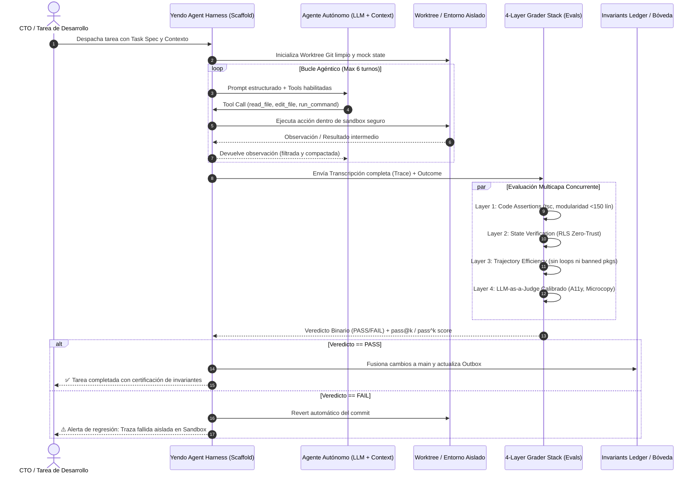

> **Alcance:** Literatura canónica de arquitectura de software, código limpio, TypeScript, validación en el Edge, sistemas distribuidos, videocursos técnicos e ingeniería de agentes IA para la Software Factory Web.

---
version: 1.0.0
tipo: research
tags:
  - yendo-mobile
  - architecture
  - en-progreso
autores: [RESEARCHER_AGENT, MANAGER_AGENT]
ultima_revision: 2026-08-27
---

# 🎓 Masterclass 04: Metodología Harness & Evals Agénticos en Producción

> **Destinatario:** CTO & QA Principal de Yendo (Human-in-the-Loop)  
> **Ubicación Canónica:** `.knowledge/learning/Masterclass_04_Harness_Y_Evals_Agenticos_SOTA.md`  
> **Tema:** Cómo estructurar el andamiaje (Harness) y la batería de evaluación (Evals) para que el equipo multi-agente de Yendo opere con consistencia matemática sin degradar el código de producción.

---

## 🔍 1. Lo que pasa tras bambalinas (La Fontanería de Datos)

En un sistema agéntico profesional, el modelo de IA nunca toca directamente el código de producción sin pasar por un **Agent Harness** que regula sus turnos y un **Evaluation Harness** que audita el resultado.

---

## 🏛️ 2. La Decisión de Arquitectura

*Por qué elegimos esta solución técnica y cuáles fueron las alternativas descartadas (el "Camino C").*

| Criterio | Solución Elegida (Yendo Eval Harness) | Alternativa Tradicional (Vibe Coding) | Alternativa Comercial (SaaS Cerrado) |
| :--- | :--- | :--- | :--- |
| **Criterio de Evaluación** | **Rúbricas Binarias Descompuestas en 4 Capas** (Código, Estado, Traza, Juez Calibrado). | "A ojo" del desarrollador ("parece que funciona en el simulador"). | Dashboards de 1 a 5 no calibrados que没人 entiende qué significa un 3.5. |
| **Aislamiento de Ejecución** | **Git Worktrees locales y Sandboxes con Circuit Breakers** (límites de turnos y tokens). | Agente editando directamente en el working directory del desarrollador. | Contenedores en la nube de alta latencia y costo elevado por ejecución. |
| **Métricas de Confiabilidad** | **`pass^k` para flujos críticos** (probabilidad de que funcione consistentemente $k$ veces seguidas). | Sólo probar una vez (`k=1`) y rezar para que no falle en demo con inversores. | `pass@k` inflado que reporta éxito si el agente acertó 1 vez de cada 10 intentos. |
| **Costo Operativo** | **$0 en infraestructura.** Assertions en Node.js + TypeScript compiler + Groq LPU de juez. | Costos ocultos en horas de refactorización manual por código roto. | $500 a $2,000/mes en plataformas SaaS de observabilidad de LLMs. |

---

## 🥊 3. La Pregunta Trampa del Inversor

> *"Si el 90% de las startups de IA sufren degradación de código y alucinaciones cuando sus agentes operan de forma autónoma, ¿cómo me garantizas que Yendo no está acumulando deuda técnica invisible cada vez que tus agentes commitean código?"*

---

## 🏆 4. Tu Respuesta Maestra como CTO

> *"Las startups que sufren degradación cometen el error de hacer 'Vibe Coding': miden el éxito con una prueba manual de una sola pasada (`k=1`) y evalúan al modelo aislado sin andamiaje.
> 
> En Yendo aplicamos la **Metodología Harness inspirada en SWE-bench y las directivas de Anthropic**: ningún agente escribe directamente en el código de producción. Todo desarrollo ocurre en un **Agent Harness** con límites de 6 turnos y un **Evaluation Harness** con gradación en 4 capas.
> 
> Para que un cambio de agente sea admitido, debe superar de forma determinística nuestro **Invariants Ledger**:
> 1. Cero errores TypeScript (`npx tsc --noEmit`).
> 2. Estricta modularidad (<150 líneas por archivo TSX).
> 3. Políticas RLS Zero-Trust intactas en PostgreSQL.
> 4. `pass^3 = 1.0` en flujos críticos: el agente debe ejecutar la solución 3 veces seguidas sin una sola falla.
> 
> No confiamos en la 'buena voluntad' del LLM; gobernamos su ejecución a través de un andamiaje que hace matemáticamente imposible que el código degradado aterrice en nuestra rama principal."*

---

## Relaciones de Contexto
- [[CANON_HARNESS_Y_EVALS_AGENTICOS_SOTA_2026]]
- [[invariants_ledger]]
- [[YENDO_DNA]]
- [[YENDO_LIBRARY]]
- [[CANON_SRE_RELIABILITY_ZERO_CRASH_2026]]
- [[00_KANBAN_AGENTS]]
- [[AGENTS]]
- [[Supabase]]
