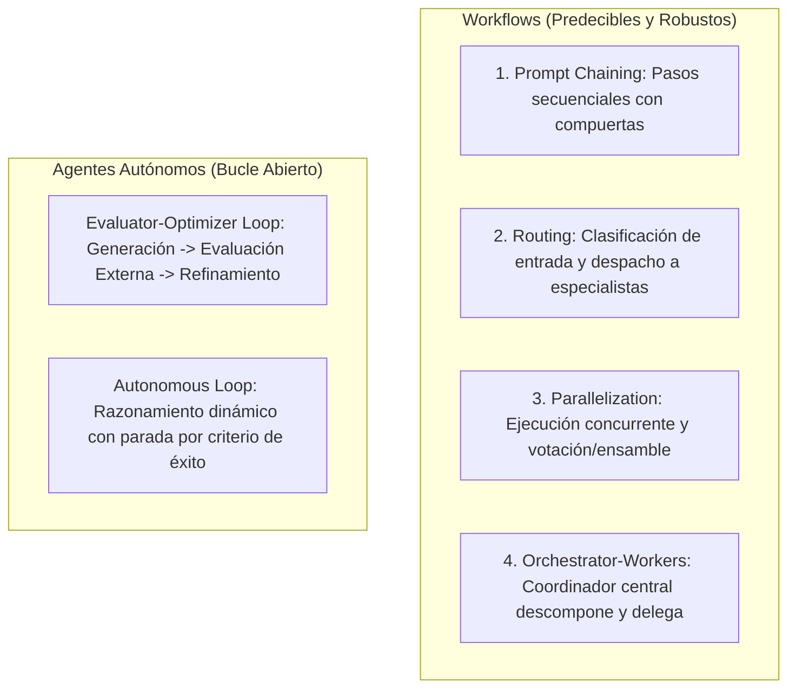
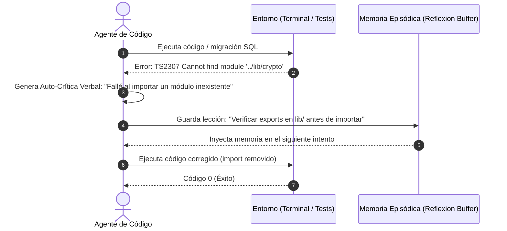

**Alcance:** Compendio de papers fundacionales de IA agéntica (ReAct, Reflexion, Voyager, Generative Agents, DSPy). (Fuente migrada y curada desde Centinela Studio Vault para la Software Factory Web y DiggityBets. NO sustituye las reglas de negocio locales ni los contratos primarios en `CANON_*`).

---
version: 1.0.0
tipo: research
tags:
  - yendo-mobile
  - architecture
  - en-progreso
autores: [RESEARCHER_AGENT, MANAGER_AGENT]
ultima_revision: 2026-08-27
---

# 🧠 Canon de Ingeniería Agéntica 01: Papers Fundacionales y Arquitectura Cognitiva

> **Ubicación Canónica:** `.knowledge/canon_estudio/CANON_AGENTIC_01_FOUNDATIONAL_PAPERS.md`  
> **Área:** Inteligencia Artificial Agéntica, Razonamiento Formal y ACI (Agent-Computer Interfaces).  
> **Fuentes Primarias:** Anthropic Research, Yao et al. (Princeton/Google), Shinn et al. (MIT/Northeastern), Yang et al. (Princeton).

---

## 1. Anthropic: "Building Effective Agents" (Taxonomía Definitiva)

Anthropic establece el principio fundamental de la ingeniería de agentes moderna: **comenzar con el diseño más simple posible y agregar complejidad únicamente cuando el caso de uso lo exija de forma demostrable.**

### 1.1 La Gran Diferencia: Workflows vs Agentes Autónomos
- **Workflows:** Sistemas donde los LLMs y las herramientas están orquestados mediante rutas de código predefinidas y deterministas.
- **Agentes:** Sistemas donde el LLM dirige de forma autónoma su propio flujo de ejecución, decidiendo qué herramientas usar y cuándo dar por concluida la tarea.



### 1.2 Los 5 Patrones de Orquestación Anthropic
1. **Prompt Chaining:** Cadena secuencial donde la salida de un paso es la entrada del siguiente. Clave para tareas con orden rígido (ej. Especificación -> Tipos -> Implementación).
2. **Routing:** Clasifica la intención y la dirige a un prompt o modelo especializado (ej. Router de Yendo que despacha a `CORE_ENGINEERING` o `DATA_PLATFORM`).
3. **Parallelization (Sectioning / Voting):**
   - *Sectioning:* Dividir una tarea grande en partes independientes procesadas en paralelo.
   - *Voting:* Ejecutar el mismo prompt en múltiples instancias y realizar un consenso para maximizar confiabilidad.
4. **Orchestrator-Workers:** Un LLM coordinador analiza la tarea compleja, determina los sub-problemas necesarios, los despacha a agentes trabajadores y sintetiza los resultados.
5. **Evaluator-Optimizer:** Un LLM genera una solución mientras otro LLM (o herramienta determinista como `tsc`) la evalúa contra criterios objetivos y retroalimenta al generador en un bucle cerrado.

---

## 2. ReAct: Sinergia de Razonamiento y Acción (Yao et al., Princeton)

### 2.1 La Falla del Razonamiento Puro y de la Acción Pura
- El razonamiento aislado (*Chain-of-Thought*) genera alucinaciones porque el modelo no tiene contacto con el estado real del sistema.
- La acción aislada (*Action-Only*) ejecuta comandos a ciegas sin formular planes ni interpretar los resultados de las herramientas.

### 2.2 El Bucle ReAct en Yendo
ReAct entrelaza trazas de pensamiento verbal con acciones concretas en un ciclo continuo:
$$\text{Pensamiento (Thought)} \longrightarrow \text{Acción (Action)} \longrightarrow \text{Observación (Observation)}$$

```
Thought: Necesito verificar si la función 'validar_checkin_presencial' valida el IDOR.
Action: grep_search { Query: "validar_checkin_presencial", SearchPath: "supabase/" }
Observation: Line 245: IF v_auth_uid IS DISTINCT FROM p_user_id THEN...
Thought: El guard IDOR está implementado. Ahora debo verificar si la distancia está acotada.
```

---

## 3. Reflexion: Aprendizaje por Refuerzo Verbal (Shinn et al.)

### 3.1 El Mecanismo de Memoria Episódica Lingüística
A diferencia del Fine-Tuning que altera los pesos de la red neuronal, **Reflexion** permite que los agentes aprendan de sus errores en tiempo de ejecución utilizando **retroalimentación lingüística**.



### 3.2 Aplicación al Bloque `REFLECTION` de Yendo
Cada entrega de código finaliza con:
```
REFLECTION
verdict: PASS | FAIL | HANDOFF
rationale: [Explicación concisa y autocrítica técnica]
```
Esto transforma cada fallo en un aprendizaje persistido en el contexto agéntico.

---

## 4. SWE-agent: Agent-Computer Interfaces (ACI) (Yang et al., Princeton)

### 4.1 Por qué los LLMs Fallan con Interfaces Unix Clásicas
El paper de SWE-agent demuestra que las herramientas de terminal diseñadas para humanos (`bash`, `grep`, `sed`, `vim`) son ineficientes para los LLMs:
- Producen salidas desbordadas que saturan la ventana de contexto.
- Propician errores de sintaxis al intentar editar archivos completos.

### 4.2 Principios de Diseño ACI:
1. **Salidas Acotadas (Poka-Yoke):** Limitar las lecturas a un máximo de 100-300 líneas por vista con numeración explícita (`view_file` con rangos de línea).
2. **Edición Quirúrgica:** Reemplazo de bloques únicos basados en coincidencia exacta (`replace_file_content`), erradicando las sobreescrituras ciegas de archivos enteros.
3. **Linter Pasivo Inmediato:** Tras cada modificación de código, el sistema debe disparar un chequeo de sintaxis inmediato (`npx tsc --noEmit` o linter) para advertir al agente antes de que tome la siguiente acción.

---

## Relaciones de Contexto
- [[AGENTIC_WORKFLOW_MASTER_PROTOCOL]]
- [[YENDO_DNA]]
- [[CANON_AGENTIC_02_FRAMEWORKS_ORCHESTRATION]]
- [[CANON_AGENTIC_03_SOTA_OPEN_SOURCE_AND_TOOLING]]
- [[CANON_AGENTIC_04_DESCUBRIMIENTOS_Y_EVOLUCION_YENDO]]
- [[Masterclass_Septiembre_2026_Sintesis_Maestra]]
- [[YENDO_LIBRARY]]
- [[Supabase]]
