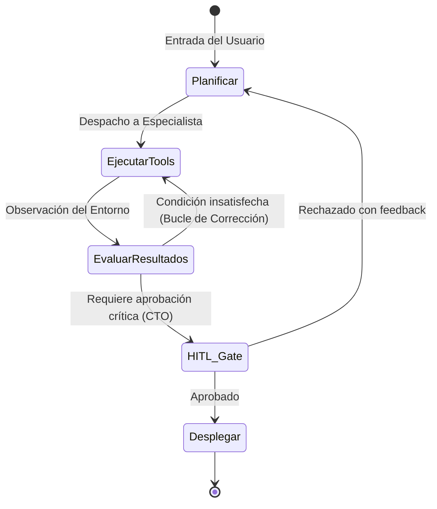

**Alcance:** Arquitectura de orquestación multi-agente, máquinas de estados deterministas y protocolos de delegación. (Fuente migrada y curada desde Centinela Studio Vault para la Software Factory Web y DiggityBets. NO sustituye las reglas de negocio locales ni los contratos primarios en `CANON_*`).

---
version: 1.0.0
tipo: research
tags:
  - yendo-mobile
  - architecture
  - en-progreso
autores: [RESEARCHER_AGENT, MANAGER_AGENT]
ultima_revision: 2026-08-27
---

# ⚙️ Canon de Ingeniería Agéntica 02: Frameworks de Orquestación y Grafos de Estado

> **Ubicación Canónica:** `.knowledge/canon_estudio/CANON_AGENTIC_02_FRAMEWORKS_ORCHESTRATION.md`  
> **Área:** Frameworks SOTA de Inteligencia Artificial Agéntica.  
> **Tecnologías:** LangGraph (LangChain), DSPy (Stanford), smolagents (Hugging Face), CrewAI.

---

## 1. LangGraph: Grafos de Estado Cíclicos y Persistencia

LangGraph reemplaza los grafos acíclicos dirigidos (DAGs) tradicionales de cadenas lineales por **grafos de estado cíclicos** indispensables para agentes que deben iterar hasta satisfacer una condición de éxito.



### 1.1 Conceptos Fundamentales de LangGraph:
1. **State (Pizarra Compartida):** Un esquema tipado (en TypeScript/Python) que todos los nodos leen y mutan mediante funciones reductoras puras (similar al patrón Redux/Zustand).
2. **Nodes (Nodos de Computación):** Agentes o funciones que reciben el estado actual y emiten un parche de actualización.
3. **Conditional Edges (Aristas Condicionales):** Funciones de enrutamiento que deciden el siguiente nodo en base al estado (ej: si hay error de TypeScript, transicionar a `SELF_HEAL`; si compila, transicionar a `QA_VERIFY`).
4. **Checkpointers & Time-Travel:** Persistencia automática del estado en cada paso en PostgreSQL/SQLite. Permite pausar la ejecución, inspeccionar el historial y "viajar en el tiempo" para bifurcar el razonamiento.
5. **Human-in-the-Loop (HITL):** Puntos de interrupción (*interrupts*) donde el grafo suspende su ejecución hasta recibir la aprobación o el feedback del CTO.

---

## 2. DSPy: Programación y Auto-Optimización de Prompts (Stanford NLP)

DSPy (**D**eclarative **S**equencing with **Py**thon) establece el fin del "Prompt Engineering" artesanal, reemplazándolo por **compilación algorítmica de instrucciones y ejemplos**.

### 2.1 Los Tres Pilares de DSPy:
1. **Signatures (Firmas Tipadas):** Declaran *qué* debe hacer el módulo sin especificar el prompt detallado.
   ```python
   class ClassifyVenueAcoustics(dspy.Signature):
       """Clasifica el confort acústico de un local en decibelios y categoría."""
       venue_description = dspy.InputField(desc="Reseñas, fotos y tipo de música del local")
       decibel_estimate = dspy.OutputField(desc="Estimación numérica de decibelios (<=72 dB o >72 dB)")
       category = dspy.OutputField(desc="Conversacional, Moderado o Ruidoso")
   ```
2. **Modules (Módulos de Razonamiento):** Estructuras parametrizables como `dspy.Predict`, `dspy.ChainOfThought` o `dspy.ReAct`.
3. **Teleprompters / Optimizers (Optimizadores Algorítmicos):**
   - **BootstrapFewShot:** Selecciona y formatea automáticamente los mejores ejemplos reales del dataset donde el agente tuvo éxito.
   - **MIPROv2 (Multi-prompt Instruction PRoposal Optimizer v2):** Genera hipótesis de prompts, optimiza conjuntamente las instrucciones y los ejemplos few-shot, y evalúa cientos de variantes contra una métrica de código o test unitario.

---

## 3. Hugging Face `smolagents`: La Revolución de los Code Agents

El paper y la biblioteca `smolagents` de Hugging Face demuestran que **forzar a los LLMs a generar JSONs estructurados para llamar a herramientas es un cuello de botella innecesario**.

### 3.1 CodeAgent vs ToolCallingAgent:

| Criterio | ToolCallingAgent (JSON tradicional) | CodeAgent (`smolagents` / Código puro) |
| :--- | :--- | :--- |
| **Acción** | Emite un string JSON: `{"tool": "fetch", "args": {...}}` | Escribe un fragmento de código ejecutable: `res = fetch(...)` |
| **Estructuras de Control** | No soporta bucles ni variables intermedias en un turno. | Soporta `for`, `while`, `if`, listas por comprensión y variables. |
| **Consumo de Tokens** | Alto overhead por llaves y estructuras JSON anidadas. | **~30% menos tokens** y menor latencia en benchmarks. |
| **Composición** | Requiere múltiples turnos de ida y vuelta para encadenar tools. | Encadena 4 herramientas en una sola ejecución en memoria. |

```python
# Ejemplo de acción en CodeAgent (smolagents):
venues = search_venues(neighborhood="Palermo")
quiet_venues = [v for v in venues if v.decibels <= 72]
table = reserve_table(venue=quiet_venues[0], quorum=4)
print(f"Mesa reservada: {table.id}")
```

---

## 4. CrewAI: Delegación Jerárquica y Gestión de Memoria

CrewAI modela equipos de agentes autónomos replicando la estructura de empresas humanas de ingeniería:
1. **Roles y Objetivos Claros:** Cada agente tiene un `Role`, un `Goal` y un `Backstory` que acota su espacio de búsqueda.
2. **Delegación Jerárquica:** El agente Manager descompone los requerimientos y delega tareas a los desarrolladores o auditores sin que los subordinados hablen entre sí de forma caótica.
3. **Memoria Tripartita:**
   - *Memoria a Corto Plazo:* Contexto de la tarea en ejecución.
   - *Memoria a Largo Plazo:* Almacenamiento persistente en base de datos vectorial para recordar éxitos pasados.
   - *Memoria de Entidades:* Información clave sobre conceptos recurrentes del negocio (ej. Dunbar, RevPASH, Palermo).

---

## Relaciones de Contexto
- [[AGENTIC_WORKFLOW_MASTER_PROTOCOL]]
- [[CANON_AGENTIC_01_FOUNDATIONAL_PAPERS]]
- [[CANON_AGENTIC_03_SOTA_OPEN_SOURCE_AND_TOOLING]]
- [[CANON_AGENTIC_04_DESCUBRIMIENTOS_Y_EVOLUCION_YENDO]]
- [[Masterclass_Septiembre_2026_Sintesis_Maestra]]
- [[YENDO_DNA]]
- [[YENDO_LIBRARY]]
- [[Zustand]]
- [[Número de Dunbar]]
