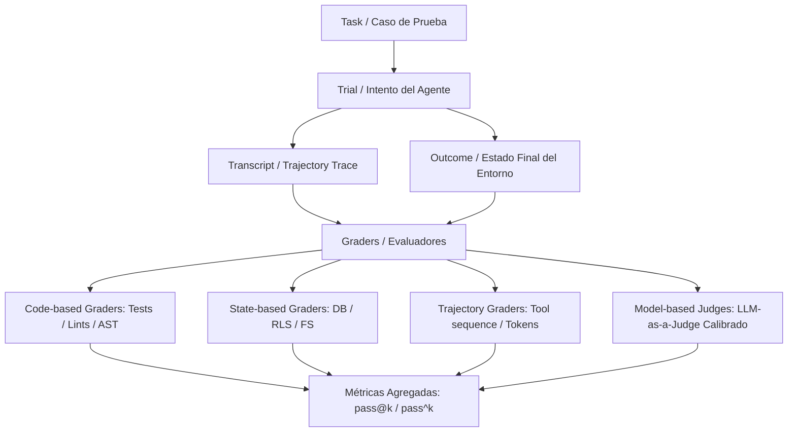

**Alcance:** Matrices de evaluación agéntica (pass@k, Hit@5, MRR), jueces deterministas y puertas de calidad automatizadas. (Fuente migrada y curada desde Yendo Mobile Vault para la Software Factory Web y DiggityBets. NO sustituye las reglas de negocio locales ni los contratos primarios en `CANON_*`).

---
version: 1.0.0
tipo: research
tags:
  - yendo-mobile
  - architecture
  - en-progreso
autores: [RESEARCHER_AGENT, MANAGER_AGENT]
ultima_revision: 2026-08-27
---

# 🛡️ TRATADO CANÓNICO: METODOLOGÍA DE AGENT HARNESS & EVALS SISTÉMICOS (SOTA 2026)

## 1. Fundamentos y Taxonomía: Harness vs. Evals
En la ingeniería de sistemas multi-agente de frontera (Frontier Agentic Systems), existe una confusión recurrente entre el **Harness** y los **Evals**. Este canon establece la distinción epistemológica y operativa definitiva:

### 1.1 El Agent Harness (Scaffold de Ejecución)
El **Agent Harness** (o Scaffold) es la infraestructura de software que envuelve y empodera a un LLM para actuar como un agente autónomo en el mundo real. Provee:
- **Gestión del Bucle de Pensamiento/Acción:** Turn loop (ReAct, Reflexion, Plan-and-Solve) controlando el ciclo `Input -> Reasoning -> Tool Call -> Observation -> Decision`.
- **Aislamiento de Entorno y Sandboxing:** Worktrees de Git, contenedores Docker efímeros o sandboxes en microVM (E2B, Firecracker), evitando contaminación de estado entre pruebas.
- **Inyección de Contexto JIT y Herramientas:** Provisión de herramientas tipadas (vía MCP o APIs nativas), gestión de memoria de corto/largo plazo y compactación de contexto.
- **Defensas y Circuit Breakers:** Timeouts de ejecución, topes de presupuesto de tokens, límites de turnos (max turns) y trampas de bucles infinitos.

> **Regla de Oro (arXiv:2605.23950):** *Nunca se evalúa un modelo aislado; siempre se evalúa la combinación indisoluble de `[Modelo + Harness]`. Un modelo inferior en un Harness superior supera holgadamente a un modelo de frontera en un Harness deficiente.*

### 1.2 El Evaluation Harness (Orquestador de Pruebas)
Es la plataforma que ejecuta evaluaciones de extremo a extremo:
- Inicializa entornos limpios a partir de fixtures predecibles (semillas de base de datos, repositorios en un commit específico).
- Despacha los agentes concurrentemente sobre un banco de problemas calibrados.
- Registra la transcripción completa (Trajectory / Trace).
- Aplica gradadores (Graders) sobre el resultado y el proceso.
- Computa métricas agregadas (`pass@k`, `pass^k`, latencia, consumo de tokens, costo).

---

## 2. Anatomía de un Eval Agéntico Moderno

De acuerdo con el estándar formalizado por Anthropic Engineering (2026), SWE-bench (Princeton) y Hamel Husain, una evaluación agéntica se compone de seis primitivas:

1. **Task (Problema / Caso de Prueba):** Unidad atómica con descripción del objetivo, entradas controladas, estado inicial congelado y criterios de éxito no ambiguos.
2. **Trial (Intento):** Una ejecución individual de una tarea. Dado el no-determinismo de los LLMs, cada tarea se ejecuta $N$ veces para obtener significancia estadística.
3. **Transcript / Trajectory (Traza):** Registro cronológico inmutable de todos los mensajes, tool calls, parámetros, resultados intermedios, tokens consumidos y llamadas al sistema.
4. **Outcome (Resultado Ambiental):** Estado real del entorno al finalizar la tarea (ej. si el registro existe en la base de datos PostgreSQL, si el archivo compila sin errores TypeScript, si el componente renderiza a 120 FPS).
5. **Graders (Gradadores / Evaluadores):** Lógica que puntúa dimensiones específicas del desempeño.
6. **Métricas Estadísticas:**
   - **`pass@k`:** Probabilidad de que el agente acierte **al menos una vez** en $k$ intentos. Crucial para tareas exploratorias o de generación de ideas.
   - **`pass^k`:** Probabilidad de que el agente acierte **todas las $k$ veces** de forma consistente: $(P_{éxito})^k$. Métrica reina para flujos de misión crítica (pagos, biometría, migraciones de base de datos).

---

## 3. Taxonomía de Gradadores en 4 Capas (The 4-Layer Grader Stack)

Para erradicar la fragilidad de evaluar con un único método, Yendo adopta el enfoque multicapa:

| Capa de Gradación | Mecanismo | Fortalezas | Cuándo Usarlo en Yendo |
| :--- | :--- | :--- | :--- |
| **Capa 1: Código Determinista (Code-based)** | Tests unitarios, `tsc --noEmit`, linters, escaneo AST, regex de invariantes. | Rápido, costo $0, 100% reproducible, sin sesgos. | Compilación TypeScript, respeto de `INV_MODULARITY_150`, chequeo anti-alucinación de imports. |
| **Capa 2: Estado Ambiental (State-based)** | Verificación de esquemas SQL, políticas RLS en PostgreSQL, fixtures en SQLite/MMKV. | Comprueba si el cambio tuvo efecto real y seguro en los datos. | Migraciones de base de datos, persistencia del Token Ledger (Y$), consistencia PostGIS. |
| **Capa 3: Calidad de Traza (Trajectory-based)** | Eficiencia de turnos ($N \le 6$), llamadas a herramientas correctas, no uso de librerías proscriptas. | Evita que el agente resuelva el problema haciendo trampa o desperdiciando $10 en tokens. | Auditoría de pasos de agentes, invocación obligatoria de `ragHook.js`, evitación de bucles de retry. |
| **Capa 4: Modelo Calibrado (LLM-as-a-Judge)** | Rúbrica binaria (Pasa/Falla) evaluada con LLM (Groq LPU / Gemini 2.5) previamente calibrado por el CTO. | Captura matices subjetivos, tono, elegancia y UX que el código no puede medir. | Calidad del microcopy rioplatense, apego estético al YDS, claridad de PR reviews y explicaciones. |

---

## 4. Metodología de Implementación: De Prototipo a Producción

Siguiendo el marco de Hamel Husain (*Critique Shadowing*) y Anthropic:

### Fase 1: Evitar las Métricas Basura (Anti-Patterns)
- ❌ **Prohibido el uso de escalas 1 a 5 no calibradas:** "¿Qué diferencia un 3 de un 4 en elegancia de código?". Crea dispersión estadística y desacuerdo inter-juez.
- ✅ **Adoptar Rúbricas Binarias Descompuestas:** Dividir una evaluación compleja en afirmaciones booleanas concretas:
  - `[PASS/FAIL]` ¿El componente utiliza exclusivamente tokens de `theme.ts`?
  - `[PASS/FAIL]` ¿El botón principal mide al menos 48dp de alto?
  - `[PASS/FAIL]` ¿El archivo tiene menos de 150 líneas?

### Fase 2: Calibración Humana (Human-in-the-Loop)
El CTO o Principal Domain Expert calibra un lote inicial de 25-50 transcripciones. El LLM-as-a-judge se ajusta (prompts, few-shot examples) hasta que su acuerdo con el CTO supere el **Cohen's Kappa ($\kappa \ge 0.85$)** o una tasa de verdaderos positivos/negativos (TPR/TNR) $\ge 90\%$.

### Fase 3: Evals de Capacidad vs. Evals de Regresión
- **Capability Evals (Colina a Escalar):** Tareas complejas donde los agentes actualmente tienen una tasa de éxito baja (20%-40%). Ejemplo: *Refactorizar automáticamente un componente monolítico de 600 líneas en 4 submódulos sin romper Reanimated worklets ni provocar re-renders en React 19*. Sirve para medir el impacto de nuevos modelos (Gemini 2.5, Claude 3.7, GPT-5) o nuevos prompts.
- **Regression Evals (Guardia de Contención):** Tareas que ya están resueltas al 95%-100%. Corren en CI/CD en cada commit o Pull Request para asegurar que ninguna optimización introduzca efectos secundarios o roturas silenciosas.

---

## 5. Aplicación al Sistema Multi-Agente de Yendo

| Squad | Banco de Tareas de Evaluación (Eval Benchmark) | Grader Primario | Criterio Inviolable |
| :--- | :--- | :--- | :--- |
| **CORE_ENGINEERING_SQUAD** | Creación y refactor de componentes TSX y Hooks. | Determinista (`tsc`, AST, eslint). | Archivos `< 150` líneas, cero imports circulares, tipos estrictos código 0. |
| **VISUAL_EXPERIENCE_SQUAD** | Layouts visuales, animaciones y gestos móviles. | Visual Pixelmatch + AST Worklets. | Físicas ejecutadas en UI Thread (`'worklet'`), `minTouchTarget >= 48dp`, tokens de color YDS. |
| **DATA_PLATFORM_SQUAD** | Esquemas PostgreSQL, RLS policies y Supabase RPCs. | State Check en PostgreSQL de prueba. | RLS Zero-Trust (`auth.uid()`), idempotencia en migraciones, transacciones atómicas. |
| **QUALITY_RELIABILITY_SQUAD** | Suites E2E Playwright E2E y preflight checks. | Playwright E2E CLI Runner + Exit Code. | Flujo de usuario simulado completado en emulador sin crash (`pass^3 = 1.0`). |
| **PRODUCT_STRATEGY_SQUAD** | Modelado de quórums, pricing y métricas RevPASH. | LLM-as-a-Judge con rúbrica B2B. | Núcleo Dunbar estricto (4 a 6 personas), viabilidad económica comprobada. |
| **HUMAN_EXPERIENCE_SQUAD** | Microcopy, accesibilidad y onboarding. | LLM-as-a-Judge de Localización + A11y. | Léxico rioplatense orgánico (cero lenguaje ibérico/neutro), contraste WCAG 2.2 AAA. |

---

## 6. Bibliografía Canónica, Papers y Recursos Formativos

### 📚 Papers Fundacionales
1. **SWE-bench:** *SWE-bench: Can Language Models Resolve Real-World GitHub Issues?* — Carlos E. Jimenez, John Yang, Alexander Wettig, Shunyu Yao, Kexin Pei, Ofir Press, Karthik Narasimhan (Princeton NLP / ICLR, 2024).
2. **SWE-agent:** *SWE-agent: Agent-Computer Interfaces Enable Automated Software Engineering* — John Yang, Carlos E. Jimenez, et al. (Princeton University, 2024).
3. **Anthropic Engineering:** *Demystifying Evals for AI Agents* — Mikaela Grace, Jeremy Hadfield, Rodrigo Olivares, Jiri De Jonghe et al. (Anthropic Research, 2026).
4. **MT-Bench / LMSYS:** *Judging LLM-as-a-Judge with MT-Bench and Chatbot Arena* — Lianmin Zheng et al. (UC Berkeley / Large Model Systems Organization, 2023).
5. **Harness Disclosures:** *Stop Comparing LLM Agents Without Disclosing the Harness* — (arXiv:2605.23950, 2026).
6. **Agent Eval Standardization:** *Towards More Standardized AI Evaluation: From Models to Agents* — A. E. Filali et al. (arXiv:2602.18029, 2026).

### 📖 Libros y Guías de Campo
1. **Chip Huyen:** *AI Engineering: Foundation Models and System Design* (O'Reilly, 2025/2026) — Capítulos 7 y 8 sobre Evaluación de Sistemas Agénticos y Guardrails.
2. **Hamel Husain:** *Your AI Product Needs Evals* & *Using LLM-as-a-Judge For Evaluation: A Complete Guide* (hamel.dev).
3. **Eugene Yan:** *Patterns for Building LLM-based Systems & Products* (eugeneyan.com) — Taxonomía de Graders y Evaluación Continua.

### 🎓 Cursos y Repositorios Abiertos
1. **DeepLearning.AI:** *Automated Testing for LLMOps* (en colaboración con Confident AI / DeepEval).
2. **Benchflow AI:** *Awesome-Evals* (`github.com/benchflow-ai/awesome-evals`) — Repositorio curado de benchmarks, datasets y evaluadores.
3. **EleutherAI:** *LM Evaluation Harness* (`github.com/EleutherAI/lm-evaluation-harness`) — El estándar de la industria para tests automatizados.

---

## Relaciones de Contexto
- [[YENDO_DNA]]
- [[YENDO_LIBRARY]]
- [[invariants_ledger]]
- [[00_KANBAN_AGENTS]]
- [[CYBERSECURITY_MASTER_PROTOCOL]]
- [[CANON_SRE_RELIABILITY_ZERO_CRASH_2026]]
- [[CANON_SOFTWARE_ENGINEERING_AT_GOOGLE]]
- [[AGENTS]]
- [[Número de Dunbar]]
- [[PostGIS]]
- [[Supabase]]
- [[Reanimated]]
