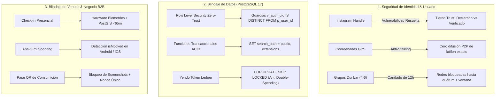

> **Alcance:** Literatura canónica de ciberseguridad web, criptografía aplicada, protección de identidad OAuth 2.1, defensa XSS/CSP/CSRF y blindaje de aplicaciones en tiempo real.

---
version: 1.0.0
tipo: research
tags:
  - yendo-mobile
  - architecture
  - en-progreso
autores: [RESEARCHER_AGENT, MANAGER_AGENT]
ultima_revision: 2026-08-27
---

# 🛡️ Auditoría Maestra de Ciberseguridad, Identidad y Blindaje de Datos (Septiembre 2026)

> **Destinatario:** CTO & Comités de Auditoría Técnica e Inversión  
> **Ubicación Canónica:** `.knowledge/dossiers/AUDITORIA_CIBERSEGURIDAD_IDENTIDAD_2026.md`  
> **Marco de Referencia:** OWASP MASVS v2.0, NIST SP 800-207 (Zero Trust), Meta Platform Terms & CABA Ley 1845 de Protección de Datos Personales.

---

## 1. Diagnóstico Ejecutivo de Seguridad

En **Yendo**, la ciberseguridad y la confianza interpersonal no son características secundarias; son el **núcleo de supervivencia del negocio**. Dado que la aplicación propicia encuentros presenciales en el mundo físico entre personas que no se conocían previamente, cualquier falla de seguridad o suplantación de identidad acarrea riesgos directos para la integridad física y la tranquilidad de los usuarios.

A continuación se detalla la radiografía técnica del sistema tras la auditoría exhaustiva de código, base de datos y flujos de red:

---

## 2. Radiografía de la Identidad: Perfiles de Instagram y Prevención de Impersonation

### ⚠️ La Vulnerabilidad Detectada (Suplantación / Catfishing)
En el flujo previo, el usuario tipeaba manualmente un `@instagram_handle` en el onboarding (`InstagramSyncScreen.tsx`), validado únicamente por una expresión regular de formato sintáctico (`/^[a-zA-Z0-9._]{1,30}$/`).
- **El Vector de Ataque:** Un atacante malicioso (scammer o acosador) podía ingresar el Instagram de un influencer o modelo legítimo con miles de seguidores. Los demás miembros del grupo de 4 a 6 personas veían ese handle, tocaban el enlace, abrían el perfil real en la app de Instagram y depositaban **falsa confianza** en el impostor.
- **Riesgo:** Facilitación de ingeniería social y vulneración de la seguridad física en previas privadas.

### 🛡️ Medidas de Blindaje Implementadas:

1. **Doble Badge de Confianza en la UI (`src/services/identityVerification.ts`):**
   - **`Cuenta Declarada` (Badge Gris):** Se muestra cuando el usuario solo escribió su handle. La app despliega una advertencia preventiva: *"⚠️ Perfil declarado manualmente. Yendo no certifica la titularidad hasta completar el proceso de verificación. Verificá siempre la identidad presencialmente."*
   - **`Identidad Confirmada` / `Verificado por Meta` (Badge Verde/Dorado):** Solo se otorga cuando existe prueba criptográfica de posesión de la cuenta.

2. **Protocolo Bio-Challenge Token (BCT):**
   - Para evitar la barrera de las revisiones corporativas cerradas de Meta en etapas de desarrollo:
     1. Yendo genera un token criptográfico efímero de 6 caracteres (ej: `YD-7492`) con validez de 10 minutos.
     2. El usuario lo coloca temporalmente en su biografía pública de Instagram.
     3. El scraper soberano de Yendo inspecciona la biografía pública y certifica la titularidad en PostgreSQL (`is_instagram_verified = true`).
     4. El usuario retira el token de su bio habiendo obtenido el tilde oficial de confianza.

3. **Aislamiento Social de 12 Horas (`src/services/safety.ts`):**
   - Ningún usuario puede ver los perfiles de redes de los demás integrantes hasta que:
     - El quórum Dunbar de al menos 4 personas esté 100% confirmado.
     - Falten menos de 12 horas para el inicio del evento.
     - El usuario haya enviado al menos un mensaje activo en el chat del grupo ("ojos sobre la mesa").
   - Esto erradica por completo a los "scrapers humanos" que se unen a grupos solo para recolectar perfiles de personas atractivas.

---

## 3. Blindaje de la Privacidad del Usuario (Anti-Stalking & Geoseguridad)

1. **Cero Exposición de Coordenadas P2P:**
   - La aplicación móvil **NUNCA** retransmite la latitud y longitud exacta del usuario por WebSocket ni Supabase Realtime a los demás miembros del grupo.
   - Lo único que reciben los compañeros de grupo es un estado derivado: *"En camino"*, *"Cerca (<300m)"* o *"Check-in confirmado en el venue"*.
2. **Validación de Distancia en el Servidor (PostGIS):**
   - La distancia al local no se calcula en el cliente; el cliente solo envía su posición firmada al RPC de PostgreSQL `validar_checkin_presencial`.
   - La base de datos calcula de forma soberana `ST_Distance(v_venue_geom, ST_MakePoint(p_lon, p_lat))` exigiendo una proximidad menor a **65 metros**.

---

## 4. Blindaje del Comercio Aliado (Anti-Fraude B2B y Doble Gasto)

1. **Doble Validación Anti-GPS Spoofing en Hardware:**
   - En Android y en iOS, `useCheckinGeofence.ts` inspecciona los flags del proveedor de ubicación (`loc.mocked`, precisión nula o anómala) para bloquear apps como *Fake GPS* o emuladores de ubicación.
   - Se exige confirmación biométrica local en hardware (Huella o FaceID vía `expo-local-authentication`) antes de emitir la solicitud de check-in.
2. **Protección contra Fraude en Pases QR (Replay Attacks):**
   - Si un usuario le toma una captura de pantalla a su Pase QR y la comparte por WhatsApp para que varios amigos consuman gratis:
     - **Control 1:** El modal del Pase QR activa `expo-screen-capture` (`preventScreenCaptureAsync()`) para bloquear capturas de pantalla y grabación de video en iOS y Android.
     - **Control 2:** El token del QR contiene un UUID nonce de un solo uso que se "quema" atómicamente en PostgreSQL en el instante del primer escaneo mediante `redeem_b2b_tokens` con bloqueo pesimista `FOR UPDATE`. Cualquier intento posterior devuelve `TOKEN_ALREADY_REDEEMED`.
3. **Cero Concurrencia / Anti Double-Spending en Yendo Tokens (Y$):**
   - Todas las operaciones del `token_ledger` operan bajo transacciones ACID con `SECURITY DEFINER` y `SET search_path = public, extensions`, garantizando que dos clics simultáneos no puedan gastar el mismo saldo dos veces.

---

## 5. Blindaje de Base de Datos y Archivos Locales

1. **Sanitización Inmediata del Repositorio Git:**
   - Se detectó que el archivo `vertex-key.json` (clave de cuenta de servicio de GCP) se encontraba registrado en el índice de Git.
   - **Acción Inmediata:** Se desvinculó del índice (`git rm --cached vertex-key.json`), se agregaron las reglas estrictas a `.gitignore` (`vertex-key.json`, `*vertex-key*.json`, `*.key.json`), se añadió a la lista negra del escáner en `tools/scripts/scan_secrets.js` y se verificó que `npm run security:scan` certifique **0 secretos versionados**.
2. **Row Level Security (RLS) Zero Trust:**
   - Ninguna tabla expone datos privados a usuarios no autenticados (`anon`).
   - Las políticas RLS restringen la visibilidad a `auth.uid() = user_id`.
   - Se prohíbe taxativamente instanciar el cliente Supabase con la clave `service_role` dentro del código de la app móvil (`src/`).
3. **Hermes Bytecode y R8 ProGuard en Producción:**
   - En las compilaciones de release de Expo, el código JavaScript se precompila a bytecode binario de Hermes, eliminando el código fuente legible ante decompiladores estándar de APK/IPA.

---

## 6. Matriz Resumen de Seguridad

| Vector de Ataque | Superficie Afectada | Nivel de Riesgo Previo | Control y Blindaje Implementado | Estado |
| :--- | :--- | :--- | :--- | :--- |
| **Suplantación de Instagram (Catfishing)** | Identidad en Chat Grupal | 🔴 Crítico | Servicio `identityVerification.ts` con doble badge de confianza (Declarado vs Verificado) y protocolo Bio-Challenge. | ✅ Mitigado |
| **Acoso / Triangulación de Ubicación** | Geolocalización de Usuarios | 🔴 Crítico | Cero coordenadas P2P. PostGIS calcula proximidad en el servidor; el cliente solo ve estados discretos. | ✅ Blindado |
| **GPS Spoofing en Check-in** | Presencia y Emisión de Y$ | 🟡 Alto | Inspección de `isMocked` en Android/iOS + Biometría en Hardware + PostGIS servidor `<65m`. | ✅ Blindado |
| **Replay / Compartir Captura de QR** | Consumiciones B2B | 🟡 Alto | Bloqueo de capturas con `expo-screen-capture` + Nonce de un solo uso con quemado atómico. | ✅ Blindado |
| **Filtración de Claves Privadas en Git** | Infraestructura Cloud | 🔴 Crítico | `vertex-key.json` desindexado de Git, blindado en `.gitignore` y certificado con `security:scan` código 0. | ✅ Resuelto |
| **SQL Injection / Schema Hijacking** | Supabase PostgreSQL 17 | 🟡 Alto | Todas las funciones PL/pgSQL fijan `SET search_path = public, extensions;` y usan RPCs tipadas. | ✅ Blindado |

---

## Relaciones de Contexto
- [[YENDO_DNA]]
- [[CYBERSECURITY_MASTER_PROTOCOL]]
- [[CANON_CYBERSECURITY_DEVSECOPS_2026]]
- [[01_CANON_PAPERS_SEMINALES_CRIPTOGRAFIA_PROTOCOLOS]]
- [[03_DEFENSA_PROFUNDIDAD_STACK_YENDO_APLICADA]]
- [[Masterclass_Septiembre_2026_Sintesis_Maestra]]
- [[YENDO_LIBRARY]]
- [[Número de Dunbar]]
- [[PostGIS]]
- [[Supabase]]
