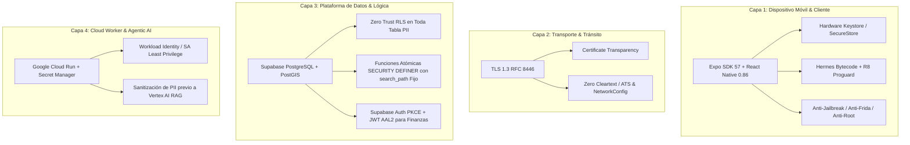

# 🛡️ PROTOCOLO MAESTRO DE CIBERSEGURIDAD YENDO (Zero Trust & App Integrity)

## 1. Declaración Constitucional de Seguridad
En **Yendo**, la ciberseguridad no es una capa añadida al final del ciclo de vida; es un **invariante arquitectónico inviolable**. 
Dado que Yendo gestiona identidades humanas, geolocalización en tiempo real y encuentros presenciales en el mundo físico entre personas previamente desconocidas (Terceros Lugares), un compromiso de seguridad no es simplemente un fallo técnico de software: **es un riesgo directo para la integridad física y la privacidad de nuestros usuarios**.

Todo código, pull request, migración de base de datos o pipeline de agente DEBE contrastarse y validarse de forma obligatoria contra las directivas de este documento antes de su aprobación o despliegue.

---

## 2. Los Cuatro Pilares Inviolables de Defensa en Profundidad

---

## 3. Modelo de Amenazas y Controles Mandatorios (Threat Model)

### 3.1 Cliente Móvil (OWASP MASVS v2.0 Compliance)
1. **Almacenamiento de Credenciales (MASVS-STORAGE):**
   - **Prohibido:** Almacenar tokens JWT, refresh tokens, datos bancarios o PII no anonimizada en `AsyncStorage`, `localStorage` web o `MMKV` sin cifrar.
   - **Mandatorio:** Usar exclusivamente `expo-secure-store` / Keychain (iOS) y EncryptedSharedPreferences / Android Keystore con respaldo en hardware criptográfico (Secure Enclave / StrongBox).
2. **Integridad del Binario y Código (MASVS-CODE):**
   - Ofuscación y optimización forzada vía ProGuard / R8 en release builds.
   - Compilación exclusiva a bytecode de Hermes (cero JavaScript plano en el asset bundle de producción).
   - Bloqueo de screenshots en pantallas críticas (entradas digitales, QR dinámico, pases de seguridad) mediante `expo-screen-capture`.
3. **Comunicaciones y Red (MASVS-NETWORK):**
   - Enlace estricto a HTTPS con TLS 1.3 (`RFC 8446`). 
   - Prohibido tráfico HTTP no cifrado (`cleartextTrafficPermitted="false"` en `network_security_config.xml` y exclusión de excepciones en `Info.plist` de iOS ATS).

### 3.2 Backend y Base de Datos (Supabase Zero Trust & NIST SP 800-207)
1. **Row-Level Security (RLS) Obligatorio:**
   - Ninguna tabla puede crearse sin `ALTER TABLE ... ENABLE ROW LEVEL SECURITY;`.
   - Políticas explícitas `RESTRICTIVE` o `PERMISSIVE` basadas exclusivamente en el contexto del token firmado `auth.uid()`.
   - Prohibición del uso de `service_role` en el cliente móvil. Cualquier intento de instanciar un cliente de Supabase con `service_role` en `src/` activa bloqueo automático por el Safety Gate.
2. **Defensa contra SQL Injection en RPCs y Funciones PL/pgSQL:**
   - Toda función PostgreSQL debe especificar `SET search_path = public, pg_temp;` para evitar secuestro de esquemas.
   - Uso de sentencias parametrizadas y funciones atómicas (ej. `join_group_atomic`) con bloqueos explícitos (`FOR UPDATE`) para evitar condiciones de carrera (TOCTOU).
3. **Autenticación y Ciclo de Vida de Identidad (NIST SP 800-63B & RFC 6749/7519):**
   - Flujo OAuth 2.0 con PKCE (Proof Key for Code Exchange) para proveedores SSO (Google, Apple).
   - Rotación automática de refresh tokens con detección de reuso de tokens.

### 3.3 Infraestructura Cloud y Pipelines IA (Google Cloud Platform)
1. **Gestión de Secretos:**
   - Cero secretos en repositorios git. Prohibido commitear archivos `.env`, `gcp-key.json` o credenciales.
   - Todo secreto en entornos serverless debe recuperarse mediante **GCP Secret Manager** en tiempo de ejecución.
2. **Identidad de Máquina con Privilegio Mínimo:**
   - Service Accounts restringidas a los roles exactos requeridos (ej. `roles/aiplatform.user` para Vertex AI, sin permisos de Project Editor/Owner).

---

## 4. Matriz de Auditoría Obligatoria para PRs (Quality Gate)

Antes de fusionar cualquier cambio a `main`, el **QUALITY_RELIABILITY_SQUAD** debe certificar:
1. `npm run security:scan` ejecutado y con 0 secretos detectados.
2. `npm run security:check` (o `npm audit`) libre de vulnerabilidades de severidad alta o crítica.
3. Validación estricta de RLS en toda nueva tabla o migración SQL.
4. Cobertura de tests de invariantes (`npm run test:invariants`).
5. Verificación de compilación TypeScript (`npx tsc --noEmit`) sin flags `--skipLibCheck`.

---

## Relaciones de Contexto
- [[YENDO_DNA]]
- [[YENDO_LIBRARY]]
- [[01_CANON_PAPERS_SEMINALES_CRIPTOGRAFIA_PROTOCOLOS]]
- [[02_ARSENAL_EDUCATIVO_CURSOS_AUDITORIAS_YOUTUBE]]
- [[03_DEFENSA_PROFUNDIDAD_STACK_YENDO_APLICADA]]
- [[CANON_CYBERSECURITY_DEVSECOPS_2026]]
- [[CANON_ESTUDIO_CIBERSEGURIDAD]]
- [[Supabase]]
- [[Protocolo_Anti_Voyeurismo_Privacidad_Progresiva]]
- [[Terceros Lugares]]
- [[PostGIS]]
