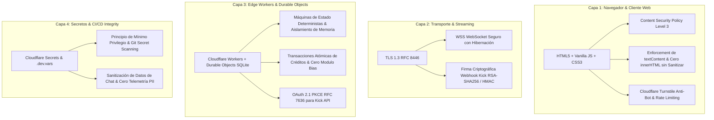

# 🛡️ PROTOCOLO MAESTRO DE CIBERSEGURIDAD WEB (Zero Trust & App Integrity)

## 1. Declaración Constitucional de Seguridad
En **HuntHub Web**, la ciberseguridad no es una capa añadida al final del ciclo de vida; es un **invariante arquitectónico inviolable**. 
Dado que HuntHub Web gestiona identidades de streaming, interacciones en tiempo real vía WebSocket y participación en vivo de espectadores (torneos, ruleta, bonushunts), un compromiso de seguridad no es simplemente un fallo técnico: **es un riesgo directo para la integridad de los eventos en vivo y la privacidad de la comunidad**.

Todo código, pull request, configuración de headers HTTP o pipeline de agente DEBE contrastarse y validarse de forma obligatoria contra las directivas de este documento antes de su aprobación o despliegue.

---

## 2. Los Cuatro Pilares Inviolables de Defensa en Profundidad

---

## 3. Modelo de Amenazas y Controles Mandatorios (Threat Model)

### 3.1 Cliente Web y Navegador (OWASP ASVS v4.0 Compliance)
1. **Prevención de Cross-Site Scripting (XSS - ASVS V5):**
   - **Prohibido:** Renderizar inputs de usuarios o mensajes de chat de Kick mediante `innerHTML`, `outerHTML` o `document.write`.
   - **Mandatorio:** Usar exclusivamente `element.textContent`, `element.setAttribute()` o sanitización estricta con DOMPurify cuando se requieran formatos visuales.
   - Filtrar caracteres de control RTL (Right-to-Left override) y secuencias unicode maliciosas antes del renderizado en OBS overlays.
2. **Políticas de Seguridad de Contenido (CSP Level 3 - ASVS V14):**
   - Headers HTTP estrictos: `default-src 'self'`, `script-src 'self'`, `object-src 'none'`, `frame-ancestors 'none'` (o restringido a OBS/Kick streamers autorizados).
   - Bloqueo absoluto de scripts inline sin hash/nonce (`unsafe-inline` prohibido en producción).
3. **Comunicaciones y Red (ASVS V9):**
   - Enlace estricto a HTTPS y WSS con TLS 1.3 (`RFC 8446`).
   - Cookies de sesión con atributos mandatorios: `Secure`, `HttpOnly`, `SameSite=Strict`.

### 3.2 Backend Edge, WebSockets y Durable Objects (NIST SP 800-207)
1. **Aislamiento de Estado y Concurrencia:**
   - Todo estado en tiempo real (torneo, ruleta, bonushunt) reside en una instancia única de Cloudflare Durable Object por canal, garantizando consistencia secuencial estricta y evitando condiciones de carrera (TOCTOU).
   - Persistencia local en SQLite dentro de Durable Objects con transacciones atómicas `ctx.storage.transaction()`.
2. **Validación Criptográfica de Inbound Webhooks:**
   - Todo webhook entrante desde Kick.com u oráculos externos DEBE verificar la firma digital (RSA-SHA256 o HMAC-SHA256) antes de encolar cualquier evento.
   - Rechazo inmediato de solicitudes con timestamp desfasado (> 300 s) para mitigar ataques de repetición (Replay Attacks).
3. **Autenticación Kick OAuth 2.1 PKCE (RFC 7636):**
   - Flujo de autorización con `code_challenge` SHA-256 y `code_verifier` efímero.
   - Rotación y cifrado de refresh tokens en Cloudflare KV / Secrets.

### 3.3 Infraestructura Edge y Pipelines de Código
1. **Gestión de Secretos:**
   - Cero secretos en repositorios git. Prohibido commitear archivos `.env`, `.dev.vars` o tokens de producción.
   - Los secretos de entorno se configuran mediante `wrangler secret put` en Cloudflare.
2. **Protección Contra Bots y Abuso:**
   - Desafío Turnstile (Cloudflare) para acciones críticas (claim de premios, registro de apuestas).
   - Rate limiting a nivel de IP y Kick User ID en el worker edge.

---

## 4. Matriz de Auditoría Obligatoria para PRs (Quality Gate)

Antes de fusionar cualquier cambio a `main`, el pipeline de CI/CD debe certificar:
1. `npm run security:scan` ejecutado con 0 secretos detectados.
2. `npm run guard:all` o `npm audit` libre de vulnerabilidades de severidad alta o crítica.
3. Cobertura de tests unitarios y de invariantes (`npm run test`).
4. Verificación de CSP y ausencia de `innerHTML` inseguro en el árbol de componentes web.

---

## Relaciones de Contexto
- [[CANON_CYBERSECURITY_DEVSECOPS_2026]]
- [[fair-draws]]
- [[provably-fair-games]]
- [[anti-fraud-fingerprinting]]
