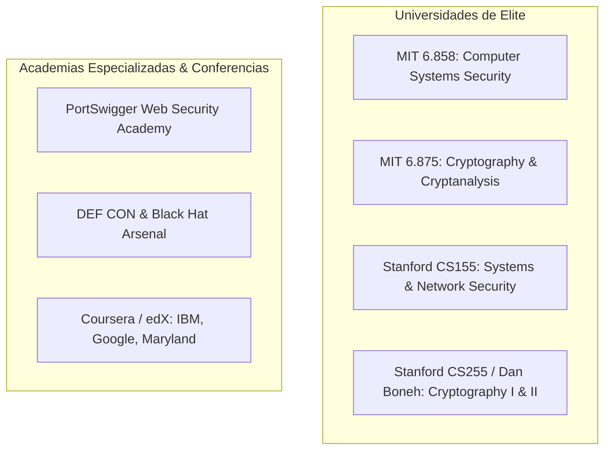

**Alcance:** Síntesis de cursos universitarios de ciberseguridad (MIT 6.858 Computer Systems Security, Stanford CS253 Web Security). (Fuente migrada y curada desde Yendo Mobile Vault para la Software Factory Web y DiggityBets. NO sustituye las reglas de negocio locales ni los contratos primarios en `CANON_*`).

---
version: 1.0.0
tipo: research
tags:
  - yendo-mobile
  - architecture
  - en-progreso
autores: [RESEARCHER_AGENT, MANAGER_AGENT]
ultima_revision: 2026-08-27
---

# 🎓 Arsenal Educativo Canónico: Cursos Universitarios Libres y Currículas de Hacking Ético

Este documento sistematiza e ingesta el conocimiento transferible de los programas universitarios de élite (MIT, Stanford, PortSwigger, DEF CON) y las currículas de formación técnica profunda en YouTube (freeCodeCamp, TCM, IppSec, LiveOverflow, HackerSploit, Simply Cyber, John Hammond). Transforma el contenido teórico y táctico en **capacidades defensivas y de auditoría continua para los agentes de Yendo**.

---

## 1. Módulos Universitarios y Académicos de Acceso Libre

### 1.1 MIT OpenCourseWare: 6.858 (Computer Systems Security) & 6.875 (Cryptography)
- **Profesores:** Nickolai Zeldovich, Frans Kaashoek, Shafi Goldwasser.
- **Núcleo de Conocimiento:**
  - **6.858:** Modelos de aislamiento de procesos, sandboxing a nivel de sistema operativo, análisis estático y dinámico de código, seguridad en navegadores web (Same-Origin Policy, CSP, sandboxing iframes) y mitigación de canales laterales.
  - **6.875:** Fundamentos rigurosos de teoría de la complejidad en criptografía, funciones pseudoaleatorias (PRF), construcciones de firmas basadas en árboles de Merkle, pruebas de conocimiento cero (ZKP) y computación segura multipartita (MPC).
- **Transferencia a Yendo:**
  - Diseño del aislamiento del runtime en Web Platform/Web UI / Vanilla & Modern Frontend frente a webviews de terceros.
  - Modelado formal de la generación segura de tokens efímeros para el quórum de mesa sin canales laterales de tiempo.

### 1.2 Stanford CS155, CS255 y Dan Boneh (Cryptography I & II)
- **Profesor:** Dan Boneh (referencia mundial en criptografía moderna y criptografía post-cuántica).
- **Núcleo de Conocimiento:**
  - Análisis profundo de modos de operación de cifrado por bloques: debilidades de CBC frente a padding oracles vs. superioridad de modos autenticados como **AES-GCM** y **ChaCha20-Poly1305**.
  - Criptografía de curvas elípticas (ECC): curva Ed25519 para firmas rápidas y seguras, y Curve25519 para intercambio Diffie-Hellman.
  - Mitigación de ataques de sincronización (*timing attacks*) mediante operaciones en tiempo constante (*constant-time algorithms*).
- **Transferencia a Yendo:**
  - Todas las operaciones de verificación de hashes, contraseñas o firmas en TypeScript/C++ deben utilizar comparación en tiempo constante (`crypto.timingSafeEqual`) para evitar fugas de información por micro-latencias.

### 1.3 Web Security Academy (PortSwigger)
- **Creadores:** Autores de Burp Suite. La plataforma de entrenamiento web y API más prestigiosa del mundo.
- **Núcleo de Conocimiento:**
  - Explotación y mitigación práctica de: Cross-Site Scripting (DOM-based, Reflected, Stored), SQL Injection, Cross-Site Request Forgery (CSRF), Server-Side Request Forgery (SSRF), Cross-Origin Resource Sharing (CORS) misconfigurations, y vulnerabilidades de deserialización.
  - Lógica de autenticación: Broken Object Level Authorization (BOLA), rotura de JWTs, manipulación de encabezados HTTP.
- **Transferencia a Yendo:**
  - Configuración estricta de CORS en Supabase Edge Functions y endpoints Cloud Run.
  - Sanitización estricta de entradas en componentes Web UI / Vanilla & Modern Frontend para prevenir inyecciones XSS en el cliente web o en componentes WebView.

### 1.4 DEF CON & Black Hat Arsenal
- **Núcleo de Conocimiento:**
  - Explotación de vanguardia de arquitecturas móviles modernas, bypass de biometría, decompilación y parcheo de binarios Android/iOS, ataques a cadenas de suministro de software (software supply chain attacks en paquetes NPM) y evasión de EDR/WAF.
- **Transferencia a Yendo:**
  - Establecimiento del [[OSS_WHITELIST_REGISTRY]]: estricta política de congelamiento y auditoría previa a la instalación de cualquier dependencia `npm` para prevenir paquetes comprometidos en la supply chain.

---

## 2. El Arsenal de Reemplazo en YouTube: Currículas Extensivas de Hacking Ético

### 2.1 Hacking Ético General y Pentesting (Reemplazo de TCM / OffSec PWK)

#### freeCodeCamp.org (*Ethical Hacking in 12 Hours* / *Penetration Testing Tutorial*)
- **Temario Playwright E2E:** Escaneo de redes y puertos con Nmap, explotación estructurada con Metasploit, análisis de servicios de red, escalamiento de privilegios en Linux y Windows (SUID binaries, sudo permissions, unquoted service paths), metodologías OSSTMM y PTES.
- **Capacidad Transferida a los Agentes:** Pensar como atacante externo para anticipar vectores de entrada perimetrales en puertos expuestos de VMs o contenedores de Google Cloud.

#### The Cyber Mentor (TCM) (*Full Ethical Hacking Course - Network Pentesting*, 15 horas)
- **Temario Playwright E2E:** Pasos metódicos de penetración: Reconocimiento pasivo/activo, enumeración profunda, ingeniería social, explotación web básica, post-explotación y pivoteo de redes.
- **Capacidad Transferida a los Agentes:** Estructuración de auditorías pre-lanzamiento automatizadas en las que un agente asume el rol del atacante (Red Team) y el QUALITY_RELIABILITY_SQUAD actúa como Blue Team.

#### Canal IppSec (*Hack The Box Walkthroughs*)
- **Temario Playwright E2E:** Metodología sistemática de investigación de vulnerabilidades. Descomposición forense de fallas complejas, técnicas de evasión de filtros y comprensión a bajo nivel de protocolos de red y sockets.
- **Capacidad Transferida a los Agentes:** Resolución metódica de bugs de seguridad: no asumir nada, probar cada suposición con payloads mínimos reproducibles.

---

### 2.2 Seguridad Web y APIs (Reemplazo de SANS SEC542)

#### Canal Farah Hawa (*OWASP Top 10 Playlist*)
- **Temario Playwright E2E:** Desglose conceptual y visual de las 10 vulnerabilidades más destructivas: Inyección SQL en aplicaciones modernas, Broken Authentication en flujos OAuth, Sensitive Data Exposure, Security Misconfiguration y falta de registro/monitoreo.
- **Capacidad Transferida a los Agentes:** Validación preventiva en la capa de revisión de código (`agent_router.js`) detectando patrones de código vulnerables antes de que toquen el repositorio.

#### Canal Rana Khalil (*PortSwigger Web Security Academy Series*)
- **Temario Playwright E2E:** Tutoriales exhaustivos en video resolviendo cada laboratorio de PortSwigger con scripting en Python. Especialización en vulnerabilidades de APIs, JWT bypasses y Broken Access Control.
- **Capacidad Transferida a los Agentes:** Creación de scripts de testing automatizado de seguridad en `tools/tests/` para verificar de forma programática que los endpoints de Yendo rechacen tokens adulterados.

---

### 2.3 Ingeniería Inversa, Malware y Explotación a Bajo Nivel

#### Canal LiveOverflow (*Binary Exploitation & Low-Level Security*)
- **Temario Playwright E2E:** Arquitectura x86/x86_64 y ARM, desensamblado con Ghidra e IDA Pro, análisis del stack y el heap, explotación de format strings, bypass de ASLR y DEP/NX mediante ROP (Return-Oriented Programming).
- **Capacidad Transferida a los Agentes:** Comprensión de las vulnerabilidades en módulos nativos C++ de Web UI / Vanilla & Modern Frontend (JSI / Nitro Modules) para evitar fugas de memoria, use-after-free o desbordamientos que puedan quebrar el sandbox de la app.

#### Canal OALabs (*Malware Analysis & Reverse Engineering*)
- **Temario Playwright E2E:** Análisis estático y dinámico de binarios ofuscados, desofuscación de strings, desempaquetado de ejecutables y monitoreo de llamadas al sistema (syscalls).
- **Capacidad Transferida a los Agentes:** Técnicas para verificar la integridad del APK de Yendo en Android y detectar si un binario distribuido a usuarios ha sido alterado, inyectado con troyanos o recompilado por terceros maliciosos.

---

### 2.4 Seguridad Móvil: iOS y Android (Reemplazo de SANS SEC575)

#### Canal HackerSploit (*Android Penetration Testing & APK Auditing*)
- **Temario Playwright E2E:**
  - Decompilación de APKs mediante `apktool` y `jadx-gui`.
  - Inspección del archivo `AndroidManifest.xml` (actividades exportadas `android:exported="true"`, broadcast receivers inseguros, permisos excesivos).
  - Análisis del almacenamiento local de la app (inspección de `/data/data/<package_name>/`).
  - Intercepción de tráfico móvil mediante Burp Suite y bypass de SSL Pinning con **Frida**.
- **Capacidad Transferida a los Agentes:**
  - Auditoría regular del APK de release de Yendo mediante scripts automatizados que ejecutan `jadx` para constatar que ninguna clave secreta, URL de staging o credencial haya quedado en el código compilado.
  - Implementación de protecciones anti-Frida y anti-tampering para complicar la manipulación de la lógica de pagos y quórum en dispositivos rooteados.

#### Canal edureka! (*Mobile Vulnerabilities & Ethical Hacking*)
- **Temario Playwright E2E:** Seguridad en el ecosistema Android e iOS, arquitectura de sandboxing, IPC seguro, Content Providers y análisis de debilidades de transporte en redes Wi-Fi públicas.
- **Capacidad Transferida a los Agentes:** Protección de usuarios que utilizan Yendo en cafeterías o bares con Wi-Fi público abierto: cifrado absoluto y validación estricta de TLS para neutralizar ataques de sniffing de paquetes.

---

### 2.5 Defensa, SOC y Blue Team (Reemplazo de Certificaciones IBM/Google)

#### Canal Simply Cyber (Gerald Auger) (*SOC Analyst Free Training*)
- **Temario Playwright E2E:** Detección de intrusiones, correlación de eventos en SIEM, gestión de alertas de seguridad, análisis de logs de acceso y ciclo de vida de respuesta a incidentes (NIST SP 800-61).
- **Capacidad Transferida a los Agentes:**
  - Diseño de alertas automáticas en Supabase y Google Cloud Logging ante anomalías: múltiples intentos fallidos de login, consultas masivas a tablas de usuarios o picos atípicos en llamadas a la API.

#### Canal John Hammond (*Malware Analysis & Digital Forensics*)
- **Temario Playwright E2E:** Análisis forense en vivo de incidentes de seguridad reales, reconstrucción de cadenas de ataque (kill chains), detección de tácticas, técnicas y procedimientos (TTPs de MITRE ATT&CK) y caza de amenazas (*threat hunting*).
- **Capacidad Transferida a los Agentes:** Protocolo de respuesta rápida ante contingencias: si se reporta un comportamiento anómalo en un grupo de usuarios o un intento de suplantación, el sistema congela la sesión de inmediato y preserva los logs inmutables para investigación forense.

---

## Relaciones de Contexto
- [[CYBERSECURITY_MASTER_PROTOCOL]]
- [[01_CANON_PAPERS_SEMINALES_CRIPTOGRAFIA_PROTOCOLOS]]
- [[03_DEFENSA_PROFUNDIDAD_STACK_YENDO_APLICADA]]
- [[YENDO_DNA]]
- [[YENDO_LIBRARY]]
- [[CANON_CYBERSECURITY_DEVSECOPS_2026]]
- [[OSS_WHITELIST_REGISTRY]]
- [[Supabase]]
