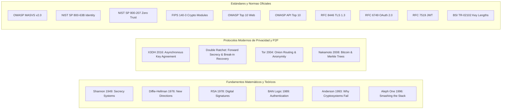

**Alcance:** Papers seminales de criptografía moderna: Diffie-Hellman, RSA, SHA-256, HMAC, curvas elípticas y pruebas de compromiso. (Fuente migrada y curada desde Yendo Mobile Vault para la Software Factory Web y DiggityBets. NO sustituye las reglas de negocio locales ni los contratos primarios en `CANON_*`).

---
version: 1.0.0
tipo: research
tags:
  - yendo-mobile
  - architecture
  - en-progreso
autores: [RESEARCHER_AGENT, MANAGER_AGENT]
ultima_revision: 2026-08-27
---

# 📜 Tratado Canónico: Los 20 Papers Seminales, RFCs y Estándares de Ciberseguridad

Este documento formaliza la base matemática, criptográfica y de ingeniería de software que rige la seguridad de **Yendo**. Se analizan exhaustivamente los 20 artefactos teóricos y normativos seminales, extrayendo su principio fundamental y su aplicación arquitectónica directa en nuestro ecosistema.

---

## Índice de Artefactos Canónicos

---

## Bloque I: Fundamentos Matemáticos y Criptografía Clásica

### 1. Communication Theory of Secrecy Systems (Claude Shannon, 1949)
- **Principio Fundamental:** Define matemáticamente el *Perfect Secrecy* (secreto perfecto) cuando la entropía de la clave es igual o superior a la del mensaje ($H(M|C) = H(M)$) y el concepto de *Unicity Distance* (distancia de unicidad). Demuestra que el One-Time Pad (OTP) es el único cifrado matemáticamente irrompible.
- **Vector Mitigado:** Criptoanálisis estadístico, ataques por frecuencia y fugas de información por redundancia de texto plano.
- **Aplicación en Yendo:**
  - Los códigos dinámicos TOTP y tokens efímeros de check-in presencial en locales gastronómicos derivan de fuentes de alta entropía del hardware (`crypto.getRandomValues()`).
  - La anonimización de ubicaciones urbanas inyecta ruido de entropía calculada (Laplace / Privacidad Diferencial) antes de indexar coordenadas en la capa pública.

### 2. New Directions in Cryptography (Whitfield Diffie & Martin Hellman, 1976)
- **Principio Fundamental:** Invención del intercambio de claves públicas sin canal seguro previo mediante el problema del logaritmo discreto sobre grupos finitos ($g^{ab} \pmod p$). Sentó las bases de la criptografía asimétrica y las firmas digitales.
- **Vector Mitigado:** Vulnerabilidad de distribución de claves simétricas (*Key Distribution Problem*) y espionaje en tránsito (*Man-in-the-Middle* pasivo).
- **Aplicación en Yendo:**
  - Negociación de sesiones seguras cliente-servidor mediante curvas elípticas modernas (ECDHE con curva X25519) en el handshake TLS 1.3.

### 3. A Method for Obtaining Digital Signatures and Public-Key Cryptosystems (Rivest, Shamir, Adleman - RSA, 1978)
- **Principio Fundamental:** Primera implementación práctica de cifrado de clave pública basada en la dificultad computacional de factorizar números enteros compuestos grandes ($n = pq$). Introduce el concepto de firma digital no repudiable mediante operación con clave privada ($s = m^d \pmod n$).
- **Vector Mitigado:** Suplantación de identidad, repudio de transacciones y manipulación de integridad de software.
- **Aplicación en Yendo:**
  - Verificación de firmas de artefactos y binarios en release (Android APK Signing Scheme v3).
  - Verificación de firmas asimétricas RS256/ES256 en tokens OpenID Connect provenientes de Apple Sign-In y Google OAuth.

### 4. A Logic of Authentication (BAN Logic) (Michael Burrows, Martín Abadi, Roger Needham, 1989)
- **Principio Fundamental:** Lógica modal formal para analizar y verificar protocolos de autenticación criptográfica. Introduce operadores formales de creencia ($P \models X$), posesión ($P \owns X$), control ($P \Rightarrow X$) y frescura ($fresh(X)$).
- **Vector Mitigado:** Ataques de repetición (*replay attacks*), confusión de identidad e intercambio incompleto de credenciales.
- **Aplicación en Yendo:**
  - Modelado formal del protocolo de emparejamiento presencial Bluetooth LE / QR para quórum de mesa: validación de frescura de nonce ($fresh(N_b)$) para garantizar que un check-in no pueda ser capturado y retransmitido por un tercero fuera del local.

### 5. Why Cryptosystems Fail (Ross Anderson, 1993)
- **Principio Fundamental:** Demuestra empíricamente que la inmensa mayoría de los fallos de seguridad no ocurren por la ruptura de algoritmos matemáticos, sino por fallas de diseño en la implementación, mala gestión de claves, errores de interfaz de usuario y suposiciones organizacionales incorrectas.
- **Vector Mitigado:** Falsa sensación de seguridad (*security through obscurity*), fugas operacionales y errores humanos de configuración.
- **Aplicación en Yendo:**
  - Adopción de bibliotecas estándar probadas en batalla (`expo-secure-store`, `@supabase/supabase-js`, Web Crypto API nativa). **Regla de oro: Prohibido reinventar criptografía casera**.
  - Auditoría continua de secretos (`npm run security:scan`) y revisiones de esquemas RLS Zero Trust.

### 6. Smashing The Stack For Fun And Profit (Aleph One, 1996)
- **Principio Fundamental:** El paper clásico seminal de Phrack sobre explotación de desbordamiento de búfer (*Stack-based Buffer Overflow*). Explica cómo sobreescribir el puntero de instrucción de retorno (`EIP/RIP`) mediante memoria adyacente no verificada para ejecutar shellcode arbitrario.
- **Vector Mitigado:** Ejecución remota de código (RCE), corrupción de memoria y escalamiento de privilegios.
- **Aplicación en Yendo:**
  - Uso de memoria administrada y segura en TypeScript / JavaScript ejecutado en el motor Hermes.
  - Para módulos nativos C++ en Web UI / Vanilla & Modern Frontend Nitro Modules / Fabric: compilación obligatoria con flags de seguridad del compilador (Stack Canaries `-fstack-protector-strong`, ASLR, DEP/NX, y Fortify Source `-D_FORTIFY_SOURCE=2`).

---

## Bloque II: Protocolos de Comunicación Segura y Privacidad P2P

### 7. The X3DH Key Agreement Protocol (Moxie Marlinspike & Trevor Perrin - Signal Foundation, 2016)
- **Principio Fundamental:** *Extended Triple Diffie-Hellman*. Protocolo de establecimiento de claves asíncrono para entornos de mensajería donde ambas partes no están conectadas simultáneamente. Utiliza combinaciones de claves de identidad, claves prefirmadas y claves efímeras de un solo uso (*one-time prekeys*). Proporciona resistencia a compromisos futuros y confidencialidad hacia adelante.
- **Vector Mitigado:** Ataques de hombre en el medio (MitM) en reposo, descifrado retroactivo si la clave de identidad es comprometida posteriormente.
- **Aplicación en Yendo:**
  - Arquitectura del subsistema de mensajería privada y grupos efímeros de 4 a 6 personas (Dunbar Quorum). Establecimiento de sesión sin exponer claves permanentes al servidor Supabase.

### 8. The Double Ratchet Algorithm (Trevor Perrin & Moxie Marlinspike - Signal Foundation)
- **Principio Fundamental:** Combina un trinquete criptográfico de curva elíptica (KDF chain basado en Diffie-Hellman continuo con cada intercambio de mensajes) con trinquetes de derivación de claves simétricas (HMAC-SHA256). Otorga dos propiedades críticas:
  1. **Forward Secrecy (PFS):** Si la clave actual es robada, los mensajes pasados no pueden ser descifrados.
  2. **Break-in Recovery (Post-Compromise Security):** Si un atacante intercepta la clave actual, en cuanto las partes legítimas intercambian un nuevo mensaje Diffie-Hellman, la seguridad se reestablece automáticamente.
- **Vector Mitigado:** Compromiso de memoria del dispositivo, extracción forense de claves de sesión, monitoreo prolongado de chats.
- **Aplicación en Yendo:**
  - Encriptación de extremo a extremo (E2EE) en canales de coordinación de encuentros privados para evitar que personal del backend o infiltrados en base de datos lean las conversaciones de los miembros de la mesa.

### 9. Tor: The Second-Generation Onion Router (Roger Dingledine, Nick Mathewson, Paul Syverson, 2004)
- **Principio Fundamental:** Enrutamiento en capas (cebolla) a través de un circuito de tres nodos (Guard, Middle, Exit). Cada capa es cifrada con una clave simétrica negociada independientemente. Ningún nodo conoce simultáneamente el origen de la petición y su destino final. Incorpora *Forward Secrecy* en los circuitos.
- **Vector Mitigado:** Análisis de tráfico, perfilamiento de comportamiento por proveedores de internet (ISP) y correlación de metadatos de red.
- **Aplicación en Yendo:**
  - Principio de separación de metadatos: la base de datos no correlaciona la IP del usuario con las coordenadas geográficas de su residencia.
  - Implementación del [[Protocolo_Anti_Voyeurismo_Privacidad_Progresiva]]: revelación gradual de identidades y ubicaciones solo cuando se alcanza el quórum del grupo.

### 10. Bitcoin: A Peer-to-Peer Electronic Cash System (Satoshi Nakamoto, 2008)
- **Principio Fundamental:** Resolución del problema del doble gasto sin intermediarios centrales de confianza mediante una cadena de bloques ligada por funciones hash criptográficas (SHA-256), árboles de Merkle para verificación compacta (SPV) y consenso por Prueba de Trabajo (PoW).
- **Vector Mitigado:** Modificación no autorizada de registros históricos, colusión de operadores de bases de datos y manipulación de balances.
- **Aplicación en Yendo:**
  - Estructuración del libro contable de auditoría (*Audit Ledger*) y reputación de usuarios mediante cadenas criptográficas ligadas por hashes (SHA-256 Merkle proofs).
  - Certificación de check-ins en locales gastronómicos: sellado inmutable en base de datos para impedir que administradores alteren el historial de asistencias de un comercio o usuario.

---

## Bloque III: Estándares Oficiales y Recomendaciones de Agencias de Ciberseguridad

### 11. OWASP Mobile Application Security Verification Standard (MASVS v2.0)
- **Principio Fundamental:** Marco estándar global de requisitos de seguridad para aplicaciones móviles organizadas en 4 categorías canónicas:
  - `MASVS-STORAGE`: Almacenamiento local protegido en hardware.
  - `MASVS-CRYPTO`: Criptografía estándar no obsoleta, generación segura de números aleatorios.
  - `MASVS-NETWORK`: Cifrado en tránsito, validación estricta de cadenas de certificados TLS.
  - `MASVS-PLATFORM`: Interacción segura con IPC, Intents en Android, URLs schemes en iOS, y configuración de depuración.
- **Aplicación en Yendo:** Matriz de cumplimiento obligatorio en todos los sprints de desarrollo móvil.

### 12. NIST SP 800-63B: Digital Identity Guidelines (Authentication & Lifecycle)
- **Principio Fundamental:** Guía del gobierno estadounidense sobre niveles de aseguramiento de autenticación (AAL1, AAL2, AAL3). Prohíbe políticas arcaicas (como forzar cambios de contraseña periódicos que inducen claves débiles) y desalienta SMS OTP por vulnerabilidades de SIM Swapping, exigiendo claves FIDO2/WebAuthn y TOTP.
- **Aplicación en Yendo:**
  - Supabase Auth configurado con políticas modernas: sin expiraciones forzadas absurdas, soporte de biometría local (Passkeys / FaceID) y TOTP AAL2 para administradores de locales y pagos.

### 13. NIST SP 800-207: Zero Trust Architecture
- **Principio Fundamental:** *"Never trust, always verify"*. Asume que la red interna ya está comprometida. Ningún recurso confía en otro basándose en su ubicación de red (IP interna). Cada acceso a datos debe ser autenticado, autorizado y cifrado dinámicamente según políticas contextuales mínimas.
- **Aplicación en Yendo:**
  - Políticas RLS en PostgreSQL: cada consulta SQL evalúa las credenciales del usuario de forma aislada.
  - Comunicación Cloud Run a Supabase autenticada individualmente y firmada, sin depender de redes perimetrales abiertas.

### 14. NIST FIPS 140-3: Security Requirements for Cryptographic Modules
- **Principio Fundamental:** Estándar federal para módulos criptográficos de hardware y software en 4 niveles de seguridad. Exige algoritmos aprobados (AES-256, SHA-256/384, HMAC, RSA >= 3072, ECC P-256), protección contra ataques físicos por canal lateral (*side-channel attacks*) y cero divulgación de claves privadas en texto plano.
- **Aplicación en Yendo:**
  - Delegación de las operaciones criptográficas del cliente a los keystores certificados FIPS 140-3 de iOS (Secure Enclave) y Android (Hardware-backed Keystore / Titan M).

### 15. OWASP Top 10 Web Application Security Risks (2021/2026)
- **Principio Fundamental:** Los diez riesgos más críticos en aplicaciones web:
  - A01: Broken Access Control (el riesgo #1 de la industria).
  - A02: Cryptographic Failures.
  - A03: Injection (SQL, NoSQL, OS Command).
  - A07: Identification and Authentication Failures.
- **Aplicación en Yendo:**
  - Mitigación exhaustiva de A01 y A03 en Supabase mediante políticas RLS y consultas compiladas en TypeScript con tipos estrictos generados automáticamente.

### 16. OWASP API Security Top 10 (2023/2026)
- **Principio Fundamental:** Vulnerabilidades específicas de APIs REST y GraphQL modernas:
  - API1: Broken Object Level Authorization (BOLA).
  - API2: Broken Authentication.
  - API3: Broken Object Property Level Authorization (Mass Assignment).
  - API4: Unrestricted Resource Consumption (Rate Limiting).
- **Aplicación en Yendo:**
  - BOLA erradicado en la raíz: un usuario jamás puede modificar o leer datos de un grupo si su `auth.uid()` no figura como miembro autorizado mediante RLS.
  - Prevención de Mass Assignment: DTOs y contratos TypeScript con Zod sin mapeo ciego de payloads JSON.

### 17. RFC 8446: The Transport Layer Security (TLS) Protocol Version 1.3 (2018)
- **Principio Fundamental:** Rediseño integral de TLS. Elimina suites criptográficas obsoletas o vulnerables (RC4, DES, 3DES, MD5, SHA-1, intercambio RSA sin PFS). Obliga a Forward Secrecy en todos los handshakes (ECDHE). Reduce la latencia de conexión a 1-RTT y soporte de 0-RTT con mitigación de replay.
- **Aplicación en Yendo:**
  - Conexiones móviles y web forzadas a negociar TLS 1.3 con Supabase API, Edge Functions y endpoints de Google Cloud.

### 18. RFC 6749: The OAuth 2.0 Authorization Framework (con RFC 7636 PKCE)
- **Principio Fundamental:** Delegación de autorización mediante tokens sin exponer las credenciales del usuario al cliente.
  - **RFC 7636 (PKCE):** Extensión crítica para clientes públicos (apps móviles). Genera un secreto efímero (`code_verifier`) y su hash transformado (`code_challenge`) para evitar que apps maliciosas intercepten el `authorization_code` en deep links.
- **Aplicación en Yendo:**
  - Inicio de sesión con Apple, Google y Facebook implementado exclusivamente vía Supabase Auth con flujo PKCE nativo y redirección segura con esquema custom verificado.

### 19. RFC 7519: JSON Web Token (JWT)
- **Principio Fundamental:** Formato estándar compacto y autocontenido para transmitir afirmaciones (*claims*) firmadas digitalmente entre partes (Header.Payload.Signature).
- **Vectores de Ataque Clásicos:** Vulnerabilidad `alg: "none"` (aceptar tokens sin firma), ataques de sustitución de clave simétrica (usar clave pública RSA como secreto HMAC), omisión de validación de expiración (`exp`), emisor (`iss`) y audiencia (`aud`).
- **Aplicación en Yendo:**
  - Las Edge Functions y Supabase rechazan tajantemente algoritmos no autorizados. Validación estricta del claim `exp` y uso de claims personalizados (`user_role`, `aal`) verificados en el motor Postgres.

### 20. BSI TR-02102: Cryptographic Mechanisms (Alemania, Federal Office for Information Security)
- **Principio Fundamental:** Recomendaciones técnicas sobre longitud mínima de claves y algoritmos seguros hasta 2030+:
  - Cifrado simétrico: AES con longitud mínima de 128 bits (recomendado 256 bits).
  - Algoritmos asimétricos: Curvas elípticas con orden mínimo de 250 bits (Brainpool, Curve25519, NIST P-256). Claves RSA con mínimo de 3000 bits.
  - Funciones Hash: Familia SHA-2 (SHA-256 o superior) o SHA-3.
- **Aplicación en Yendo:**
  - Todo el cifrado de datos en reposo y en tránsito en Yendo cumple o supera las directrices BSI TR-02102 (AES-256-GCM, Curve25519, SHA-256).

---

## Relaciones de Contexto
- [[CYBERSECURITY_MASTER_PROTOCOL]]
- [[02_ARSENAL_EDUCATIVO_CURSOS_AUDITORIAS_YOUTUBE]]
- [[03_DEFENSA_PROFUNDIDAD_STACK_YENDO_APLICADA]]
- [[YENDO_DNA]]
- [[YENDO_LIBRARY]]
- [[Protocolo_Anti_Voyeurismo_Privacidad_Progresiva]]
- [[CANON_CYBERSECURITY_DEVSECOPS_2026]]
- [[Supabase]]
- [[Número de Dunbar]]
