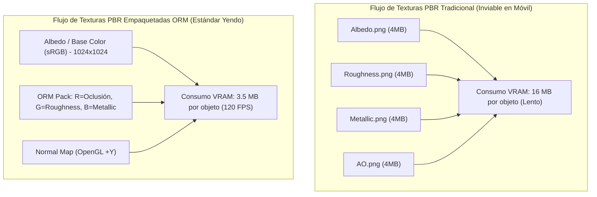
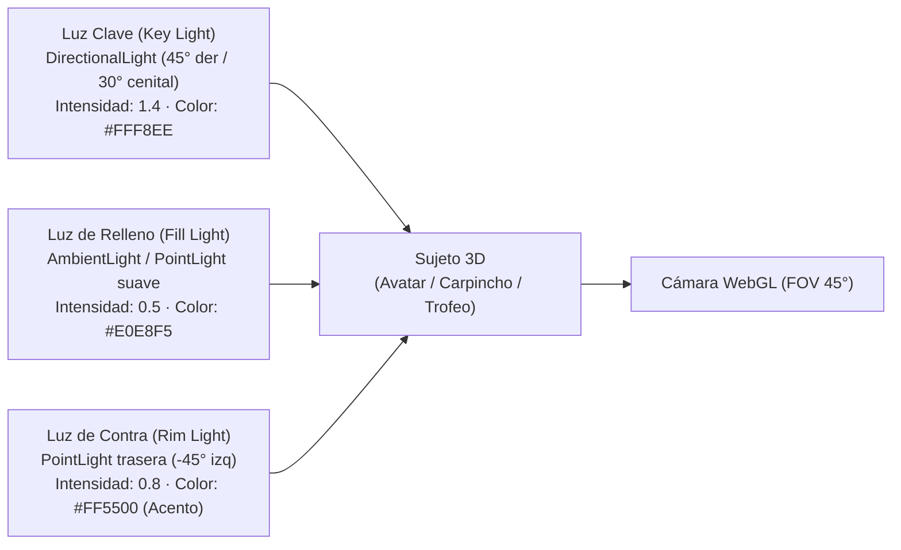

> **Alcance:** Literatura canónica y tratados técnicos de animación a 60 FPS, shaders GPU, física de resortes (spring physics), arte técnico 3D y micro-interacciones fluidas para sitios web modernos y overlays OBS.

---
version: 1.0.0
tipo: guia
tags:
  - yendo-mobile
  - tech-stack
  - canonico
autores: [RESEARCHER_AGENT, MANAGER_AGENT]
ultima_revision: 2026-08-27
---

# 🎨 Guía Maestra: Renderizado 3D, Materiales PBR, Iluminación y Cinematografía en Yendo

> [!info] Clasificación y Alcance
> Esta guía documenta los principios científicos e industriales de **Physically Based Rendering (PBR)** formulados por Allegorithmic (Substance), las técnicas de iluminación cinematográfica de **Blain Brown** (*Cinematography: Theory and Practice*) y la optimización de bajo nivel para **React Three Fiber y WebGL**, estableciendo la constitución visual para todos los avatares, trofeos y escenas 3D de **Yendo Mobile**.
> 
> **Clasificación:** `3D Graphics / PBR Guide / Cinematografía / Iluminación 3 Puntos / WebGL Performance`  
> **Departamentos Asignados:** `MOTION_ART_DIRECTOR_AGENT · CREATIVE_TECH · CORE_AGENT · UI_AGENT`  
> **Invariantes Innegociables:** Framerate a 120 FPS · Máx. 50 Draw Calls · Texturas ORM empaquetadas · Dark-First (#121212)

---

## 1. 🔬 Fundamentos PBR (Physically Based Rendering) — Allegorithmic / Substance

El renderizado basado en la física modela cómo la luz interactúa realmente con la materia respetando dos leyes inmutables: **la conservación de la energía** (un material no puede reflejar más luz de la que recibe) y **la reflectancia de Fresnel** (todos los materiales reflejan más luz en ángulos rasantes).

### A. El Flujo Metalness / Roughness
1. **Base Color (Albedo):**
   - Para materiales **dieléctricos** (plástico, madera, tela, pelaje del carpincho): Representa el color difuso puro con valores de reflectancia entre el 2% y el 5% (valores sRGB entre 50 y 240). **Cero sombras o luces horneadas** en esta textura.
   - Para materiales **conductores** (metales como bronce, oro o cromo): El color difuso es negro absoluto; la información de color representa la reflectancia especular $F_0$ (valores sRGB altos entre 180 y 255).
2. **Roughness (Rugosidad Micro-superficial):**
   - Mapa en escala de grises lineal que define la orientación de las micro-facetas.
   - `0.0` (Negro): Superficie perfectamente lisa tipo espejo (reflejo nítido de alta intensidad).
   - `1.0` (Blanco): Superficie extremadamente rugosa (difusión completa de la luz, mate).
3. **Metallic (Máscara Conductora):**
   - Mapa binario: los píxeles deben ser estrictamente `0.0` (dieléctrico) o `1.0` (metal puro). Los valores intermedios solo se admiten en transiciones de borde o corrosión.
4. **Empaquetado de Texturas ORM (Occlusion, Roughness, Metallic):**
   - **Regla Estricta Yendo:** En lugar de cargar tres archivos de imagen independientes, se unifican en los canales RGB de un solo archivo:
     * **Canal Rojo (R):** Ambient Occlusion (AO).
     * **Canal Verde (G):** Roughness.
     * **Canal Azul (B):** Metallic.
   - **Ahorro:** Reduce las llamadas de muestreo de textura en la GPU en un **66%** y el consumo de ancho de banda a un tercio.

---

## 2. 🎬 Cinematografía y Composición: Iluminación de 3 Puntos (Blain Brown)

En *Cinematography: Theory and Practice*, Blain Brown demuestra que la dimensionalidad y la emoción de una escena se construyen mediante el control preciso del ratio de contraste entre la luz y la sombra (*Chiaroscuro*).

En el entorno **Dark-First (#121212)** de Yendo, la iluminación tridimensional en [`ModelViewer3D.tsx`](file:///c:/Users/Tomi/yendo_mobile/src/components/3d/ModelViewer3D.tsx) se orquesta según este esquema:

1. **Luz Clave (Key Light):**
   - Posición: `[3, 5, 2]`. Define la forma, el relieve y las sombras dominantes del sujeto. Tonalidad blanca ligeramente cálida.
2. **Luz de Relleno (Fill Light):**
   - Posición: Iluminación ambiental difusa al 35%-40% de la luz clave. Evita que las zonas oscuras se conviertan en negro absoluto sin detalles.
3. **Luz de Contra o Recorte (Rim / Backlight):**
   - Posición: `[-3, -2, -2]`. Incide desde atrás sobre los bordes del modelo con el color primario de Yendo (**`#FF5500`**).
   - **Efecto Cinematográfico:** Separa al personaje u objeto del fondo oscuro profundo `#121212`, creando un halo luminoso distintivo de alta sofisticación.

---

## 3. ⚡ Reglas de Rendimiento WebGL y React Three Fiber (`[[CORE_AGENT]]`)

Para que la experiencia visual corra a **120 FPS estables** sin provocar estrangulamiento térmico (*thermal throttling*):

1. **Presupuesto Poligonal Máximo (Polygon Budget):**
   * **Avatar o Mascota Principal:** $\le 25.000$ triángulos.
   * **Objetos Secundarios / Props:** $\le 8.000$ triángulos.
   * **Vértices totales en pantalla simultáneos:** $\le 40.000$.
2. **Presupuesto de Llamadas de Dibujo (Draw Calls):**
   * Límite estricto: **$\le 50$ draw calls por fotograma**.
   * Uso obligatorio de `<instancedMesh>` cuando se representen múltiples elementos repetitivos en la escena.
3. **Gestión del Render Loop:**
   * Utilizar `frameloop="demand"` en modelos que no posean animación continua.
   * Pausar inmediatamente el renderizado (`frameloop="never"`) al detectar que la app pasa a segundo plano mediante `AppState`.
4. **Espacio de Color sRGB:**
   * Configurar siempre `gl.outputColorSpace = THREE.SRGBColorSpace` para evitar que las texturas se vean lavadas o quemadas en paneles OLED.

---

#pbr #3d-rendering #cinematography #blain-brown #substance #react-three-fiber #webgl #lighting-3-points #color-science

---

## Relaciones de Contexto
- [[YENDO_DNA]]
- [[YENDO_LIBRARY]]
- [[React Three Fiber]]
- [[Capybara Mascot]]
