> **Alcance:** Literatura canónica y tratados técnicos de animación a 60 FPS, shaders GPU, física de resortes (spring physics), arte técnico 3D y micro-interacciones fluidas para sitios web modernos y overlays OBS.

---
version: 1.0.0
tipo: guia
tags:
  - yendo-mobile
  - tech-stack
  - canonico
autores: [RESEARCHER_AGENT, MANAGER_AGENT]
ultima_revision: 2026-08-27
---

# 🧠 Dossier de Arquitectura: Pipeline Externo de Renderizado, Compresión e Importación 3D y Motion Graphics

> [!info] Clasificación y Alcance Técnico
> Este dossier establece el estándar oficial de ingeniería para la creación de activos visuales complejos fuera de la aplicación, su compresión matemática headless y su posterior importación a **React Native 0.86.2** y **Expo SDK 57**.
> 
> **Clasificación:** `Technical Art / Pipeline 3D / Motion Graphics / Compresión Binaria / Rendimiento GPU`
> **Departamentos:** `MOTION_ART_DIRECTOR_AGENT · CREATIVE_TECH · UI_AGENT · SRE_PERFORMANCE_AGENT`

---

## 1. 🎯 La Premisa de Ingeniería: Por qué Renderizar y Comprimir Externamente

Renderizar geometrías tridimensionales complejas o calcular simulaciones de física procedurales en tiempo real dentro del hilo de JavaScript de un dispositivo móvil es inviable: funde la batería, satura la memoria VRAM y degrada la tasa de refresco a menos de 30 FPS.

La práctica de la industria en estudios Tier-1 consiste en:
1. **Autoría Externa Especializada:** Diseñar, esculpir, animar y bakeaar texturas en software profesional (Blender, Cinema 4D, After Effects, Rive Editor, Substance Painter).
2. **Compresión Matemática Headless (Build Step):** Reducir el tamaño de los activos entre un **70% y un 90%** mediante algoritmos de compresión geométrica (Draco, Meshopt) y transcodificación de texturas.
3. **Importación Ligera a React Native:** Consumir activos pre-optimizados en formatos binarios o declarativos ejecutados en el **GPU / UI Thread** sin penalizar la CPU.

---

## 2. 🚀 Los 3 Pipelines de Producción por Tipo de Activo

```mermaid
graph TD
    subgraph "1. Pipeline 3D Orgánico / Espacial"
        A1["Blender / Maya / ZBrush"] --> A2["Exportar glTF / GLB Low-Poly (<25k poly)"]
        A2 --> A3["Compresión: Draco / gltfpack / gltfjsx"]
        A3 --> A4["Importación: @react-three/fiber + expo-gl"]
    end

    subgraph "2. Pipeline Motion Graphics & Personajes"
        B1["Rive Editor / After Effects"] --> B2["State Machine (.riv) / Bodymovin (.lottie)"]
        B2 --> B3["Compresión Binaria Nativa (<80 KB)"]
        B3 --> B4["Importación: rive-react-native / lottie-react-native"]
    end

    subgraph "3. Pipeline VFX Cinematográficos / Humo / Neón"
        C1["Houdini / Cinema4D / After Effects"] --> C2["Render con Fondo Transparente (Canal Alfa)"]
        C2 --> C3["Compresión FFmpeg: HEVC Alpha (iOS) / WebM VP9 (Android)"]
        C3 --> C4["Importación: expo-image / Video Player Nativo"]
    end
```



---

## 3. 📊 Matriz Comparativa de Formatos y Motores

| Formato / Herramienta | Tipo de Activo | Peso Típico | Renderizado en Móvil | Interacción / Físicas | Cuándo Usarlo en Yendo |
| :--- | :--- | :--- | :--- | :--- | :--- |
| **Rive (`.riv`)** | Vectorial 2D / 2.5D | **20 KB – 80 KB** | GPU Nativo (Metal / Vulkan C++) | **Extrema:** State Machines reactivas al tacto | **La Mascota (El Carpincho):** Expresiones, gestos y estados de quórum a 120 FPS. |
| **GLB + Draco / gltfjsx** | Modelos 3D Tridimensionales | **800 KB – 2.5 MB** | WebGL vía `expo-gl` y R3F | **Alta:** Rotación espacial 360°, luces dinámicas | **Avatar 3D / Trofeos:** Vistas interactivas de locales o insignias espaciales. |
| **Lottie / dotLottie** | Motion Graphics e Íconos | **15 KB – 120 KB** | Canvas / SVG nativo | **Baja / Media:** Playback cíclico o disparado | **Microinteracciones:** Checks de confirmación, loaders y fuegos artificiales. |
| **Animated WebP** | Secuencias de Cuadros Pre-renderizados | **100 KB – 400 KB** | Decodificador nativo (`expo-image`) | **Cero:** Playback puro | **Stickers / Emojis animados:** Efectos visuales de fondo que no requieren interacción. |
| **Alpha Video (HEVC / VP9)** | VFX Fotorrealistas (humo, fuego) | **500 KB – 2 MB** | Decodificador de Hardware SoC | **Cero:** Reproducción de video | **Intro Cinematográfica / Splashes:** Fondos con destellos y partículas de neón. |

---

## 4. 🛠️ Guía Técnica de Compresión 3D para `MOTION_ART_DIRECTOR_AGENT`

### Paso 1: Reglas de Modelado en Blender para Yendo
- **Presupuesto de Polígonos:** Mantener las mallas entre 5.000 y 25.000 triángulos.
- **Bakeo de Iluminación y Sombras:** Bakeaar la oclusión ambiental (Ambient Occlusion) y la iluminación global directamente en el mapa de textura difusa para no sobrecargar el cálculo de luces en tiempo real.
- **Texturas PBR Unificadas:** Empaquetar Albedo, Roughness y Normal Map en resoluciones de **1024x1024 o 512x512** en formato PNG/WebP.

### Paso 2: Compresión con Herramientas CLI Headless
Yendo cuenta con la herramienta de auditoría:
```bash
node tools/pipelines/optimizar_asset_3d.js "src/assets/models/carpincho.glb"
```

Los comandos de compresión industrial recomendados son:
```bash
# 1. Compresión geométrica DRACO (reduce peso hasta un 85%)
npx gltf-pipeline -i carpincho.glb -o carpincho_draco.glb -d

# 2. Optimización de caché de vértices de GPU con Meshoptimizer
npx gltfpack -i carpincho.glb -o carpincho_opt.glb -cc -tc

# 3. Generación automática del componente declarativo React Three Fiber
npx gltfjsx carpincho_opt.glb --transform --types
```

---

## 5. 💡 Conclusiones y Recomendaciones Estratégicas

1. **Prioridad 1 (La Mascota y UI Interactiva): Rive (`.riv`)**
   - Para el Carpincho y las microinteracciones táctiles, **Rive es insuperable**. Al ser un binario vectorial liviano de menos de 60 KB, no consume ancho de banda y su motor C++ garantiza 120 FPS innegociables.
2. **Prioridad 2 (Objetos 3D y Tarjetas Espaciales): glTF/GLB + Draco en R3F**
   - Cuando se requiera verdadera profundidad tridimensional, se modela en Blender, se comprime con Draco a menos de 2 MB y se consume con `@react-three/fiber` en un entorno aislado con `LazyLoading`.
3. **Prioridad 3 (VFX Hipercomplejos): Pre-renderizar a WebP o Alpha Video**
   - Si un efecto requiere partículas volumétricas o simulación de telas que la GPU móvil no puede digerir, se exporta como video transparente o secuencia WebP reproducida por `expo-image`.

---

#3d-pipeline #motion-graphics #rive #lottie #gltf #draco #blender #react-three-fiber #performance

---

## Relaciones de Contexto
- [[YENDO_DNA]]
- [[YENDO_LIBRARY]]
- [[React Three Fiber]]
- [[Rive]]
- [[Lottie]]
- [[Capybara Mascot]]
