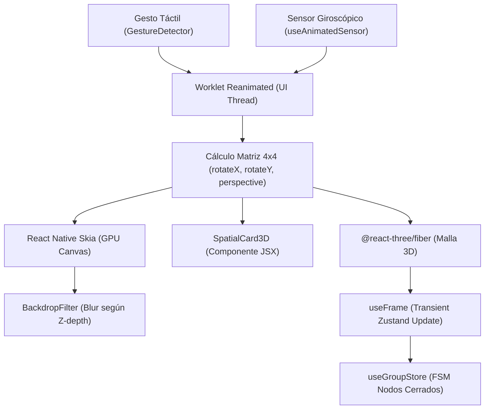

> **Alcance:** Literatura canónica y tratados técnicos de animación a 60 FPS, shaders GPU, física de resortes (spring physics), arte técnico 3D y micro-interacciones fluidas para sitios web modernos y overlays OBS.

---
version: 1.0.0
tipo: guia
tags:
  - yendo-mobile
  - tech-stack
  - canonico
autores: [RESEARCHER_AGENT, MANAGER_AGENT]
ultima_revision: 2026-08-27
---

# 🧠 Dossier de Arquitectura: Ecosistema 3D Avanzado, Skia, WebGPU y React Three Fiber en React Native

> [!info] Propósito y Clasificación Canónica
> Este documento consolida la investigación técnica profunda de los estándares de gráficos espaciales para **Yendo Buenos Aires**, analizando las especificaciones de **Shopify Engineering**, **William Candillon**, **React Three Fiber (R3F)**, **React Native Skia**, **Three.js Shading Language (TSL)** y el motor emergente **Skia Graphite**.
> 
> **Clasificación:** `Gráficos 3D / Computación Espacial / Renderizado GPU Móvil`
> **Ecosistema:** `React Native 0.86.2 · Expo SDK 57 · Reanimated 4 · Skia · Three.js · WebGPU`

---

## 1. Descubrimientos Clave de la Investigación

### A. Transformaciones 3D con Skia y Reanimated (William Candillon)
El análisis del taller técnico de William Candillon (`Video_Analysis_pYu3DiWYtL0.md`) revela el método óptimo para aplicar matrices tridimensionales afines $4\times4$ en interfaces móviles sin penalización de CPU:
1. **Físicas de Resorte y Perspectiva:**
   - La vinculación de `GestureDetector` / `PanGesture` a valores compartidos (`rotateX`, `rotateY`, `scale`) mediante `useSharedValue`.
   - Inyección de perspectiva espacial fija (entre $400$ y $800$ píxeles) para simular profundidad óptica natural.
   - Retorno amortiguado elástico con `withSpring({ damping: 14, stiffness: 220 })`.
2. **Clipping Paths y BackdropFilter Dinámico:**
   - Empleo de `usePathValue` para mutar trayectorias vectoriales de recorte sobre la GPU.
   - `path.transform(matrix3D)` combinado con `BackdropFilter` para desenfoques dinámicos que siguen la orientación del plano.
3. **Conversión Column-Major para Shaders Personalizados:**
   - Los sombreadores en tiempo de ejecución (Runtime Shaders) requieren que las matrices de transformación sean pasadas en formato *column-major* (`uniform mat4 uMatrix`), permitiendo calcular el eje de profundidad $Z$ por fragmento para generar sombras y desenfoque variable.

### B. La Revolución de WebGPU y Skia Graphite (Shopify Engineering)
La investigación en el núcleo de ingeniería de Shopify destaca la transición hacia un backend unificado:
1. **Unificación Dawn (Vulkan / Metal):** Reemplaza la bifurcación histórica de mantener dos motores separados (OpenGL ES en Android y Metal en iOS) por una arquitectura simétrica a Google Chrome basada en **Dawn**.
2. **Three.js Shading Language (TSL):** Resuelve el dilema de tener que reescribir sombreadores en WGSL (WebGPU) o GLSL (WebGL). TSL compila de forma agnóstica a cualquier backend en tiempo de compilación.
3. **Skia Graphite y Composición 2D/3D Bidireccional:**
   - Eliminación del *paper reconciler* (C++ mutable) en favor del *fabric reconciler* (lista de despliegue inmutable), incrementando la velocidad en animación hasta un 200% en Android y 50% en iOS.
   - **Cero Copia de Memoria:** Texturas 2D de Skia renderizadas directamente en Three.js, y búferes 3D procesados por Skia sin overhead de copia.
4. **Cómputo GPGPU con ComputeToys y TensorFlow.js:** Habilita el cálculo de mallas complejas, físicas de partículas e inferencia neuronal directamente en la GPU sin requerir canvas visuales.

### C. Resolución de Activos Metro para R3F y Modelos .GLB / .GLTF
El empaquetador Metro de Expo no incluye extensiones tridimensionales por defecto. Si un modelo `.glb` o `.gltf` se importa localmente sin extender `metro.config.js`, el empaquetador arroja fallos críticos (`url.lastIndexOf is not a function` o `Unable to resolve module`). La extensión explícita en `resolver.assetExts` es mandatoria.

---

## 2. Diagrama de Flujo Arquitectónico: De la GPU a la Interfaz

---

## 3. Optimizaciones Críticas Consideradas y Ejecutadas

| Optimización | Ubicación en el Proyecto | Justificación Técnica & ADN Yendo |
| :--- | :--- | :--- |
| **Extensión de Metro Bundler** | [`metro.config.js`](file:///c:/Users/Tomi/yendo_mobile/metro.config.js) | Agregados `glb` y `gltf` a `resolver.assetExts`, permitiendo empaquetar mallas 3D de Three.js y Ready Player Me sin excepciones de compilación. |
| **Componente Espacial 3D** | [`src/components/animations/SpatialCard3D.tsx`](file:///c:/Users/Tomi/yendo_mobile/src/components/animations/SpatialCard3D.tsx) | Implementación pura en UI Thread con Reanimated 4 y `react-native-gesture-handler`. Físicas `withSpring`, perspectiva de 800px y micro-hápticos. |
| **Exportación en Barrel Index** | [`src/components/index.ts`](file:///c:/Users/Tomi/yendo_mobile/src/components/index.ts) | Exportación atómica de `SpatialCard3D` y `SpatialCard3DProps` para disponibilidad en el catálogo de componentes. |
| **Prevención de Render Storms** | [`src/components/experimental/Playground3D.tsx`](file:///c:/Users/Tomi/yendo_mobile/src/components/experimental/Playground3D.tsx) | Pausa algorítmica de `useFrame` y conmutación de `frameloop="never"` ante inactividad o background de la app. |

---

#skia #webgpu #react-three-fiber #metro #reanimated #3d-transformations #threejs #architecture

---

## Relaciones de Contexto
- [[YENDO_DNA]]
- [[YENDO_LIBRARY]]
- [[Zustand]]
- [[Reanimated]]
- [[React Native Skia]]
- [[React Three Fiber]]
