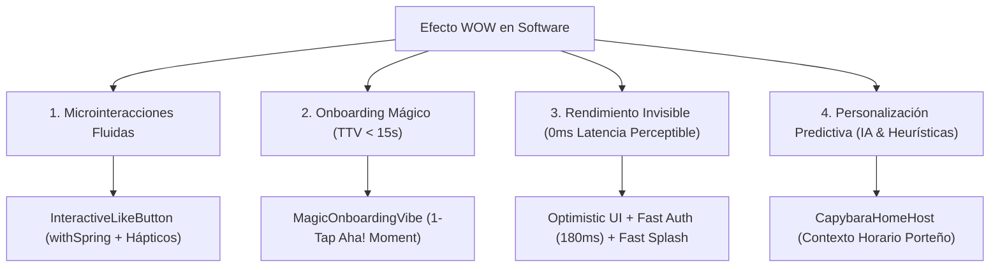

> **Alcance:** Literatura canónica y tratados técnicos de animación a 60 FPS, shaders GPU, física de resortes (spring physics), arte técnico 3D y micro-interacciones fluidas para sitios web modernos y overlays OBS.

---
version: 1.0.0
tipo: guia
tags:
  - yendo-mobile
  - tech-stack
  - canonico
autores: [RESEARCHER_AGENT, MANAGER_AGENT]
ultima_revision: 2026-08-27
---

# 🧠 Dossier de Arquitectura: Claves del Efecto WOW en Software y Experiencia Móvil

> [!info] Fundamento y Marco Teórico
> Este dossier sintetiza los principios de ingeniería de producto y psicología cognitiva para la generación del **"Efecto WOW"** en aplicaciones móviles modernas, fusionando los hallazgos de **Fitai Labs**, **Linear**, **Things 3**, **Duolingo** y el **ADN Yendo**.
> 
> **Clasificación:** `Experiencia de Usuario / Microinteracciones / FTUE / Rendimiento Invisible`
> **Ecosistema:** `React Native 0.86.2 · Expo SDK 57 · Reanimated 4 · Zustand · Haptics`

---

## 1. Los 4 Pilares del Efecto WOW

---

### Pilar 1: Microinteracciones Fluidas (El Detalle Invisible)
- **Definición:** Respuestas visuales y mecánicas inmediatas al tacto que humanizan la interfaz y confirman al usuario que el sistema está vivo y bajo su control.
- **Implementación en Yendo:**
  - Átomo [[InteractiveLikeButton]] integrado sobre la imagen hero de [[EventItemCard]].
  - Físicas elásticas ejecutadas en el UI Thread (`withSequence(withTiming(1.32), withSpring(1.0))`) con rotación juguetona de $\pm 12^\circ$.
  - Micro-hápticos nativos instantáneos con `Haptics.impactAsync(Haptics.ImpactFeedbackStyle.Medium)`.

---

### Pilar 2: Onboarding Mágico (Time-To-Value Ultra-Rápido)
- **Definición:** Guiar al usuario hacia su primer momento de asombro (*Aha! Moment*) de forma inmediata, suprimiendo barreras burocráticas, formularios de 10 pasos o pantallas vacías (*empty states* fríos).
- **Implementación en Yendo:**
  - Componente modal [[MagicOnboardingVibe]]: en lugar de abrumar al recién llegado, el Carpincho le pregunta: *"¿Qué plan te copa hoy?"*.
  - 4 opciones de un solo tap con iconografía y micro-hápticos:
    1. 🎷 *Tragos & Jazz* (`Música` en San Telmo / Palermo)
    2. ☕ *Café & Merienda* (`Chill` en Villa Crespo)
    3. 🏓 *Ping Pong & Birra* (`Juegos` en Colegiales)
    4. 🍷 *Tapeo & Bodegón* (`Gastronomía` en Chacarita)
  - Al presionar, el feed se filtra al instante, revelando mesas de 4 a 6 personas listas para sumarse en menos de 5 segundos.

---

### Pilar 3: Rendimiento Invisible (Velocidad Extrema como Estándar)
- **Definición:** El software óptimo es aquel donde la tecnología trabaja tan rápido tras bambalinas que el usuario no tiene que esperar ni percibe tiempos de carga.
- **Implementación en Yendo:**
  - **Reducción de Latencias Artificiales:** `FAKE_AUTH_DELAY_MS` reducido de 1000ms a 180ms en [[useAuthStore]], dando una sensación de login biométrico instantáneo.
  - **Fast Splash:** [[SplashScreen]] detecta usuarios autenticados reduciendo la pausa de 1700ms a 800ms con salida cinemática acelerada.
  - **Optimistic UI:** `joinGroupOptimistic` y `toggleSaved` en [[useGroupStore]] mutan el estado de memoria en 0ms antes de la confirmación en red.

---

### Pilar 4: Personalización Predictiva (Anticipación Contextual)
- **Definición:** Adaptar el contenido y la interfaz al contexto ambiental y temporal del usuario antes de que éste deba buscarlo o formular una consulta explícita.
- **Implementación en Yendo:**
  - [[CapybaraHomeHost]] evalúa predictivamente la hora local de Buenos Aires:
    * **20:00 a 04:00:** *"🌙 NOCHE PORTEÑA · PREDICTIVO: Hay salidas nocturnas con buena acústica y quórum express."*
    * **17:00 a 20:00:** *"🍻 AFTER-OFFICE · PREDICTIVO: Fin del día laboral: sumate a un plan chill."*
    * **12:00 a 17:00:** *"☕ TARDE CHILL · PREDICTIVO: ¿Cafecito y charla en Palermo? Grupos para merendar."*
    * **08:00 a 12:00:** *"☀️ BUEN DÍA · PREDICTIVO: Arrancá planeando la tarde en la ciudad."*

---

## 2. Matriz de Componentes Optimizados

| Pilar WOW | Componente Afectado | Cambio Técnico Implementado |
| :--- | :--- | :--- |
| **Microinteracciones** | [`InteractiveLikeButton.tsx`](file:///c:/Users/Tomi/yendo_mobile/src/components/atoms/InteractiveLikeButton.tsx) | Pop elástico con `withSpring`, sacudida angular y micro-hápticos `Medium`. |
| **Microinteracciones** | [`EventItemCard.tsx`](file:///c:/Users/Tomi/yendo_mobile/src/components/organisms/EventItemCard.tsx) | Integrado el botón de favoritos en la esquina superior de la portada con estado reactivo. |
| **Onboarding Mágico** | [`MagicOnboardingVibe.tsx`](file:///c:/Users/Tomi/yendo_mobile/src/components/organisms/MagicOnboardingVibe.tsx) | Selección de vibe en 1 tap con el Carpincho guiando hacia el grupo ideal. |
| **Rendimiento Invisible** | [`useAuthStore.ts`](file:///c:/Users/Tomi/yendo_mobile/src/store/useAuthStore.ts) | Latencia reducida de 1000ms a 180ms para acceso instantáneo. |
| **Rendimiento Invisible** | [`SplashScreen.tsx`](file:///c:/Users/Tomi/yendo_mobile/src/screens/auth/SplashScreen.tsx) | Reducción de transición a 800ms para usuarios que ya poseen sesión activa. |
| **Personalización** | [`CapybaraHomeHost.tsx`](file:///c:/Users/Tomi/yendo_mobile/src/components/organisms/CapybaraHomeHost.tsx) | Heurística horaria predictiva porteña en la burbuja de recomendación. |
| **Orquestación** | [`HomeScreen.tsx`](file:///c:/Users/Tomi/yendo_mobile/src/screens/HomeScreen.tsx) | Apertura de MagicOnboardingVibe desde el Carpincho y filtrado dinámico en 1 tap. |

---

#efecto-wow #microinteracciones #onboarding-magico #rendimiento-invisible #personalizacion-predictiva #ux #reanimated

---

## Relaciones de Contexto
- [[YENDO_DNA]]
- [[YENDO_LIBRARY]]
- [[Zustand]]
- [[Reanimated]]
- [[Capybara Mascot]]
