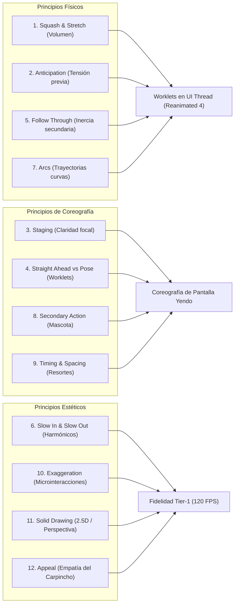

**Alcance:** Compendio de los 12 principios de animación de Disney (Illusion of Life) aplicados a micro-interacciones web y transiciones de estado. (Fuente migrada y curada desde Yendo Mobile Vault para la Software Factory Web y DiggityBets. NO sustituye las reglas de negocio locales ni los contratos primarios en `CANON_*`).

---
version: 1.0.0
tipo: guia
tags:
  - yendo-mobile
  - tech-stack
  - canonico
autores: [RESEARCHER_AGENT, MANAGER_AGENT]
ultima_revision: 2026-08-27
---

# 🎬 Compendio Playwright E2E: Las Biblias del Motion Design, Físicas y Principios de Animación en Yendo

> [!info] Clasificación Canónica y Alcance
> Este compendio sintetiza los tratados fundacionales del movimiento animado —encabezados por ***The Animator's Survival Kit*** de Richard Williams y ***Design for Motion*** de Austin Shaw—, traduciendo sus leyes cinemáticas universales a la arquitectura de **Web UI / Vanilla & Modern Frontend Reanimated 4**, **Worklets C++** y la física de interfaces de **Yendo Mobile**.
> 
> **Clasificación:** `Motion Design / Principios de Disney / Físicas de Resortes / Coreografía UI / Reanimated Worklets`  
> **Departamentos Asignados:** `MOTION_ART_DIRECTOR_AGENT · CREATIVE_TECH · CORE_AGENT · UI_AGENT`  
> **Objetivo de Rendimiento:** 120 FPS innegociables · Latencia táctil < 16ms · Zero Main Thread Blocking

---

## 1. 📖 Las Fuentes Canónicas

### A. *The Animator's Survival Kit* (Richard Williams, Faber & Faber, 2001)
Considerada la biblia definitiva de la animación tradicional. Williams, director de animación de *Who Framed Roger Rabbit* y ganador de tres premios de la Academia, codificó el conocimiento empírico de los pioneros de Walt Disney (*The Nine Old Men*) en una gramática matemática precisa basada en el espaciado (*spacing*), la sincronización (*timing*) y la física del peso.

### B. *Design for Motion: Fundamentals and Techniques of Motion Design* (Austin Shaw, Routledge, 2016/2019)
Tratado académico fundamental sobre la coreografía espacial y la semiótica visual en medios digitales. Explica cómo el movimiento no es un adorno cosmético, sino un sistema de **guía cognitiva** (*Cognitive Steering*) que dirige la atención, comunica jerarquía de información y otorga peso tangible al software.

---

## 2. 🧬 Los 12 Principios de Disney Traducidos a la UI de Yendo y Reanimated 4



### 1. Squash & Stretch (Compresión y Estiramiento)
- **Axioma Clásico:** Ningún objeto vivo es infinitamente rígido. Al impactar o acelerar, se deforma, pero **su volumen total debe permanecer estrictamente constante**.
- **Traducción a UI Móvil:** Al presionar botones interactivos ([`InteractiveLikeButton.tsx`](file:///c:/Users/Tomi/yendo_mobile/src/components/atoms/InteractiveLikeButton.tsx)) o tarjetas de evento, si la escala vertical disminuye a `0.94`, la horizontal debe expandirse a `1.04` para simular masa física:
  ```typescript
  // Ley de conservación de volumen en Reanimated:
  transform: [
    { scaleY: withSpring(0.94, springConfig) },
    { scaleX: withSpring(1.04, springConfig) },
  ]
  ```

### 2. Anticipation (Anticipación)
- **Axioma Clásico:** Antes de un salto o carrera, el cuerpo retrocede para acumular energía cinética.
- **Traducción a UI Móvil:** Antes de que un modal o drawer ([`ViralPassModal.tsx`](file:///c:/Users/Tomi/yendo_mobile/src/components/organisms/ViralPassModal.tsx)) se expanda en pantalla, se aplica una micro-retracción de 4px o un scale a `0.98` durante 40ms, preparando al ojo del usuario para la explosión de movimiento.

### 3. Staging (Puesta en Escena y Foco)
- **Axioma Clásico:** Cada fotograma debe transmitir una única idea visual con total claridad; si múltiples elementos compiten por la atención, el espectador se confunde.
- **Traducción a UI Móvil:** Durante la apertura del quórum de mesa, el fondo de la pantalla se oscurece con un velo accesible (`rgba(0,0,0,0.82)`) y los elementos no esenciales reducen su opacidad al 30%, dirigiendo el 100% de la atención táctil hacia el llamado a la acción.

### 4. Straight Ahead Action & Pose to Pose
- **Axioma Clásico:** *Pose to Pose* planifica fotogramas clave; *Straight Ahead* genera movimiento cuadro a cuadro.
- **Traducción a UI Móvil:** En Yendo, las transiciones estructurales de navegación son *Pose to Pose* (mapeadas en estados finitos de Zustand), mientras que los gestos táctiles directos (`Gesture.Pan()`, `Gesture.Pinch()`) son *Straight Ahead*, calculados cuadro a cuadro en milisegundo cero dentro de Worklets de C++.

### 5. Follow Through & Overlapping Action (Acción Continuada y Superpuesta)
- **Axioma Clásico:** Las partes no rígidas de un cuerpo continúan moviéndose después de que el cuerpo principal se ha detenido.
- **Traducción a UI Móvil:** Al deslizar una lista de tarjetas de eventos ([`EventItemCard.tsx`](file:///c:/Users/Tomi/yendo_mobile/src/components/organisms/EventItemCard.tsx)), la portada hero se detiene primero, y los chips de tags, avatares y el botón de guardar se acomodan con un retraso en cascada (*Stagger*) de 30ms a 60ms.

### 6. Slow In & Slow Out (Amortiguación Natural)
- **Axioma Clásico:** Los cuerpos aceleran gradualmente y desaceleran antes de frenar; el movimiento lineal constante se percibe robótico y antinatural.
- **Traducción a UI Móvil:** Prohibición absoluta de `Easing.linear` en transiciones de interfaz; reemplazo universal por osciladores armónicos amortiguados.

### 7. Arcs (Trayectorias en Arco)
- **Axioma Clásico:** La mayoría de las acciones mecánicas y orgánicas siguen trayectorias parabólicas o elípticas, nunca líneas rectas rígidas.
- **Traducción a UI Móvil:** Al arrastrar un elemento para descartarlo ([`SwipeableDeck.tsx`](file:///c:/Users/Tomi/yendo_mobile/src/components/animations/SwipeableDeck.tsx)), la traslación en el eje X está matemáticamente vinculada a una rotación angular suave ($Z = X \times 0.08$) y a una ligera caída parabólica en $Y$.

### 8. Secondary Action (Acción Secundaria)
- **Axioma Clásico:** Acciones subordinadas que enriquecen y dan credibilidad a la acción principal.
- **Traducción a UI Móvil:** Cuando la mascota ([`CapybaraInteractive.tsx`](file:///c:/Users/Tomi/yendo_mobile/src/components/organisms/CapybaraInteractive.tsx)) celebra que se alcanzó el quórum de mesa, la acción principal es el salto, mientras que la acción secundaria es el parpadeo de orejas y el movimiento del mate.

### 9. Timing & Spacing (Sincronización y Espaciado)
- **Axioma Clásico:** Más dibujos cercanos significan lentitud; dibujos separados significan velocidad. El *Timing* da la ilusión de peso y densidad.
- **Traducción a UI Móvil:**
  * Microinteracciones táctiles (taps, likes, switches): **120ms – 180ms**.
  * Modales, hojas de acción y pases sociales: **220ms – 320ms**.
  * Transiciones de pantalla y expansiones de mapa: **350ms – 420ms**.
  * Cualquier animación superior a 500ms es considerada un antipatrón de latencia percibida.

### 10. Exaggeration (Exageración)
- **Axioma Clásico:** Imitar la realidad exacta produce resultados estériles y aburridos; la caricaturización sutil acentúa la emoción.
- **Traducción a UI Móvil:** Cuando un usuario suma a su compañero (+1) y completa la mesa de 5 personas, el confeti y el rebote del sello del Carpincho se sobredimensionan un 15% antes de asentarse, produciendo el **Efecto WOW** de logro presencial.

### 11. Solid Drawing (Dibujo Sólido y Volumen Espacial)
- **Axioma Clásico:** Considerar las formas en el espacio tridimensional con peso, profundidad y sombras consistentes.
- **Traducción a UI Móvil:** Aplicación de perspectiva óptica de 800px en tarjetas tridimensionales ([`SpatialCard3D.tsx`](file:///c:/Users/Tomi/yendo_mobile/src/components/animations/SpatialCard3D.tsx)) con sombreado degradado dinámico según el giroscopio.

### 12. Appeal (Carisma y Conexión Emocional)
- **Axioma Clásico:** El diseño de personajes debe resultar magnético, empático y memorable.
- **Traducción a UI Móvil:** La personalidad serena, sociable y cálida de la mascota oficial (el Carpincho porteño) y el microcopy cercano (*"Che, ¿yendo?"*) humanizan la tecnología.

---

## 3. 📐 Fundamentos Matemáticos: Ley de Hooke vs. Linear Easing

El departamento de `[[CORE_AGENT]]` y `[[CREATIVE_TECH]]` establece formalmente el abandono de las curvas de Bézier predefinidas (`cubic-bezier`) para todas las interacciones táctiles, adoptando el **Oscilador Armónico Amortiguado**:

$$F(t) = -k \cdot x(t) - c \cdot v(t)$$

Donde:
- $k$: Constante de rigidez (*Stiffness*). Determina la aceleración de retorno al punto de equilibrio.
- $c$: Coeficiente de amortiguamiento (*Damping*). Controla la absorción de energía y la disipación del rebote.
- $m$: Masa inercial del elemento virtual ($m = 1.0$).

### Configuración Canónica de Resortes en Yendo:
```typescript
export const springPresets = {
  /** Respuesta táctil instantánea para botones (snappy, sin rebote excesivo) */
  snappy: { damping: 20, stiffness: 300, mass: 0.8 },
  /** Modales, tarjetas hero y pases virales (fluidez cinematográfica) */
  modal: { damping: 18, stiffness: 220, mass: 1.0 },
  /** Rebound juguetón para la mascota y badges de celebración */
  bouncy: { damping: 12, stiffness: 180, mass: 1.2 },
} as const;
```

---

## 4. 🧭 Principios de Austin Shaw para Coreografía de Pantalla

1. **Lead-and-Follower:** El elemento de mayor jerarquía semántica (el título del plan o la mesa de 5) se mueve primero; los elementos satélites (precio, dirección, avatares) lo siguen con desfase direccional.
2. **Continuidad Visual de la Mirada:** Cuando el usuario toca una experiencia en el Feed, la imagen de portada no desaparece para cargar otra; se expande fluidamente mediante **Shared Element Transitions** guiando la fóvea ocular del usuario sin saltos de contexto.

---

#motion-graphics #animators-survival-kit #richard-williams #austin-shaw #reanimated #spring-physics #worklets #disney-principles

---

## Relaciones de Contexto
- [[YENDO_DNA]]
- [[YENDO_LIBRARY]]
- [[Zustand]]
- [[Reanimated]]
- [[Capybara Mascot]]
