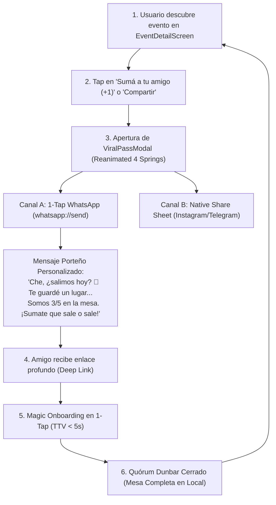

**Alcance:** Ingeniería de viralidad, coeficientes K, compartición social de victorias y retención de comunidades digitales. (Fuente migrada y curada desde Yendo Mobile Vault para la Software Factory Web y DiggityBets. NO sustituye las reglas de negocio locales ni los contratos primarios en `CANON_*`).

---
version: 1.0.0
tipo: research
tags:
  - yendo-core
  - growth-viral
  - en-progreso
autores: [RESEARCHER_AGENT, MANAGER_AGENT]
ultima_revision: 2026-08-27
---

# 🧠 Dossier de Arquitectura: Mecánicas de Marketing Viral, Bucles de Crecimiento y Pase Social 2026

> [!info] Clasificación Canónica
> Este documento sintetiza los descubrimientos de frontera sobre **Marketing Viral Móvil**, analizando los modelos de **Jonah Berger** (*Contagious - STEPPS*), **Lenny Rachitsky** (*Product-Led Growth Loops*), **Sean Ellis** (*Hacking Growth*) y casos de estudio contemporáneos (Partiful, Locket Widget, Duolingo, Strava), articulando la implementación técnica del nuevo **Pase Social / Ticket Porteño** en **Yendo**.
> 
> **Clasificación:** `Growth Engineering / Viral Marketing / Product-Led Distribution / UX Psicológica`
> **Ecosistema:** `Web UI / Vanilla & Modern Frontend 0.86.2 · Web Platform SDK 57 · Reanimated 4 · WhatsApp Deep Linking · MD3 Dark-First`

---

## 1. 🔍 Descubrimientos Clave en Marketing Viral Móvil (2026)

### A. La Trampa de la "Viralidad Forzada" vs. "Product-Led Virality"
- **El Error Histórico:** La mayoría de las aplicaciones fracasan al intentar viralizarse porque tratan el compartir como una función accesoria (un botón de "Compartir" genérico escondido en un menú).
- **La Solución de Producto (Lenny Rachitsky):** Los bucles de crecimiento sostenibles son aquellos donde el acto de compartir **es el producto mismo**:
  * En *Calendly*, enviar una invitación es la distribución.
  * En *Partiful*, compartir el flyer con RSVP es la distribución.
  * En *Yendo*, compartir el **Pase Social / Ticket de Salida** con el amigo (+1) para cerrar la mesa de 5 personas es la distribución nativa.

### B. Los 6 Motores STEPPS de Jonah Berger Aplicados al Ecosistema Rioplatense
1. **Social Currency (Moneda Social):** El usuario que comparte un plan gastronómico o cultural curado en Palermo/San Telmo queda posicionado ante sus amigos como un anfitrión sofisticado y con "buen ojo", no como un promotor comercial.
2. **Triggers (Disparadores Ambientales):** Los jueves y viernes a las 18:00 hs (after-office) y sábados al mediodía actúan como detonantes contextuales que despiertan la pregunta: *"¿Qué sale hoy?"*.
3. **Emotion (Emoción de Alta Intensidad):** El entusiasmo por conocer gente nueva y el alivio de la ansiedad social al poder asistir acompañado de un compañero de confianza.
4. **Public (Observabilidad):** El diseño visual del ticket con bordes troquelados, sello del Carpincho y acreditación de quórum lo convierte en un artefacto reconocible en capturas de pantalla de WhatsApp e Instagram Stories.
5. **Practical Value (Valor Práctico):** Reservar una mesa sin pagar comisiones usureras, evitando que la salida se cancele por falta de quórum.
6. **Stories (Narrativa):** La aventura de la noche porteña compartida cara a cara, respaldando el minimalismo digital.

---

## 2. 📐 Diagrama del Bucle Viral Nativo Implementado en Yendo

---

## 3. 🛠️ Componentes Técnicos Implementados

1. **[`ViralPassModal.tsx`](file:///c:/Users/Tomi/yendo_mobile/src/components/organisms/ViralPassModal.tsx):**
   - Tarjeta troquelada estilo ticket con estética Dark-First (`#121212`, `#161616`, `#FF5500`).
   - Mapeo de micro-hápticos `Medium` con `expo-haptics`.
   - Barra de progreso de Quórum Dunbar en tiempo real (`occupiedSlots / totalCapacity`).
   - Sello de calidad: *"Aprobado por el Carpincho 🧉 · Plan Anti-Doomscrolling"*.
   - Distribución en 1 tap a WhatsApp mediante `Linking.openURL` con fallback automático a `Share.share`.
2. **Integración en [`EventDetailScreen.tsx`](file:///c:/Users/Tomi/yendo_mobile/src/screens/EventDetailScreen.tsx):**
   - Banner interactivo de acompañante (+1) posicionado estratégicamente antes de los grupos activos.
   - Header flotante con botón de compartir conectado directamente al `ViralPassModal`.
   - Cálculo automático del horario y cupos de la experiencia.
3. **Exportación en el Design System ([`index.ts`](file:///c:/Users/Tomi/yendo_mobile/src/components/index.ts)):**
   - Disponible para ser reutilizado en `GroupChatScreen`, `HomeScreen` y en los flujos de reserva.

---

#growth #viral-marketing #stepps #product-led-growth #viral-loops #reanimated #yendo

---

## Relaciones de Contexto
- [[Número de Dunbar]]
- [[Reanimated]]
- [[Capybara Mascot]]
- [[YENDO_DNA]]
- [[YENDO_LIBRARY]]
