# Tratado Canónico: Libros Abiertos de Tipografía, Redes de Alto Rendimiento, Arquitectura Chromium RenderingNG y Patrones Web (2026)

**Alcance:** Síntesis técnica de libros abiertos y documentación oficial de **Tipografía Práctica (*Butterick's Practical Typography*), Diseño Web Resiliente (*Jeremy Keith*), Redes de Alto Rendimiento (*High Performance Browser Networking — Ilya Grigorik*), Arquitectura Interna del Navegador (*Google Chromium RenderingNG*), Patrones Modernos de Ingeniería Frontend (*Patterns.dev — Addy Osmani & Lydia Hallie*) y Currícula Oficial *web.dev* (`LCP`, `INP`, `CLS`, `LoAF`)**. NO es fuente de criptografía ni de protocolos de chat.

---

## 1. *Butterick's Practical Typography* (Matthew Butterick) & *Resilient Web Design* (Jeremy Keith)

`[VERIFICADO: practicaltypography.com, resilientwebdesign.com]`

### 1.1 Las 5 Reglas de Oro de Butterick para Interfaces Digitales
1. **La Tipografía es para el Lector, no para el Escritor**: El éxito de una interfaz se mide por la velocidad con la que el ojo humano escanea cifras, estados y jerarquías sin fatiga cognitiva.
2. **Longitud de Línea (*Measure*: 45–75 caracteres)**: Las líneas de texto que superan los 80 caracteres obligan al ojo a perder el renglón al volver al margen izquierdo. Aplicar siempre `max-width: 65ch` en bloques de lectura.
3. **Espaciado entre Letras (*Tracking*) Proporcional al Tamaño**:
   - Titulares grandes (`>= 28px`): requieren *tracking* ligeramente negativo (`letter-spacing: -0.02em` a `-0.03em`) para compactar ópticamente las palabras.
   - Etiquetas en mayúsculas pequeñas (*All-Caps Badges* `10px–12px`): requieren *tracking* positivo generoso (`letter-spacing: 0.06em` a `0.10em`) para evitar que las letras se apelotonen.
4. **Cifras Tabulares (`tabular-nums`) vs. Proporcionales**:
   - En tablas de datos, marcadores en tiempo real, relojes y saldos monetarios, cada dígito (`0` al `9`) debe ocupar exactamente el mismo ancho horizontal (`font-variant-numeric: tabular-nums`).
5. **Mejora Progresiva (*Resilient Web Design* — Jeremy Keith)**:
   - Construir en 3 capas: (1) HTML semántico funcional y accesible, (2) Layout algorítmico CSS resiliente a cualquier tamaño de pantalla, y (3) Enriquecimiento progresivo con animaciones y WebSockets.

---

## 2. Arquitectura Interna del Navegador: *Google Chromium RenderingNG*

`[VERIFICADO: developer.chrome.com/docs/chromium/renderingng-architecture]`

Comprender las **10 Etapas del Pipeline de Renderizado de Chromium (*RenderingNG*)** es indispensable para mantener **60 FPS (`16.6ms` por cuadro)** y `<= 5% CPU` en OBS:

```mermaid
flowchart LR
    subgraph Main["Hilo Principal (Main Thread — JS & DOM)"]
        S1["1. Animate (rAF)"] --> S2["2. Style (Recalc CSS)"]
        S2 --> S3["3. Layout (Geometría)"]
        S3 --> S4["4. Pre-Paint (Property Trees)"]
        S4 --> S5["5. Paint (Display Lists)"]
        S5 --> S6["6. Commit (Hacia Compositor)"]
    end
    subgraph Comp["Hilo Compositor & Proceso GPU (Viz)"]
        S7["7. Layerize & Tile"] --> S8["8. Raster (Skia GPU)"]
        S8 --> S9["9. Activate & Draw Quads"]
        S9 --> S10["10. Present Frame (VSync)"]
    end
    S6 --> S7
```

### Reglas de Ingeniería Derivadas de *RenderingNG*:
1. **Ruta Rápida del Compositor (*Fast-Path Compositing*)**:
   - Cuando solo cambian `transform`, `opacity` o un `@property` en una capa aislada, Chromium **salta por completo las etapas 2, 3, 4 y 5 del Hilo Principal** y anima directamente en el Hilo Compositor (`Etapas 7–10`), garantizando 60 FPS incluso si JavaScript está ocupado.
2. **Aislamiento de Sub-Árboles con `contain` y `content-visibility`**:
   - Declarar `contain: layout style paint;` en tarjetas independientes y `content-visibility: auto; contain-intrinsic-size: 0 48px;` en filas de tablas largas recorta el costo de las etapas `Style` y `Layout` en más de un **70%**.
3. **Prevención de *Layout Thrashing* (Sincronización Forzada)**:
   - Leer una propiedad geométrica (`offsetWidth`, `getBoundingClientRect()`, `scrollTop`) inmediatamente después de mutar el DOM obliga a Chromium a ejecutar `Style` y `Layout` sincrónicamente en mitad de JavaScript. **Regla**: Agrupar todas las lecturas antes que todas las escrituras (*FastDOM pattern*).

---

## 3. *High Performance Browser Networking* (Ilya Grigorik) & *Patterns.dev* (Addy Osmani)

`[VERIFICADO: hpbn.co, patterns.dev, web.dev/learn/performance]`

### 3.1 Optimización de Transporte y Tiempo Real (*HPBN*)
- **Reutilización de Conexiones y Compresión**: En aplicaciones conectadas a Cloudflare Edge, minimizar los *round-trips* (RTT) agrupando lecturas iniciales y utilizando un único canal multiplexado (WebSocket con hibernación o `BroadcastChannel` entre pestañas locales) en lugar de múltiples *short-polling timers*.
- **Backoff Exponencial con *Full Jitter***: Ante una desconexión de red, nunca reconectar en intervalos fijos (provoca *Thundering Herd*); aplicar:
  $$t_{\text{sleep}} = \min\left(t_{\text{max}},\ t_{\text{base}} \cdot 2^{\text{attempt}}\right) \cdot \text{rand}(0.5, 1.0)$$

### 3.2 Optimización de *Core Web Vitals* (`LCP`, `INP`, `CLS` & `LoAF`)
1. **Largest Contentful Paint (`LCP <= 1.8s`)**:
   - El elemento héroe visible en el primer pantallazo debe cargarse con `fetchpriority="high"` y jamás depender de una cadena de peticiones JS en cascada. Imágenes fuera del primer pantallazo llevan `loading="lazy" decoding="async"`.
2. **Interaction to Next Paint (`INP <= 100ms`) & Long Animation Frames (`LoAF < 50ms`)**:
   - Ningún manejador de eventos (`click`, `input`, `keydown`) debe bloquear el hilo principal por más de `50ms`. Dar respuesta visual inmediata en el primer frame y ceder el hilo (`requestAnimationFrame` o `setTimeout(..., 0)` / `scheduler.yield()`) antes de cálculos pesados.
3. **Cumulative Layout Shift (`CLS === 0.00`)**:
   - Toda imagen, avatar, iframe o contenedor de carga asíncrona debe reservar su espacio exacto mediante `width`/`height` explícitos o `aspect-ratio`.

---
**Conexiones del Grafo (Obsidian):** [[INDEX]] · [[DESIGN_MASTERY_2026]] · [[AGENT_CREATIVE_AND_VISUAL_AWARENESS_2026]] · [[CANON_REFACTORING_UI_WATHAN_SCHOGER]] · [[CANON_PRACTICAL_UI_ADHAM_DANNAWAY]] · #ui_ux_design
