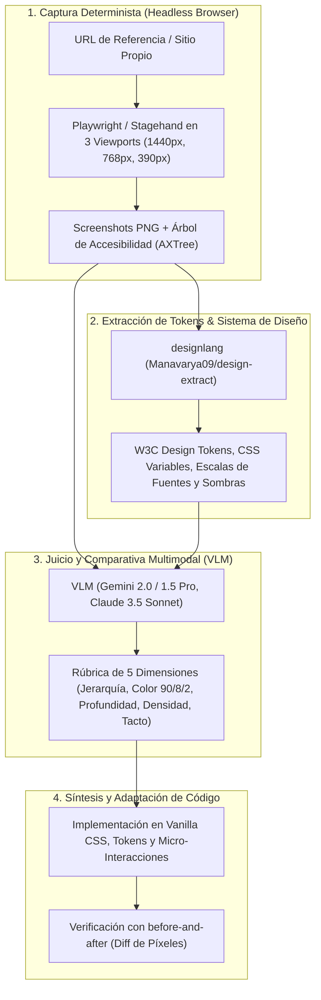

# CANON SOTA 2026: Percepción Visual, Minería de Referencias y Extracción de Sistemas de Diseño para Agentes de IA

> **Área:** Visual Web Agents, Multimodal GUI Understanding, Design Token Extraction & Visual Benchmarking  
> **Estado:** Documento Canónico de Conocimiento del Equipo de Agentes  
> **Indexación:** Integrado en RAG (MiniSearch BM25 + Qdrant Cloud RRF)  
> **Costo:** **$0 USD / $0 ARS** (Herramientas 100% Open-Source)

---

## 1. La Arquitectura de Percepción Visual del Equipo de Agentes

Para que un equipo de agentes de IA desarrolle interfaces verdaderamente atractivas, no basta con leer código HTML y CSS: **debe ser capaz de "ver" como un diseñador humano**.

El pipeline de percepción visual consta de 4 capas:

---

## 2. Papers Seminales en Agentes Visuales de Navegación e Interfaces

| Paper / Autores | Conferencia / Año | Hallazgo / Aporte Central |
| :--- | :--- | :--- |
| **WebVoyager: Building an End-to-End Web Agent with Large Multimodal Models** *(He et al.)* | ACL 2024 [arXiv:2401.13919] | Demuestra que los agentes web que combinan capturas de pantalla visuales con Set-of-Marks (SoM) superan por más de 30% a los agentes basados exclusivamente en texto o HTML DOM. |
| **VisualWebArena: Evaluating Multimodal Agents on Realistic Visual Web Tasks** *(Koh et al.)* | 2024 [arXiv:2401.13649] | Benchmark estándar de tareas web altamente visuales (mapas, comercio electrónico con fotos, sliders y layouts complejos) donde el texto solo es insuficiente. |
| **CogAgent: A Visual Language Model for GUI Agents** *(Hong et al.)* | CVPR 2024 [arXiv:2312.08914] | VLM con módulo de atención de alta resolución (1120×1120) especializado en detectar pequeños iconos, botones y textos densos en pantallas web y móviles. |
| **SeeClick: Harnessing GUI Grounding for Advanced Visual GUI Agents** *(Cheng et al.)* | 2024 [arXiv:2401.10935] | Modelo enfocado en "Grounding" visual: transforma descripciones en lenguaje natural en coordenadas `(x, y)` precisas sin depender de identificadores DOM frágiles. |
| **InfiGUI-R1: Advancing Multimodal GUI Agents via Deliberative Reasoning** *(2025)* | arXiv 2025 | Incorpora razonamiento deliberativo ("System 2 Thinking") para que los agentes visuales planifiquen y comparen estados de interfaz antes de ejecutar acciones. |

---

## 3. Repositorios y Herramientas Clave en GitHub

### 3.1 Extracción de Sistemas de Diseño: `designlang` (`Manavarya09/design-extract`)
- **Repositorio:** `https://github.com/Manavarya09/design-extract` (Clonado en `references/software-factory/design-extract/`).
- **Comando rápido:** `npx designlang <url> --screenshots --dark`
- **Capacidades:**
  - Extrae el sistema de diseño completo de cualquier sitio web en producción: colores primarios y de superficie, escala tipográfica (font-family, line-height, letter-spacing), sistema de espaciado (base de 8pt o 4pt), sombras multicapa y radios de borde.
  - Genera 8 archivos clave: `DESIGN.md` (formato para LLMs), `tokens.css`, `design-tokens.json` (W3C), `tailwind.config.js` y reporte visual `preview.html`.
  - **Comparativa directa:** `npx designlang diff <urlA> <urlB>` compara visual y semánticamente dos sitios web.

### 3.2 Automatización Multimodal: `browserbase/stagehand`
- **Repositorio:** `https://github.com/browserbase/stagehand`
- **Capacidades:** SDK basado en Playwright que dota a los agentes de primitivas de visión: `observe()` (detecta elementos interactivos en pantalla), `extract()` (extrae datos estructurados de lo que se ve) y `act()` (interactúa usando visión o selectores auto-reparables).

### 3.3 Agente de Bucle Autónomo: `browser-use/browser-use`
- **Repositorio:** `https://github.com/browser-use/browser-use`
- **Capacidades:** Bucle continuo en Python donde el agente toma un objetivo, captura pantallas, localiza coordenadas y opera el navegador observando el resultado de cada acción como un ser humano.

### 3.4 Comparativa Visual de Píxeles: `vercel-labs/before-and-after`
- **Comando:** `npx @vercel/before-and-after before.png after.png --markdown`
- **Capacidades:** Genera tablas comparativas `| Before | After |` con diffing de píxeles y métricas de cambio para adjuntar evidencia visual en pull requests y auditorías.

---

## 4. Fuentes de Inspiración y Galerías de Referencia SOTA

Para que los agentes busquen referencias idóneas en cada caso de uso, el equipo debe consultar y crawlear:

| Fuente de Referencia | Enfoque de Diseño | Cuándo Consultarla |
| :--- | :--- | :--- |
| **[Darkmode.design](https://darkmode.design)** | Colección curada de sitios de alta gama en modo oscuro | Para calibrar paletas oscuras, niveles de negro, contraste de textos tenues y acentos de color. |
| **[Godly.website](https://godly.website)** | Sitios web con dirección de arte premiada y micro-interacciones | Para layouts asimétricos, tipografía expresiva, animaciones y transiciones de estado. |
| **[Awwwards](https://www.awwwards.com)** | Estándar global de diseño interactivo y 3D web | Para referencias de WebGL, WebGPU, efectos de cursor y scroll narrativo. |
| **[Mobbin](https://mobbin.com)** | Patrones reales de interfaces web y móviles | Para resolver flujos de usuario complejos (autenticación, tablas de transacciones, modales). |
| **Líderes de la Industria (Benchmarks Directos):** | Stake.com, Roobet, Rollbit, CSGOEmpire, Linear.app, Vercel, Apple | Referencias directas para casino, streaming de alta energía, dashboards analíticos y micro-interacciones táctiles. |

---

## 5. La Rúbrica de Crítica Visual de 5 Ejes

Al comparar nuestro sitio contra una referencia de alta gama, el VLM o agente evaluador aplica una rúbrica estructurada:

1. **Jerarquía Tipográfica (Escala y Peso):**
   - ¿El título principal (`font-display: Chakra Petch`) domina con autoridad sin romper en pantallas móviles?
   - ¿El texto secundario (`Outfit`) mantiene un ratio de contraste mínimo de 4.5:1 (WCAG AA)?
2. **Presupuesto Cromático (Regla 90/8/2):**
   - 90% fondos oscuros profundos (`#06080D`, `#0B0F19`).
   - 8% superficies intermedias de cristal y bordes semitransparentes.
   - 2% acentos de alta saturación (Dorado `#FFD700`, Verde Kick `#53FC18`, Cyan `#00E5FF`).
3. **Profundidad Física y Materiales:**
   - ¿Se utilizan bordes de luz (`inset 0 1px 0 rgba(255,255,255,0.12)`) en vez de sombras oscuras invisibles?
   - ¿El glassmorphism tiene saturación de color (`saturate(180%)`) y textura de ruido anti-banding?
4. **Densidad de Información y Economía de Espacio:**
   - ¿La información clave está visible "above the fold" sin requerir scroll infinito?
   - ¿Las tablas y componentes usan números tabulares (`tabular-nums`) para evitar vibraciones al actualizar valores?
5. **Tactilidad y Feedback de Interacción:**
   - ¿Los botones responden instantáneamente a la pulsación (`scale(0.965)`)?
   - ¿Las transiciones usan curvas de fluidos de Apple (`cubic-bezier(0.16, 1, 0.3, 1)`) en vez del genérico `ease`?

---

## 6. Libros y Video Cursos Canónicos para el Equipo

### 6.1 Libros Fundamentales
1. **Refactoring UI** *(Adam Wathan & Steve Schoger)*:
   - Pensar en escala de grises antes de aplicar color.
   - Usar escala de espaciado fija de 8pt (4, 8, 12, 16, 24, 32, 48, 64px).
   - Dar profundidad con bordes luminosos y sombras sutiles en capas.
2. **Designing Interfaces (3rd Edition)** *(Jenifer Tidwell)*:
   - Patrones de dashboards, tablas de datos densas, paneles colapsables y navegación adaptativa.
3. **The Elements of Typographic Style** *(Robert Bringhurst)*:
   - Ritmo vertical armónico, proporcionalidad entre tamaño de fuente y altura de línea (`line-height: 1.4-1.6`).
4. **Don't Make Me Think** *(Steve Krug)*:
   - Diseño obvio y auto-explicativo: un usuario debe entender el estado de un juego o sorteo en menos de 2 segundos.

### 6.2 Cursos y Recursos Oficiales
1. **Web.dev (Google Chrome Devs):** *Learn CSS, Learn Responsive Design, Learn Accessibility*. El estándar de oro de especificaciones nativas de la W3C.
2. **Animations on the Web (Emil Kowalski):** La guía definitiva de física de resortes, animaciones de layout FLIP y rendimiento a 60/120 FPS sin tocar el hilo principal de la CPU.
3. **Playwright Official Documentation & Trace Viewer:** Técnicas de captura determinista, snapshots visuales y emulación precisa de dispositivos móviles.

---
**Conexiones del Grafo (Obsidian):** [[INDEX]] · [[DESIGN_MASTERY_2026]] · [[AGENT_CREATIVE_AND_VISUAL_AWARENESS_2026]] · [[CANON_REFACTORING_UI_WATHAN_SCHOGER]] · [[CANON_PRACTICAL_UI_ADHAM_DANNAWAY]] · #ui_ux_design
