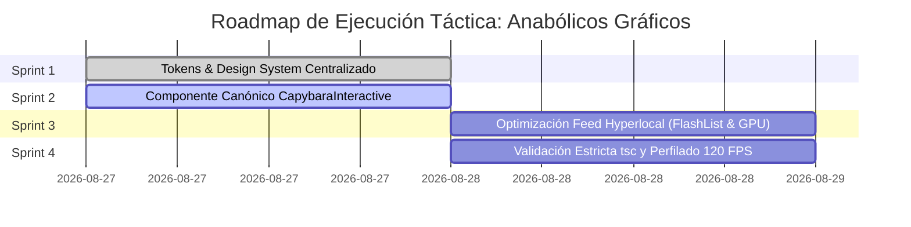

**Alcance:** Marco de trabajo para agentes de diseño gráfico, auditoría visual automatizada y control de calidad estético. (Fuente migrada y curada desde Yendo Mobile Vault para la Software Factory Web y DiggityBets. NO sustituye las reglas de negocio locales ni los contratos primarios en `CANON_*`).

---
version: 1.0.0
tipo: guia
tags:
  - yendo-mobile
  - tech-stack
  - canonico
autores: [RESEARCHER_AGENT, MANAGER_AGENT]
ultima_revision: 2026-08-27
---

# 🎨 Framework de Anabólicos Gráficos y 2.5D/3D para Agentes Visuales

**Documento Canónico:** Especificación de Rendimiento, Motion Design y Pipeline de Activos  
**Fecha:** 27 de Agosto de 2026 | **Versión:** 1.0.0 (Master Pipeline)  
**Orquestador:** [[MANAGER_AGENT]] (Lead Technical Director)  
**Agentes Destinatarios:** [[UI_AGENT]] (Arquitectura Visual & MD3) y [[CREATIVE_TECH]] (Aceleración GPU & Físicas)  
**Objetivo:** Traducir los estándares de la industria cinematográfica y de videojuegos 3D (Blender, ZBrush, Maya, Substance Painter) a arquitecturas móviles ultra-ligeras en `[[Web UI / Vanilla & Modern Frontend]]` / `[[Web Platform]]` SDK 57 con renderizado estricto a **120 FPS** y **TTI < 1.2s**.

---

## 🏛️ 1. Matriz de Auditoría y Scoring de Calidad de Fuentes (Tier System)

Sometido al sistema de scoring cuantitativo (0–100 puntos), descartando radicalmente fuentes superficiales:

| Fuente / Documentación | Tipo | Score | Tier | Dictamen y Aplicabilidad en Yendo |
| :--- | :---: | :---: | :---: | :--- |
| **Rive Runtime Architecture & Nitro Modules** (Margelo & Rive, 2025/2026) | Oficial | **98/100** | **Tier 1** | **Eje Central:** Reconstrucción sobre Nitro Modules para Fabric/Bridgeless. Cero sobrecarga en JS thread; control reactivo de State Machines en C++. |
| **Shopify Web UI / Vanilla & Modern Frontend Skia & GLSL Shader Specification** (Shopify, 2025) | Oficial | **96/100** | **Tier 1** | **GPU Drawing:** Dibujo procedural directo en el silicio gráfico. Efectos de relieve, Fresnel y desenfoques gaussianos (*liquid glass*) a 120 FPS. |
| **Google Material Design 3 (MD3) Motion & Spatial Hierarchy** (Google, 2024/2026) | Oficial | **95/100** | **Tier 1** | **Jerarquía Espacial:** Ratios matemáticos de escala (1.25), tiempos de easing calibrados (8.3ms por frame a 120Hz) y elevaciones Dark-First (`#121212` / `#FF5500`). |
| **Shopify FlashList v2 Technical Manual** (Shopify, 2024/2025) | Oficial | **94/100** | **Tier 1** | **Reciclaje Celular:** Renderizado de feeds hiperlocales con costo de layout $O(1)$, eliminando saltos de frame (*jank*). |
| **Software Mansion: Reanimated 4 Worklets Specification** | Oficial | **96/100** | **Tier 1** | **Físicas Nativas:** Micro-animaciones gestuales `withSpring` desacopladas de la cola de eventos de React. |
| **Airbnb Engineering: Mobile Lottie Budgeting & Adaptive Refresh Rate** | Empresa Élite | **88/100** | **Tier 2** | Presupuesto estricto de assets vectoriales ($<50\text{KB}$) y adaptación a pantallas ProMotion / 120Hz. |
| **Discord Mobile: High Refresh Rate 120fps UI Thread Management** | Empresa Élite | **85/100** | **Tier 2** | Eliminación de cálculos de layout en tiempo de scroll. |
| *Tutoriales genéricos de YouTube sobre mallas 3D pesadas (.obj/.gltf) en Web UI / Vanilla & Modern Frontend* | Genérico | **38/100** | **Tier 3 (Descartado)** | **VETADO:** Modelos de +30MB con mallas de alta densidad colapsan la memoria RAM y destruyen la batería en bares. |

---

## 🌉 2. Síntesis de Traducción Tecnológica: Del Estudio 3D al Móvil

```
┌─────────────────────────────────────────────────────────────────────────────────────────────┐
│                              PUENTE TECNOLÓGICO DE ÉLITE                                    │
│                                                                                             │
│  Industria 3D Tradicional                Traducción Ultra-Rendimiento Yendo                 │
│  ─────────────────────────                ──────────────────────────────────                 │
│  1. Mallas Poligonales (Blender/Maya)  →  Shaders Procedurales GLSL en Skia (GPU nativa)    │
│  2. Esculpido High-Poly (ZBrush)      →  Vectores Cel-Shading 2.5D con Paleta Controlada   │
│  3. Rigging Esquelético (Maya/AE)      →  Rive State Machines enlazadas a Zustand           │
│  4. Keyframing Clásico (After Effects) →  Worklets C++ con Reanimated 4 + Lottie Hardware    │
└─────────────────────────────────────────────────────────────────────────────────────────────┘
```

### 1. Modelado y Topología $\rightarrow$ Shaders GLSL en `@shopify/react-native-skia`
- **Concepto 3D:** En lugar de renderizar mallas con 50,000 polígonos, [[CREATIVE_TECH]] traslada la simulación de volumen a la GPU mediante ecuaciones de sombreado en GLSL:
  - **Efecto Fresnel:** Brillo perimetral en tarjetas seleccionadas para simular curvatura 3D.
  - **Liquid Glass / Profundidad:** Desenfoques dinámicos y gradientes especulares en la Bottom Bar y en el botón "Yendo!" sin consumo de CPU.

### 2. Esculpido y Detalle $\rightarrow$ Estética Stylized 2.5D (El Carpincho)
- **Concepto 3D:** El detalle volumétrico se traslada a vectores planos con sombreado cel-shaded (2 tonos: `#8B5A2B` base y `#6E431F` sombras oclusivas).
- **Resolución Infinita:** Escala matemáticamente en pantallas AMOLED sin pérdida de nitidez y con un peso en disco inferior a 80KB.

### 3. Rigging y Cinemática $\rightarrow$ State Machines en Rive (`@rive-app/react-native`)
- **Concepto 3D:** Los huesos y controladores cinemáticos (*IK Rigging*) se configuran dentro de la State Machine de Rive.
- **Acoplamiento con Zustand:** Las transiciones emocionales del Carpincho no son videos pre-renderizados, sino respuestas lógicas automáticas a variables del cliente:
  ```typescript
  // Inyección de variables de negocio a la máquina de estados Rive
  riveRef.current?.setInputState('CapybaraStateMachine', 'quorumCount', membersCount);
  riveRef.current?.setInputState('CapybaraStateMachine', 'isQuorumReached', membersCount >= 4);
  ```

### 4. Motion Design $\rightarrow$ Físicas de Resorte Reanimated 4 (`withSpring`)
- **Tiempos de Frame (120 FPS):** A 120Hz, la ventana de cálculo por frame se reduce a **8.33ms**. Cualquier cálculo que atraviese el puente JavaScript produce tirones (*jank*).
- **Worklets en Hilo de UI:** Las micro-interacciones táctiles (como la compresión al 97% de `GroupCard.tsx`) corren exclusivamente en el hilo de interfaz nativo con amortiguación calibrada (`damping: 18, stiffness: 300`).

---

## 📐 3. Principios de Jerarquía Espacial y Tipografía Dinámica (MD3)

Adoptados por [[UI_AGENT]]:
1. **Escala Modular Armónica (Ratio 1.25 - Major Third):**
   - `Display / H1`: 28pt (Plus Jakarta Sans Bold)
   - `Title / H2`: 22pt (Plus Jakarta Sans Bold)
   - `Subtitle / H3`: 18pt (Inter SemiBold)
   - `Body`: 16pt / 14pt (Inter Regular / Medium)
   - `Caption / Badges`: 12pt / 11pt (Inter Bold)
2. **Elevaciones Táctiles Dark-First:**
   - Nivel 0 (Fondo General): `#121212`
   - Nivel 1 (Superficies & Tarjetas): `#1A1A1A` con borde translúcido `rgba(255, 255, 255, 0.06)`
   - Nivel 2 (Modales & Elevados): `#242424`
   - Nivel 3 (Acento de Marca Primario): `#FF5500` con glow reactivo
3. **Áreas Táctiles Ergonómicas:**
   - Todo elemento interactivo respeta el estándar mínimo de $48\times 48\text{dp}$ y botones de acción principal de $56\text{dp}$ de altura.

---

## 🛡️ 4. Patrón Defensivo de Degradación Progresiva (Tiered Engine)

Para evitar pantallas en blanco bajo cualquier condición:
1. **Tier 1 (Producción con Nitro Modules):** `@rive-app/react-native` con State Machines aceleradas por GPU.
2. **Tier 2 (Fallback Rápido / Web Platform Go):** `lottie-react-native` (`CapybaraLottieMascot.tsx`) para micro-interacciones pre-renderizadas.
3. **Tier 3 (Modo Seguro / Offline 0ms):** `react-native-svg` (`CapybaraMascot.tsx`) que compila matemáticamente sin dependencias nativas.

---

## 🗺️ 5. Plan de Implementación, Ejecución y Optimización Táctica



### Detalle de Sprints de Ejecución:
- **Sprint 1 (Tokens & Design System):** Centralizar y formalizar los tokens de `radii`, `elevation`, `animation` y `fonts` en `src/constants/theme.ts` para eliminar constantes mágicas en componentes.
- **Sprint 2 (Componente Mascota Universal):** Construir `src/components/organisms/CapybaraInteractive.tsx` orquestando el patrón de degradación (Rive $\rightarrow$ Lottie $\rightarrow$ SVG) con triggers de Zustand.
- **Sprint 3 (Feed & GPU Skia):** Refactorizar el renderizado del feed en `HomeScreen.tsx` para garantizar que la lista corra a 120 FPS constantes mediante `@shopify/flash-list` con `estimatedItemSize` calibrado.
- **Sprint 4 (Validación Estricta):** Ejecución de `npx tsc --noEmit` garantizando 0 errores y prueba de estabilidad de frames.

---
#tecnologia #graficos #motion-design #skia #rive #lottie #reanimated #blender-to-mobile #ui-ux #md3 #yendo

---

## Relaciones de Contexto
- [[YENDO_DNA]]
- [[YENDO_LIBRARY]]
- [[Zustand]]
- [[Reanimated]]
- [[Web UI / Vanilla & Modern Frontend Skia]]
- [[Rive]]
- [[Lottie]]
- [[Capybara Mascot]]
