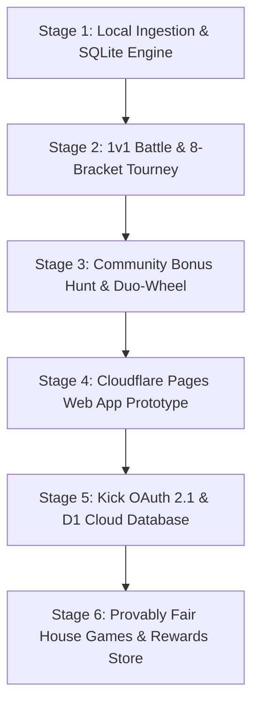

# Future Web Application Architecture & Cloud Migration Blueprint

> **Project:** HuntHub (Casino Stream Engagement Suite)  
> **Author:** Antigravity Architecture & Research Squad  
> **Date:** October 2026  
> **License & Cost:** 100% Permanently Free Tier ($0 USD / $0 ARS), Zero Credit Card Required.  
> **Compliance:** Curacao / Argentine / Kick TOS Compliant (Virtual currency only, zero custody, +18 notices).

---

## 1. Executive Summary

HuntHub is currently engineered as a zero-dependency local Node.js engine with OBS browser overlays and docks. This blueprint specifies the target cloud architecture to deploy the entire suite (Events, Points Engine, Duo-Wheels, 1v1 Battles, 8-Bracket Tournaments, Community Bonus Hunt, and Provably Fair Mini-Games) as a public, secure web platform accessible to viewers and the streamer at zero cost.

```
+-----------------------------------------------------------------------------------+
|                                  SPECTATOR VIEW                                   |
|  - View live bracket, battle, and bonus hunt status                               |
|  - Link Kick account via OAuth 2.1 PKCE                                           |
|  - Track personal stream points & wager in Provably Fair House Games               |
+-----------------------------------------------------------------------------------+
                                         │
                                         ▼
+-----------------------------------------------------------------------------------+
|                        FRONTEND (Cloudflare Pages - $0)                           |
|  - Single-Page Application (SPA) / Dark Glassmorphism Design                      |
|  - Cloudflare Turnstile (Bot protection, 100% free, no annoying captchas)         |
|  - ThumbmarkJS Device Fingerprinting (Canvas, Audio, WebGL, Screen)               |
+-----------------------------------------------------------------------------------+
                                         │
                                         ▼
+-----------------------------------------------------------------------------------+
|                     API & WEBSOCKET EDGE (Cloudflare Workers)                     |
|  - 100,000 requests/day free tier                                                 |
|  - Kick OAuth 2.1 PKCE authorization endpoint handler                             |
|  - Webhook RSA signature verifier (Channel points & live events)                  |
|  - WebSocket Hub for real-time overlay sync                                       |
+-----------------------------------------------------------------------------------+
                                         │
                                         ▼
+-----------------------------------------------------------------------------------+
|                   PERSISTENT STORAGE (Cloudflare D1 SQL Database)                 |
|  - 5,000,000 row reads / day (Free tier)                                          |
|  - 100,000 row writes / day (Free tier)                                           |
|  - 5 GB total storage (500 MB per DB)                                             |
|  - Sybil multi-account clustering, atomic points transactions, provably fair seeds|
+-----------------------------------------------------------------------------------+
```

---

## 2. Infrastructure & Cost Audit

| Service Component | Platform | Free Tier Quota | Credit Card Needed? | Cost |
| :--- | :--- | :--- | :--- | :--- |
| **Static Hosting (SPA)** | Cloudflare Pages | Unlimited bandwidth, custom domains, free SSL | **NO** | **$0.00** |
| **API Backend** | Cloudflare Workers | 100,000 requests/day | **NO** | **$0.00** |
| **Database** | Cloudflare D1 (Serverless SQLite) | 5M row reads/day, 100k writes/day, 5 GB storage | **NO** | **$0.00** |
| **Real-Time Sync** | WebSocket / Durable Objects | Hibernation API (zero idle CPU cost) | **NO** | **$0.00** |
| **Anti-Bot Defense** | Cloudflare Turnstile | Unlimited verifications | **NO** | **$0.00** |
| **Chat Ingestion** | Kick Pusher WebSocket | Unlimited real-time connection | **NO** | **$0.00** |

---

## 3. Kick Authentication & Verification Flow (OAuth 2.1 PKCE)

### 3.1 Authorization Sequence
To link a user's Kick account securely without passwords or tokens exposed in chat:

1. **Client-Side PKCE Generation:**
   - Viewer clicks *"Conectar con Kick"*.
   - Web app generates a high-entropy `code_verifier` (43-128 random characters) and computes the SHA-256 hash `code_challenge`:
     $$\text{code\_challenge} = \text{BASE64URL}(\text{SHA256}(\text{code\_verifier}))$$
2. **Kick Redirect:**
   - App redirects the viewer to `https://id.kick.com/oauth/authorize`:
     ```text
     https://id.kick.com/oauth/authorize?
       response_type=code&
       client_id=CLIENT_ID&
       redirect_uri=https://hunthub.pages.dev/auth/callback&
       scope=user:read+channel:read&
       code_challenge=CHALLENGE&
       code_challenge_method=S256&
       state=RANDOM_STATE
     ```
3. **Authorization Callback & Token Exchange:**
   - Kick redirects back to `redirect_uri` with an authorization `code`.
   - Cloudflare Worker executes a `POST` request to `https://id.kick.com/oauth/token` with the `code` and `code_verifier`.
   - Kick returns the authenticated viewer's `user_id`, `username`, and `profile_pic`.

### 3.2 Chat-Driven Verification Fallback
For viewers who do not want to leave the stream chat, the dual verification system works via chat handshake:
1. Viewer types `!link <stake_user>` in chat.
2. Bot verifies chat badge (Subscriber / VIP / Mod).
3. If account is flagged as new or unverified, bot whispers/replies with a 1-time 6-digit verification code to enter on the web app.

---

## 4. Multi-Account (Anti-Alt) & Anti-Sybil Defense

To prevent malicious users from farming stream points, manipulating bonus hunt calls, or multi-entering tournaments:

### 4.1 Client Fingerprinting (ThumbmarkJS)
The web client executes a silent client-side fingerprinting scan:
- **Canvas 2D Fingerprint:** Geometry, font rasterization, anti-aliasing signatures.
- **WebGL Signature:** GPU unmasked vendor and renderer strings.
- **AudioContext Fingerprint:** Frequency buffer processing latency and FFT signatures.
- **Hardware Profile:** Concurrency, device memory, platform, touch support.
- Generated hash: `device_fingerprint = sha256(...)`.

### 4.2 Cloudflare Turnstile Integration
- Replaces Google reCAPTCHA with an invisible, non-intrusive challenge.
- Validated on Worker edge before any points claim, tournament entry, or game round.

### 4.3 Database Sybil Clustering
When a user authenticates or makes a claim:
```sql
-- D1 Table: sybil_clusters
CREATE TABLE IF NOT EXISTS device_clusters (
  cluster_id TEXT PRIMARY KEY,
  device_fingerprint TEXT NOT NULL,
  ip_subnet TEXT NOT NULL,
  primary_user_id TEXT NOT NULL,
  created_at TIMESTAMP DEFAULT CURRENT_TIMESTAMP
);

CREATE TABLE IF NOT EXISTS account_links (
  user_id TEXT PRIMARY KEY,
  kick_username TEXT NOT NULL,
  stake_username TEXT UNIQUE,
  device_fingerprint TEXT,
  ip_subnet TEXT,
  is_flagged INTEGER DEFAULT 0
);
```
- **Rule 1:** Only 1 Kick account permitted per `device_fingerprint`. If a 2nd account shares the fingerprint, it is automatically shadowbanned.
- **Rule 2:** `stake_username` is strictly 1:1 unique.
- **Rule 3:** IP Subnet clustering: Maximum 2 accounts per `/24` IPv4 subnet.

---

## 5. Provably Fair House Games Engine

Viewers can wager their earned stream points on classic casino mini-games. All rounds are mathematically provably fair using HMAC-SHA256 commit-reveal draws:

### 5.1 Cryptographic Spec
1. **Server Seed Generation:**
   - Server creates a cryptographically secure 256-bit random seed: `server_seed`.
   - Before any bet is accepted, the server publishes the hash:
     $$\text{server\_seed\_hash} = \text{SHA256}(\text{server\_seed})$$
2. **Client Seed & Nonce:**
   - The user supplies their own `client_seed` (or browser generates one editable by the user).
   - Each round increments an integer `nonce` ($0, 1, 2, \dots$).
3. **Outcome Calculation:**
   $$\text{HMAC} = \text{HMAC\_SHA256}(\text{server\_seed}, \text{client\_seed} \parallel \text{nonce})$$
   - Byte sequences are converted to game-specific values with zero modulo bias.
4. **Reveal & Verification:**
   - When the seed pair is rotated, the plain `server_seed` is revealed. Viewers can independently verify every past round in an on-site calculator.

### 5.2 Games Architecture
1. **Blackjack:** Shuffled 52-card deck generated via Fisher-Yates with HMAC bytes. Soft 17 dealer rules, 3:2 blackjack payout.
2. **Roulette:** European 37-pocket (0 to 36). Outcome $= (\text{HMAC\_INT} \pmod{37})$.
3. **Plinko:** 8 to 16 rows. Each peg decision (Left=0, Right=1) derived from individual bits of the HMAC hash.
4. **Hi-Lo:** Next card value comparison with exact mathematical multiplier based on remaining probability.

---

## 6. Migration Stages & Phased Roadmap



1. **Stage 1 to 3 (CURRENT - 100% COMPLETE):**
   - Local Node.js engine, OBS browser overlays, custom OBS control docks, Duo-Wheel, 8-Bracket SVG tournament, Community Bonus Hunt tracker with exact $bht.bet$ formulas.
2. **Stage 4 (Cloudflare Pages Frontend):**
   - Host the web application on Cloudflare Pages.
   - Dark glassmorphism dashboard with public bracket viewing, live hunt tracker, and viewer profiles.
3. **Stage 5 (Cloud Edge API & Kick OAuth):**
   - Migrate local SQLite database to Cloudflare D1.
   - Add Kick OAuth 2.1 PKCE login and Turnstile anti-bot verification.
4. **Stage 6 (Points Economy & House Games):**
   - Provably fair Blackjack, Roulette, Plinko, and Hi-Lo.
   - Stream shop rewards redemption out-of-band.
