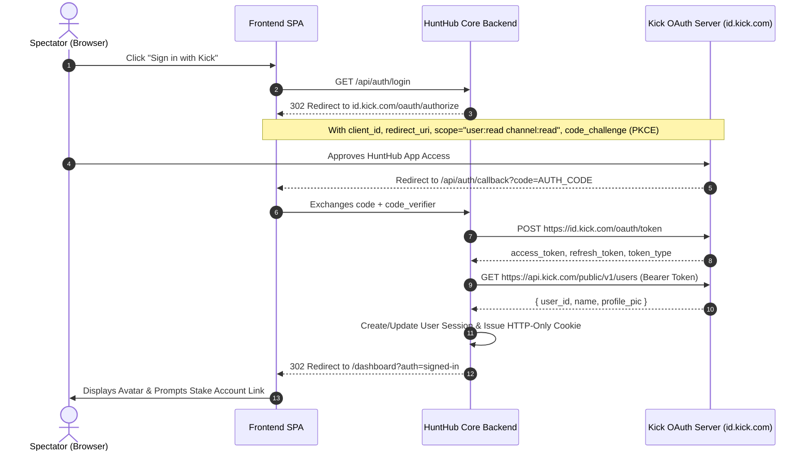

# Reverse Engineering & Architectural Blueprint: Top Casino Streamer Platforms

> **Document:** `research/STREAMER_SITES_REVERSE_ENGINEERING_REPORT.md`  
> **Authors:** Squad 1 (Research) & Squad 2 (Architecture & Backend)  
> **Target Sites Analyzed:**  
> 1. `https://www.reachaces.com/rewards` & `https://www.reachaces.com/weekly-raffles/`  
> 2. `https://schneckyirl.com/`  
> 3. `https://keithlocks.com/`  
> 4. `https://www.blakjac21.com/`  
> **Scope:** Kick OAuth 2.1 authentication, Stake affiliate linking, raffle mechanics, points/economy systems, Discord verification, anti-fraud device fingerprinting, and house game algorithms.

---

## 1. Executive Summary & Architectural Overview

Our forensic analysis and reverse engineering of the 4 prominent casino streaming websites revealed two dominant development architectures and a shared business-logic pattern across the gambling stream ecosystem:

1. **The Serverless Micro-Stack (ReachAces & BlakJac21):**  
   - Built on **Node.js / Vercel Serverless Functions** with Vanilla ES6 modules, CSS Custom Properties, and micro-APIs.
   - Evidence shows ReachAces and BlakJac21 share the **exact same code origin** (including legacy shared tokens such as `sessionStorage.removeItem("bj21-stake-prompt-dismissed")` found inside `reachaces.com/js/auth.js`).
   - Features immediate mandatory Stake affiliate linking modals, custom rank-up bonuses ($150,000+ pool), weekly raffles counting weighted wagers, and a virtual stream currency ("UncCoins") for browser-playable house games (Blackjack, Roulette, Keno).

2. **The Full-Stack Reactive Architecture (Schnecky & Keithlocks):**  
   - Built on **Laravel + Inertia.js / Vite SPA** with SSR hydration and Cloudflare CDN edges.
   - Features real-time on-site chat with WebP avatar pipelines, live Stake wager leaderboards ($45,000–$70,000 active race), and client-side device fingerprinting (`FingerprintProvider` on `keithlocks.com`).

---

## 2. In-Depth Dissection by Site

### 2.1 ReachAces (`reachaces.com`)
- **Frontend Stack:** Semantic HTML5, Vanilla CSS, Google Fonts (`Outfit` & `Figtree`), native responsive navigation.
- **Kick Authentication Flow:**
  - Login entry point: `GET /api/auth/login`.
  - Redirects to Kick OAuth 2.1 authorization endpoint with scopes `user:read channel:read`.
  - Callback receives `code`, exchanges it server-side for access token, establishes session cookie (`same-origin`), and returns to `/rewards/?auth=signed-in`.
  - Error diagnostics explicitly logged in `auth.js`:
    ```javascript
    // auth.js line 20
    if (message === "Client authentication failed") {
      return "Kick rejected the client secret. Regenerate it in Kick Developer Portal, paste it into .env, run npm run verify:kick until it says SUCCESS, then update Vercel and redeploy.";
    }
    ```
- **Mandatory Stake Affiliate Link Modal:**
  - If a user signs in via Kick and has no linked Stake username, an unskippable modal renders (`showStakeLinkModal`).
  - Calls `POST /api/users/link-stake` with body `{ stakeUsername }`.
  - Server verifies against Stake Affiliate API:
    - If user wagered under code `ReachAces`, returns `stakeCodeVerified: true` and `affGranted: true`.
    - If unverified, displays warning: *"We could not find that username on the ReachAces leaderboard yet."*
- **Level-Up Rewards & Discord Integration:**
  - Over $150,000 in custom rewards across VIP tiers: Bronze, Silver, Gold, Platinum 1–6, Diamond 1–5, Obsidian.
  - Verification is handled out-of-band: users open a Discord ticket at `discord.gg/ReachAces` submitting their Stake username and screenshot of rank up. A bot or moderator cross-references the affiliate database before issuing crypto payouts.
- **Weekly Raffles Engine (`/weekly-raffles/`):**
  - **Rules:** 1 ticket per $100 weighted wager on code `ReachAces` during a 7-day rolling window.
  - **Data Source:** Pulls directly from Stake's Affiliate Leaderboard API parameter `total_weighted_amount`.
  - **Admin Actions:** Endpoints for `raffle-start-week-btn`, `raffle-reset-week-btn`, `raffle-draw-btn`, and `raffle-clear-btn`.

---

### 2.2 SchneckyIRL (`schneckyirl.com`)
- **Technology Stack:** Laravel 11 + Inertia.js + Ziggy router + Vite bundling + Laravel Cloud (`fls-*.laravel.cloud`).
- **Database & State Hydration:**
  - Embedded JSON payload in `#app[data-page]` exposes the live data models:
    - `leaderboard_settings`: Configurable objects for `stake` (Prize: $45,000, active 2026-10-01 to 2026-10-15), `stake_raffle` ($1,000), `stake_exclusives` ($10,000), `rain_raffle`, `hypedrop`.
    - `chat`: Real-time chat messages array with user ID, username, avatar webp, message ID, timestamp.
    - `leaderboards.stake.leaderboard`: Array of top wagerers:
      ```json
      { "uid": "", "username": "GS8***", "wagered": 603726, "currency": "USD", "prize": 12500, "avatar": "/assets/avatars/default/ironbank.png" }
      ```
- **Slot Character Monograms / Avatars:**
  - Avoids copyright slot assets by using stylized icon filenames representing popular slot characters: `ironbank.png`, `dawnofkings.png`, `ripcity.png`, `doghouse.png`, `lebandit.png`.

---

### 2.3 KeithLocks (`keithlocks.com`)
- **Technology Stack:** Laravel + Vite SPA (`index-DX3SdXuv.js`), Tailwind CSS, Cloudflare Insights.
- **Key Client Modules:**
  - `FingerprintProvider-gn4Ge-T9.js`: **Client-side device fingerprinting** module executed on boot. Hashes canvas 2D rendering, WebGL context vendor/renderer, audio latency, and screen metrics to detect multi-account users attempting to farm rewards.
  - `PlinkoBoard-D_be4bAh.js`: Interactive canvas-based **Plinko game** playable on-site.
  - `realtime-DcTAPmkv.js`: Real-time WebSocket connection for live leaderboard updates ($70,000 prize pool).

---

### 2.4 BlakJac21 (`blakjac21.com`)
- **Points Economy ("UncCoins"):**
  - Virtual stream currency awarded to active viewers and Kick chatters.
  - Real-time balance display: `#hg-balance`.
  - Self-credit / Admin top-up endpoint: `#hg-self-credit`.
- **Playable House Games Suite:**
  - **Blackjack:** Standard casino rules — pays 3:2, dealer stands on 17, insurance pays 2:1. Multi-hand capability (`data-hand-index`), shoe deck graphics (`.hg-bj-shoe-deck`).
  - **Roulette:** European single-zero layout with inside/outside betting.
  - **Keno:** Number picker with payout multiplier tables.
  - **Top Dollar:** Classic 3-reel bonus slot simulation.
- **Kick Authentication & Stake Link:**
  - Uses the exact same auth flow as ReachAces (`/api/auth/login`, `/api/users/link-stake`).

---

## 3. Comparison Matrix of Analyzed Streamer Platforms

| Feature | ReachAces | SchneckyIRL | Keithlocks | BlakJac21 | **HuntHub (Our Architecture)** |
| :--- | :--- | :--- | :--- | :--- | :--- |
| **Hosting Stack** | Node / Vercel Serverless | Laravel Cloud / Inertia | Laravel / Vite SPA | Node / Vercel Serverless | Cloudflare Workers + DO / Fastify |
| **Kick Auth** | OAuth 2.1 PKCE | Discord + Kick OAuth | Kick OAuth 2.1 | OAuth 2.1 PKCE | Official OAuth 2.1 PKCE (RFC 7636) |
| **Stake Affiliate Linking** | Modal `/api/users/link-stake` | Automated sync | Automated sync | Modal `/api/users/link-stake` | Secure modal + affiliate API verification |
| **Raffles Engine** | 1 ticket / $100 weighted | Periodic manual | Periodic automated | Periodic manual | Verifiable ticket draws + Provably Fair |
| **Points / Economy** | None (wager-only) | Stream points | Community points | **UncCoins** (virtual balance) | **HuntCoins** (100% free channel points) |
| **House Games** | None | None | Plinko (`PlinkoBoard.js`) | Blackjack, Roulette, Keno | Provably Fair Blackjack, Roulette, Plinko, Hi-Lo |
| **Anti-Fraud Security** | Username matching | IP throttle | `FingerprintProvider` | Username matching | ThumbmarkJS + Cloudflare Turnstile + SQLite Clustering |
| **Draw Randomizer** | Standard random | Standard random | Standard random | Standard random | **CSPRNG + Provably Fair SHA-256 + Winner Cooldown** |

---

## 4. How Kick.com Linking is Configured



---

## 5. Stake Referral & Weighted Wager Integration

Stake provides streamers with an **Affiliate API endpoint** that reports real-time data for players registered under their referral code.

### 5.1 The `total_weighted_amount` Metric
Casino games on Stake contribute differently to affiliate wagering based on house edge:
$$\text{Weighted Wager} = \sum (\text{Bet Amount} \times \text{Game Weight})$$
- High-edge slots (e.g. 3.5%–4%) contribute 100% of the wager.
- Low-edge games (e.g. Blackjack, Baccarat with <1% edge) contribute a reduced percentage (typically 10%–25%).

### 5.2 Weekly Raffle Ticket Algorithm
To implement the 1 ticket per $100 weighted wager rule:
$$\text{Tickets} = \left\lfloor \frac{\text{total\_weighted\_amount}}{100} \right\rfloor$$
- Every user with $\ge 1$ ticket is assigned a discrete integer ticket range $[T_{\text{start}}, T_{\text{end}}]$.
- Total tickets in raffle: $N_{\text{total}} = \sum \text{Tickets}_i$.
- Winner selection uses CSPRNG rejection sampling over $[0, N_{\text{total}} - 1]$.

---

## 6. Curated Open-Source Repository Hunt for Cloud Migration

The following curated repositories provide production-tested patterns for our upcoming cloud transition:

| Repository / Package | Purpose in HuntHub | License | Stars / Health |
| :--- | :--- | :--- | :--- |
| [`ThumbmarkJS/thumbmarkjs`](https://github.com/fingerprintjs/fingerprintjs) | Device fingerprinting (Canvas, WebGL, Audio) for multi-account blocking without cookies | Permissive (Apache 2.0 / BSL) | High (Standard in anti-fraud) |
| [`cloudflare/workers-sdk`](https://github.com/cloudflare/workers-sdk) | Cloudflare Workers, Durable Objects, and WebSocket Hibernation API | Apache-2.0 | Active (Official) |
| [`brackets-manager.js`](https://github.com/Drarig29/brackets-manager.js) | Full tournament engine (single/double elimination, round-robin, Swiss) | MIT | Highly rated |
| [`brackets-viewer.js`](https://github.com/Drarig29/brackets-viewer.js) | Standalone CSS/JS knockout tournament bracket visualizer | MIT | Modern & Lightweight |
| [`danneu/provably-fair`](https://github.com/danneu/provably-fair) | Reference HMAC-SHA256 commit-reveal algorithms for dice, roulette, and card games | MIT | Clean & Audited |
| [`crypto-random-string`](https://github.com/sindresorhus/crypto-random-string) | Cryptographically secure random token and seed generator | MIT | 10M+ downloads/week |

---

## 7. Actionable Roadmap for HuntHub Cloud Migration

1. **Authentication:** Implement Kick OAuth 2.1 PKCE with Vercel/Cloudflare Workers serverless handler.
2. **Affiliate Linking:** Replicate the ReachAces modal prompt immediately upon Kick sign-in, with cached Stake affiliate API queries.
3. **Provably Fair Draws:** Standardize HMAC-SHA256 commit-reveal for all giveaways, wheels, and raffles so viewers can verify outcomes independently.
4. **Anti-Sybil Armor:** Deploy ThumbmarkJS on client boots and Cloudflare Turnstile on sensitive endpoints (claiming prizes, joining tournaments).
5. **House Games:** Integrate virtual "HuntCoins" with browser-based Blackjack and Plinko as engagement hooks during streaming downtime.
